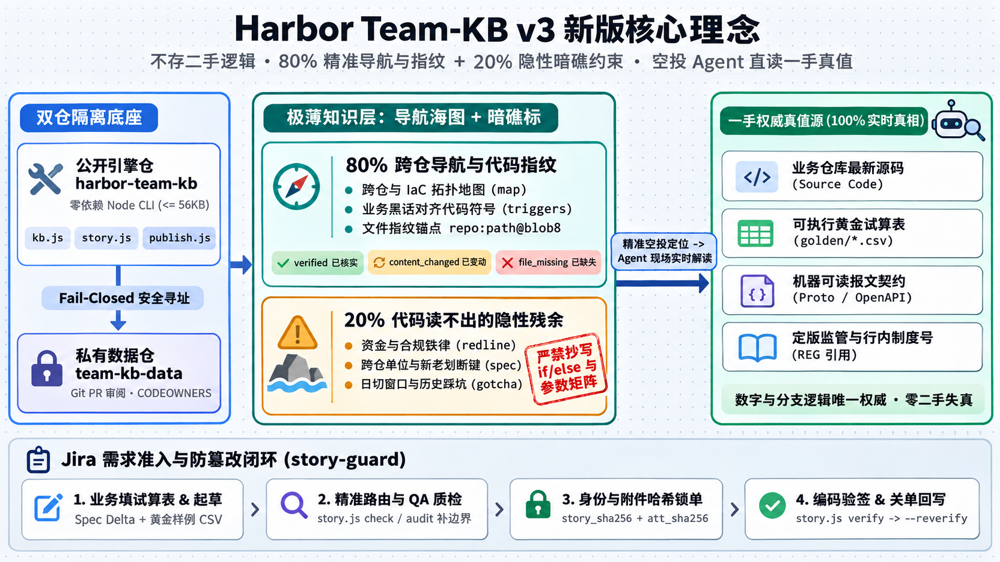

# Harbor Team KB v3 核心设计理念与严谨业务落地范式

> **一句话定位**：`harbor-team-kb` **不存完整的业务实现与参数细节**，而是维护一份经团队审阅、可检测代码文件变动的**“跨仓导航海图 + 暗礁约束卡片”**（“80% 导航指纹 + 20% 暗礁残余”职责重心原则）；具体计算分支、报文 Schema 与精确试算真值，一律在定位到一手载体后交给编程 Agent 现场读取推演。

> *注：上图展示了包含 Phase 1/2 已实现底座与 Phase 2.5 金融强合规扩展规格在内的完整架构蓝图；关于当前代码已落地能力与下一阶段规划能力的精确划分见本文 4.3 节与 [`SPEC_V3.md`](./SPEC_V3.md)。*

---

## 1. 第一性原理：为什么把全部业务细节写进知识库反而有害？

大模型编程 Agent 进入多仓库研发团队后，能力呈现出明显的不对称性：

- **Agent 擅长的事（拿到路径后的现场解读）**：只要给出准确的文件路径、核心符号、接口定义（Protobuf / OpenAPI / XSD）与试算数据表（CSV），它能够直接读取一手源码追踪分支、核对类型并推演边界情况。
- **Agent 薄弱的事（跨仓盲搜与猜测潜规则）**：团队往往同时维护十几个微服务仓与基础设施仓（Terraform / Helm / K8s / 跑批调度），日常 IDE 只打开单仓，Agent 很难凭口头术语快速找准跨仓位置；更无法从单仓代码里读出**“哪段防御代码是日切窗口防重账红线”**、**“新老合同按签约日还是起息日划断”**或**“跨系统报文金额单位是分还是元”**。

如果沿用传统文档库思路，把代码里的 `if/else` 计息分支、产品费率表或全量报文字段抄进静态 Markdown，很快会遇到两个问题：
1. **双重维护容易过期**：业务代码或配置频繁迭代，很难保证每次都同步手改文档；
2. **过期的权威卡片会误导编码**：没有卡片时 Agent 会去搜代码或提问；一旦读到写着“团队规范”却已过期的旧算法描述，反而容易顺着错误前提写出缺陷。

因此，本项目的核心原则是：**代码、Schema 和测试数据能自己表达的细节留在业务仓，卡片只做指向一手载体的“薄海图”和记录隐性边界的“暗礁标”。**

---

## 2. 核心心智模型：“100% 真实地形” vs “80% 导航海图 + 20% 暗礁标”

> 注：“80% / 20%”用于概括**卡片建设的重心与信息分工**（优先铺设跨仓寻路坐标，克制记录隐性约束），并非按字数配比的硬指标；实际的机器硬预算为全域 `kb.js map <= 3,200` 字符、单张待审 Story `<= 64 KB`、单个技能脚本 `<= 56 KB`。

### 2.1 唯一权威真值层（真实地形 —— 留在业务仓与制度库，不抄进卡片）
- **业务源码与基础设施清单**：微服务代码、批处理脚本、Helm / Terraform 配置；
- **机器可读接口契约**：Protobuf、OpenAPI、XSD、Copybook 定义与契约测试；
- **可执行黄金试算集（如 `golden/*.csv`）**：经业务确认、由单元测试直接加载断言的输入输出数据；
- **定版监管与制度原文**：合规制度库中的正式文件，以及运行时数据库/配置中心里的动态业务参数。

### 2.2 知识卡片层（海图与暗礁登记簿 —— 存入团队私有 Git 数据仓 `<data-repo>`）

1. **跨仓导航坐标与文件变化检测（`map` + `triggers` + `@<blob8>`）**
   - 将团队业务术语映射到 `<repo>:<path>#<symbol>@<blob8>`；
   - `@<blob8>` 是跨平台 LF 归一化后的整文件字节指纹，`kb.js get` 读取时按本机工作区现状给出 **7 种状态**（现行已实现）：
     - `verified`：本机已检出该仓，文件与符号存在，且当前字节指纹与 `@<blob8>` 一致；
     - `content_changed`：文件仍在，但字节内容已变化，提醒 Agent **重读最新源码核对卡片描述是否仍然适用**；
     - `present_unpinned`：文件存在但未绑定指纹；
     - `unverified_repo_absent`：当前机器未检出该仓库（如实报告未核验，不假装已验证）；
     - `file_missing` / `symbol_missing`：本机已检出该仓但文件或符号已缺失（触发硬漂移告警）；
     - `external_ref`：外部链接或 `JIRA:` / `INC:` / `PR:` / `CVE:` 单号引用（Phase 2.5 规划扩展支持 `REG:` 制度号）。
   - **默认不自动刷新旧指纹**：普通编辑（`kb.js propose`）保留旧 `@<blob8>` 不变；仅在本地 Git 工作树无未提交修改时显式运行 `kb.js propose --reverify` 才会重算指纹并输出前后对比（是否在主干分支及业务含义是否一致仍由提交人与 PR Reviewer 审阅把关）。

2. **单仓代码读不出的暗礁残余（`spec` / `redline` / `gotcha` / `adr` / `runbook` / `postmortem`）**
   - **`redline`（禁令红线）**：金额禁浮点、无有效期内授权书禁调征信、日切窗口保护等编码红线；
   - **`spec`（守恒不变量与划断键）**：如“总额度 = 可用 + 已用 + 冻结”、“新老合同按借据起息日而非签约日划断”、“核心与总账交互金额单位为分（`int64`）”；
   - **`gotcha` / `postmortem` / `adr` / `runbook`**：闰年 2 月 29 日计息、节假日顺延跨月、历史故障根因与应急操作步骤。

### 2.3 快速自检表：什么写进卡片，什么留在业务仓？

| 信息类型 | 是否写进卡片？ | 推荐做法 |
|---|---|---|
| “提前还款冲抵代码在哪个仓、配套哪张试算表？” | **写**（`map` / 锚点） | 记 `loan-core:src/repay/AllocationEngine.java#allocate@<blob8>` 与黄金 CSV 锚点 |
| “正常本金、罚息、复利、费用的 12 个 `if/else` 扣款分支” | **不抄写** | 卡片只记守恒不变量与划断键，让 Agent 顺着锚点读源码与试算 CSV |
| “线上各贷款产品的实时罚息上浮比例与宽限期参数值” | **不抄写** | 锚定参数加载代码；若参数存于数据库/配置中心，卡片明示“线上参数不在 Git，须查工单输入或询问” |
| “跨系统冲正报文正负号方向、幂等键拼装规则、分/元单位” | **写**（`spec`） | 这些隐性约定在 Schema 字段类型里看不出来，属于高价值跨仓契约 |
| “某监管条款的法定刚性红线与行内合规确认结论” | **写**（`redline`） | 关联已确认的 `JIRA:<单号>`（及规划中的 `REG:` 文号），锚定落地代码与测试文件 |

---

## 3. 与相邻方案的真实定位对比及检索引擎取舍

详细的一手调研记录见 [`docs/research/positioning-2026-11-14.md`](./docs/research/positioning-2026-11-14.md)。本项目的定位不是宣称独创底层技术，而是在受管研发环境中做一组务实的产品取舍：

### 3.1 为什么不在核心引擎内引入本地向量与重排模型（如开源 `tobi/qmd`）？

开源 `tobi/qmd` 提供了很好的本地 Markdown 混合检索（BM25 + 向量 + 本地模型查询扩展与重排），但现阶段不将其纳入核心引擎主要基于三点工程取舍：

1. **受管环境零依赖落地**：仅用 Node.js 标准库即可在受管 IDE、内网开发机上直接运行，无需安装原生向量扩展或拉取本地模型权重文件。
2. **精炼短卡优先枚举与保守词匹配**：在几十至几百张审阅卡片的规模下，`kb.js map` 可直接按领域枚举，`story.js audit` 按领域确定性加载；同时 BM25F 在无词重叠时直接返回空，避免向量最近邻在红线场景下硬凑不相关条目，也确保所有内容读取都经过 `kb.js get` 的锚点状态与安全检查。
3. **合理的外部共存方式**：团队若有上千篇未整理的历史 PRD 或会议纪要，可在外部独立用 QMD 查原始资料；若未来经真实任务评测发现卡片库确有明显词汇错配漏召回，外部检索也仅宜作为**候选卡片 ID 召回旁路**，最终仍须通过 `kb.js get` 读取，且不介入 `qa_route` 确定性路由。

### 3.2 与相邻方案的客观对照

| 相邻方向 | 代表工具 | 已知先例与各自特点 | `harbor-team-kb` 的具体场景取舍 |
|---|---|---|---|
| **企业通用文档库 / RAG** | Confluence / 飞书知识库 | 适合承载长篇方案、会议纪要与跨部门协作 | 不替代通用 Wiki；只维护精简的跨仓坐标与约束卡片，并通过 `@<blob8>` 检测锚定文件变化。 |
| **代码关联文档 / Agent 共享记忆** | Swimm（商业）、ByteRover（本地可用，远端原生同步接其云服务）、Serena（开源，含记忆引用检查） | 已验证代码耦合文档与版本化 Markdown 记忆的可行性 | 面向不便引入商业平台或额外同步服务的团队，直接复用现有私有 Git 仓库、PR 审核与 Node 标准库，并区分 7 种锚点状态与显式 `--reverify`。 |
| **规格驱动开发（SDD）** | OpenSpec / GitHub Spec Kit | 支持围绕代码仓编写规格、变更回写与组织门禁 | 结合现有 Jira DC 工单流转（需配合支持原样文件导出的 `Jira Editor` 技能），仅对命中触发条件的高风险工单启用深度质检与哈希核对。 |
| **单仓静态指令基线** | `AGENTS.md` + `docs/` + `rg` | 单仓库内零额外维护成本 | **这是必须正面对比的基准线**。单仓小项目直接维护 `AGENTS.md` 往往更划算；多微服务仓 + IaC 分离 + 跨角色合规协作时本工具才产生增量价值。 |

### 3.3 诚实说明：机制能做到什么、不能做到什么
- **整文件指纹是“变化提醒”，不是“语义正确证明”**：代码改了注释也会触发 `content_changed`（存在一定误报），而数据库动态配置变更不会改变代码指纹，不能替代自动化单元测试。
- **哈希核对用于防漏看与串联流程，不是密码学身份签名**：`story_sha256` 用来发现工单获批后的标题/描述改动；真实的身份权限与审计由 Jira 服务端权限配置与私有 Git 分支保护承担。

---

## 4. 严谨业务需求落地范式：以银行信贷系统为标尺

面对监管严格、计息规则随时间演进、新老合同长期并存、金额不容尾差的银行信贷系统，“薄卡片 + Agent 读一手真值”通过以下分工落地：

### 4.1 信贷四类核心资产的真值分工

| 信贷业务资产 | 唯一权威载体（真实地形） | 知识卡片只记什么（海图与暗礁） | 锚定与边界规则 |
|---|---|---|---|
| **1. 监管发文 / 行内信贷制度** | 合规制度库定版原文 | `redline`：文号条款、法定刚性红线、行内合规解释结论及确认该口径的 `JIRA:<单号>` | 合规岗在 Jira 留下确认记录；卡片 PR 由 `CODEOWNERS` 核对与 Jira 一致，并锚定落地代码与测试文件 `@<blob8>` |
| **2. 时间 × 产品 × 新老划断规则** | 代码仓规则实现，或运行时产品参数库 | `spec`：守恒不变量、**划断键定义**（签约日 / 放款日 / 起息日 / LPR 重定价日），不抄费率表或分支代码 | **特别注意存量合同**：新规切换后，存量老借据仍长期适用旧规！因此旧规则卡按**划断键 × 日期窗口**提示适用范围，绝不一刀切标为“废止删除” |
| **3. 计息 / 罚息 / 冲抵试算集** | 业务确认的 `*.golden.csv` -> 业务代码仓测试资源目录 | 卡片不写具体试算金额，只记该黄金 CSV 覆盖的产品与边界场景并绑定 `@<blob8>` | `<repo>:src/test/resources/golden/<topic>.csv@<blob8>` |
| **4. 跨核心 / 总账 / 征信报文** | 提供方 Schema（Protobuf / XSD / OpenAPI）与契约测试 | `map` 指路提供方与消费方仓；`spec` 只记幂等键、冲正正负号、分/元单位、日切窗口 | 本机已检出仓标 `@<blob8>`；未检出的外部协作仓如实返回 `unverified_repo_absent` |

### 4.2 业务与风控“全程零 Git”的协作闭环（避免多处抄表）

业务和合规团队无需接触 Git 或 Markdown，同时避免在 Excel、Jira 正文、附件、代码仓四处手工抄写同一张大表：

1. **业务 / 风控（Excel + Jira 确认）**：
   - 在固定信封列模板中填写试算用例（支持多输出列如本金/利息/罚息分项，以及 `REJECT:<错误码>` 拒绝类用例），注明期望值来源（如业务手算表、老核心对账单、监管示例，避免由新写代码跑出结果倒填），导出为 `*.golden.csv`（工具自动兼容 Excel 导出的 UTF-8 BOM）；
   - 在 QA 澄清完边界问题后，直接在 Jira 工单留下确认意见。
2. **PM / BA（建单与风险路由）**：
   - 将 `*.golden.csv` 挂为工单附件，Story 正文的 `Concrete Examples` 只写 2–3 行代表性摘要并指明附件文件名（不重复贴整张大表），在 `Spec Delta` 写明新老划断键与受影响卡片 ID，运行 `story.js check`。
3. **QA（聚焦 `<= 5` 个歧义 + 补齐信贷边界行 + 生成审批哈希行）**：
   - 协助检查信贷高频边界行：**划断日前一天 vs 当天、闰年 2 月 29 日、大小月底（1/31 -> 2/28）、节假日顺延跨月、部分提前还款缩期/缩额、LPR 重定价切换**；
   - 运行 `story.js audit` 生成审批哈希行贴入评论，流转至 `Story Approved`（排队期间锁定编辑）。
4. **研发（哈希核对 + 黄金 CSV 驱动单测 + 卡片指纹更新）**：
   - 编码前与提测前运行 `story.js verify` 检测工单内容是否变动，将 `*.golden.csv` 放入业务代码仓由参数化单测直接加载断言；
   - 关单前在干净工作树运行 `kb.js propose --reverify` 与 `publish.js` 合入卡片更新；后续 UAT/生产缺陷修复时将复现行（附缺陷单号）追补进业务仓黄金 CSV。

### 4.3 现行已实现能力（Phase 1/2）与金融增强规格（Phase 2.5 规划）对照

| 环节 | Phase 1 & Phase 2（当前仓库代码已实现并通过测试） | Phase 2.5 / V3.2（已在 [`SPEC_V3.md` 第 6 章](./SPEC_V3.md) 完成设计，待编码） |
|---|---|---|
| **跨仓检索与锚点** | 双仓隔离、Fail-Closed 寻址、`map`、BM25F、7 态 `@<blob8>`、显式 `--reverify` | 新增 `cutoff_basis` + `effective_from/to` 划断窗口提示（保护存量借据规则不被误判废止）与 `REG:` 制度号引用 |
| **风险路由与触发词** | `Domain` 缺失、`Spec Delta != NONE` 或命中 `triggers`（中文 `>= 2` 字子串 / ASCII `>= 3` 词边界）判 `REQUIRED` | 新增分级触发词（中文单条 `>= 4` 字、`A+B` 共现词、`ID:` 精确标识符）与 `validate-data.js --strict-triggers` |
| **工单质检与哈希核对** | 原文 `story_sha256`、随机 Nonce 防注入包络、`verify --expect / --from-comment` | 新增 `approvers.json` 账号核对（`--comments-json`）、`--require-online` 与仅针对 `*.golden.csv` 的 `golden_sha256`（不影响开发期上传截图） |
| **试算样例检查** | 正文表格强制包含 `Normal:` 与 `Boundary:` / `Rejection:` 分类前缀 | 新增 `story_golden.js`：BOM 兼容、支持多 `exp_*` 列与 `REJECT:<CODE>`、禁科学计数法、与业务仓 CSV 逐行核对 |
| **数据仓门禁与托管** | GitHub `CODEOWNERS` + Actions 模板 + `publish.js` 隔离分支发布 | 新增 `init-data-repo --host github\|gitlab\|bitbucket` 多平台 CI 模板与 GitLab MR 推送选项 |

---

## 5. 务实起步与止损纪律：先做 Step 0 评估，再决定开不开门禁

为避免治理工具沦为形式主义负担，推进顺序严格遵循**“先轻导航，后验痛点，无效即退”**：

1. **先用最轻的 `map + redline` 验证导航价值**：
   选定 1 个跨仓协作频繁的子域，先整理 5–10 张仓库职责图（`map`）与编码红线（`redline`），在真实任务中对比纯 `AGENTS.md + rg` 基线，确认能缩短找仓时间、减少红线违规且维护负担可控。
2. **开启 `story-guard` 准入前必做 Step 0 历史抽样**：
   - 抽样拟试点子域近 6–12 个月已关闭 Story（建议 `>= 30` 单）及关联 UAT/线上缺陷：若**“需求口径歧义 / 边界与新老划断遗漏 / 跨系统隐性契约误解”**三类缺陷占总缺陷比例 **`< 20%`**，说明主要矛盾不在需求契约，**不开启 `story-guard` 准入门禁**，只保留 `map + redline`；
   - 若占比 `>= 20%`，用前 70% 历史工单调校触发词、后 30% 验证，优先将 `REQUIRED` 触发比例控制在 **`15%–35%`**。
3. **统一 3 迭代止损线**：
   试点跑满 **3 个迭代（且累计关闭 `>= 15` 张 Story）** 后复盘 Jira 与 Git 客观记录：若每单同类缺陷较 Step 0 基线下降 **`< 15%`**，或 `REQUIRED` 比例持续 **`> 50%` / 中位质检卡单 `> 2` 个工作日** 且调词无法收敛，立即关停该子域的深度 Story 准入与 `Spec Delta` 流程，退回纯 **`map + redline`** 轻量模式。

---

## 6. 文档导航

- **快速安装与测试命令**：[`README.md`](./README.md)
- **日常操作步骤与 Jira DC 配置说明**：[`USER_GUIDE.md`](./USER_GUIDE.md)
- **架构规格、全量 CLI 参数/退出码与 Phase 2.5 扩展契约**：[`SPEC_V3.md`](./SPEC_V3.md)
- **自动化验证报告与边界说明**：[`VALIDATION_V3.md`](./VALIDATION_V3.md)
- **相邻方案一手调研与定位边界**：[`docs/research/positioning-2026-11-14.md`](./docs/research/positioning-2026-11-14.md)
