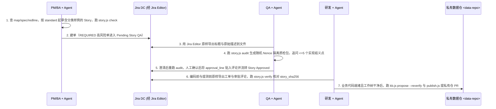

# `harbor-team-kb` v3 架构与演进规格说明书（Spec v3 — First-Principles Edition）

> **核心定位**：`harbor-team-kb` 不是通用企业文档库，而是一份**刻意保持极薄、经团队审阅、带代码出处变化检测状态的“工程导航海图 + 暗礁约束登记簿”**，配以一层挂在现有 Jira Data Center 与私有 Git 工作流上的轻量准入检查与一致性核对工具（`story-guard`）。
>
> **双仓架构**：**公开零依赖工具引擎仓（`harbor-team-kb`）+ 团队私有知识数据仓（`<data-repo>`）**物理分离；卡片重点承载**跨仓导航坐标、文件指纹与单仓源码读不出的隐性约束**（“80/20 海图与暗礁”职责分配原则），具体计算分支、报文结构与试算数据引导 Agent 现场直读业务源码、Schema 与测试资产。
>
> **实现状态声明**：本文 **第 1、3、4、5 章** 描述设计边界与 **Phase 1 & Phase 2 工具层现行契约**，其中流程配置及真实环境验证不等于工具代码已自动完成；**第 6 章** 定义面向强合规/金融信贷场景的 **Phase 2.5（V3.2）规划扩展契约**；**第 8 章** 定义**冷启动、调查结果沉淀与持续维护流程**，区分可用现有工具手工执行的步骤、待实现的 Agent 行为和后续自动化。第 6、8 章中的规划能力不能当作现行命令或已通过验收的功能。配套通俗导读见 [`CORE_CONCEPTS.md`](./CORE_CONCEPTS.md)。

---

## 1. 第一性原理诊断、核心范式与诚实工程边界

### 1.1 “80% 导航指纹 + 20% 暗礁残余”职责分配原则（海图与真实地形分离）

> 注：“80% / 20%”是表达**建设优先级与职责重心**的工程经验法则，而非按字符比例强行配平的统计指标；系统实际执行的机器硬预算为：`kb.js map` 全域输出 `<= 3,200` 字符、待审 Story 文件 `<= 64 KB`、单技能脚本文件 `<= 56 KB`。

编程 Agent 的能力结构高度不对称：**拿到准确文件路径后，现场阅读源码、接口 Schema 与测试数据的能力很强；但跨数十个仓库盲搜坐标和猜测单仓代码之外的潜规则时极易出错。** 由此推导出三项底层取舍：

1. **跨仓寻路与术语对齐（导航层，高收益、易核对，优先建设）**：
   团队往往同时维护多个微服务仓与 IaC（Terraform / Helm / K8s / 跑批调度）仓库，日常 IDE 只打开单仓。通过 `map` 与 `triggers`，在极小上下文预算内把业务术语映射到跨仓目录、核心符号与测试文件，并用 `@<blob8>` 检测本机已检出仓库中的目标文件自上次人工核实后是否发生字节变动（未检出仓库则如实标记 `unverified_repo_absent`）。
2. **单仓代码表达不了的隐性残余（暗礁层，严控体量、防自动洗白）**：
   根据信息熵增规律，**不在静态 Markdown 中双写代码 `if/else` 控制流、具体产品参数矩阵或全量报文字段表**，否则代码或配置一改，旧卡片就会变成误导 Agent 的过期信息。卡片正文只记录单仓源码自身看不出来的残余信息：
   - **守恒不变量与划断键（`spec`）**：如“总额度 = 可用 + 已用 + 冻结”、“新老合同按借据起息日而非签约日划断”、“跨系统金额单位是分（`int64`）而非元”；
   - **红线禁令（`redline`）**：如金额禁浮点、无有效期内授权书禁调征信接口、核心日切窗口防重账保护逻辑（提醒 Agent 切勿误判为冗余代码删改）；
   - **排障经验与历史裁决（`gotcha` / `postmortem` / `adr` / `runbook`）**：闰年 2 月 29 日计息、算头不算尾、跨日冲正会计日归属等低频高损经验。
3. **应对指标异化与审后改动的务实防呆（准入核对层）**：
   - 大模型很容易凑出表面符合 `Given/When/Then` 格式的空泛文本。因此机器 `check` 只做确定性结构防呆（必填章节、`Spec Delta` 真实引用、分类样例前缀覆盖、敏感信息扫描）；真正的业务歧义由人工 QA 聚焦追问 `<= 5` 个会导致代码实现分歧的问题。
   - 审后一致性通过 **Jira 流转角色权限 + `Story Approved` 排队态锁编辑 + 审批哈希行（`approval_line`）前后比对** 辅助检测，防止工单获批后标题或描述被改动而研发未察觉。

### 1.2 严谨业务资产的权威真值分工（以金融/信贷系统为标尺）

判断一项信息能否写进知识卡片的标准：**定版文号与不变的守恒关系可写入卡片；随业务迭代的参数矩阵、计算分支与全量字段定义不抄进卡片，统一用锚点指向一手载体。**

| 业务资产对象 | 唯一权威载体（真实地形） | 知识卡片只存什么（海图与暗礁标） | 锚定与不可达边界处理 |
|---|---|---|---|
| **监管条文 / 行内制度** | 合规制度库定版原文 | `redline`：制度文号、条款号、定版条文中的法定刚性红线（如法定利率上限口径）、行内合规裁决结论及对应已审批 Jira 单号 | 引用 `JIRA:<审批单号>`（Phase 2.5 扩展支持 `REG:<文号>`）+ 落地代码与测试文件 `@<blob8>`；合规岗在 Jira 完成确认，研发提卡片 PR 时由 `CODEOWNERS` 核对与 Jira 结论一致 |
| **时间 × 产品 × 新老划断规则** | 代码仓规则实现 / 测试集，或运行时产品参数库 | `spec`：维度结构、守恒不变量、**划断键定义**（签约日 / 放款日 / 起息日 / 重定价日），**不抄写费率矩阵或冲抵分支** | 锚定参数 Schema/加载器代码 `@<blob8>` + 测试文件 `@<blob8>`；**若当前参数值存于 Git 之外的数据库/配置中心，卡片须明示“线上参数不在 Git”，Agent 必须读取工单输入或询问，禁止臆造线上参数值** |
| **计息 / 账务黄金试算集** | 业务确认的试算数据 -> 业务代码仓测试资源文件（如 `golden/*.csv`） | **卡片不存具体试算金额**，仅记录该测试文件覆盖的产品范围、划断窗口与边界场景类别 | `<repo>:src/test/resources/golden/<topic>.csv@<blob8>` |
| **跨系统报文数据契约** | 提供方机器可读 Schema（Protobuf / OpenAPI / XSD / Copybook）与契约测试 | `map` 记提供方与消费方仓库路径；`spec` 只记 Schema 表达不了的语义（幂等键、冲正正负号方向、分/元单位、日切窗口） | 本机已检出仓用 `<repo>:<schema>@<blob8>`（`verified` / `content_changed`）；本机未检出的外部协作仓仍写 `<partner-repo>:<path>`（诚实返回 `unverified_repo_absent`），外部文档链接或单号才归为 `external_ref` |

### 1.3 检索引擎取舍与外部混合检索（如 QMD）共存边界

现阶段**不把本地向量索引与本地大模型重排组件（如开源 `tobi/qmd`）引入核心引擎**，基于以下工程权衡：
1. **小规模精炼卡片优先确定性枚举与词项匹配**：团队审阅维护的结构化卡片规模通常在几十至数百张，`kb.js map` 可按领域直接枚举，`story.js audit` 按领域确定性装载关联卡片；无需引入额外的原生 SQLite 向量扩展与本地模型权重下载，降低银行及受管开发终端的落地摩擦。
2. **保留“无词项重叠即返回空”的保守特性**：BM25F 无词重叠时直接返回空结果；而向量最近邻检索总会返回近似条目，在红线与不变量场景下**误召回不相关规则的干扰往往高于漏召回**，且直接切片返回会绕过 `kb.js get` 的 7 态锚点检测与 `DEMO_FALLBACK` 提示。
3. **外部旁路共存方式**：若团队另有数千篇未整理的历史长篇 PRD、会议纪要，可在外部独立使用 QMD 检索原始背景资料；若未来卡片规模显著扩大、且经人工任务评测确认补充 `triggers` 后仍存在明显词汇错配漏召回，外部工具也仅宜作为**候选卡片 ID 召回旁路**，最终内容读取仍须经过 `kb.js get`，且不介入 `qa_route` 确定性路由判定。

### 1.4 诚实工程边界与非目标（对齐 `docs/research/positioning-2026-11-14.md`）

1. **不是通用企业 Wiki 替代品，也不是独有技术护城河**：Git/Markdown 记忆、代码关联文档与 Spec Delta 在业界均有相邻先例；本工具聚焦的价值是在不增加常驻服务、MCP、额外模型或云端依赖的前提下，让受管环境中的现有研发 Agent 用上团队审阅过、能核对出处的薄知识卡。
2. **`verified` 只代表本机锚定文件字节未变，不证明业务解释永久正确**：整文件指纹只是变化检测信号——注释或无关函数改动可能触发 `content_changed` 提醒（误报率需在真实迭代中观测），而上游运行时配置变化或锚点漏绑也不会被文件指纹捕获，不能替代自动化单测与契约测试。
3. **审批哈希行不是密码学身份签名，也不替代权限系统**：`story_sha256` 用于检测工单在获批后是否发生正文改动；谁有权流转状态、谁贴入评论、谁合入知识仓，依赖 Jira 自身项目权限/审计日志与私有 Git 分支保护（`CODEOWNERS`）。此外，真实 Jira 联调前须先确认团队的 `Jira Editor` 技能支持将标题与原始描述直接原样导出为文件。
4. **必须与真实基线做任务对照评估**：小团队单仓场景下 `AGENTS.md + docs/ + rg` 就是最直接的零成本基线；不能凭自建查询集指标宣称检索领先或业务有效，必须通过真实研发任务对照评估净收益与单卡维护成本。

### 1.5 双仓分离与技能静态红线（对齐 `loop-runner/src/skillAuthoring.ts`）

1. **公开引擎与私有数据物理分离（Fail-Closed）**：
   - `harbor-team-kb` 为公开零依赖工具引擎仓（仅含脱敏英文演示种子，零内网域名、零个人路径）；
   - 团队真实 `kb/`、`standards/`、根级 `CODEOWNERS` 与 CI 门禁存放在独立私有 Git 仓库 `<data-repo>`；已配置私有仓指针（第 1–5 级）一旦失效立即以退出码 `2` 报错，严禁静默回退公开引擎仓。
2. **零外部依赖、无常驻服务、无自建 Jira HTTP 客户端**：仅使用 Node.js 标准库（`fs`、`path`、`os`、`crypto`、`child_process`）。
3. **单技能自包含与文件体积硬上限**：
   - `loop-runner` 强制要求 `skills/<skill>/scripts/` 下**平铺单文件 `< 64 KB`（`65,536` 字节）**，工程内控上限设为**每个 `.js` 文件 `<= 56 KB`（`57,344` 字节）**，`SKILL.md` `< 4,096` 字符且正文必须显式点名同目录全部已存在的脚本文件名；
   - 严禁跨 Skill 目录 `require` 相对路径（兼容符号链接与受管复制安装），公共寻址与敏感信息扫描逻辑在各技能入口同构内联并由表驱动单测锁死一致性；
   - 源码严禁出现命中 `DEFINITION_PATH` 的受保护路径字面量，严禁使用 `exec`/`execSync`/`readline`，所有 Git 子进程必须带 `timeout` 与 `GIT_TERMINAL_PROMPT=0`。
4. **持久化路径隔离**：可丢弃缓存放 `~/.cache/harbor-kb/`；不可丢弃指针与草稿必须放 `~/.harbor/`（`~/.harbor/kb_data_root`、`~/.harbor/drafts/`）或 Harbor Mate 工作区 `.loop/outbox/kb/`。

### 1.6 借鉴 Serena 的记忆理念，保持轻量实现

Serena 的[记忆设计](https://oraios.github.io/serena/02-usage/045_memories.html)和[维护约定](https://github.com/oraios/serena/blob/main/src/serena/resources/memory_maintenance.md)提供了分层读取、引用导航和选择性沉淀的先例。Harbor 将这些原则用于**以业务任务为入口的团队工程导航**；核心继续遵守第 1.5 节的 Node.js 标准库与 Git 约束，不引入 Serena、Python、语言服务或 MCP 作为必需运行依赖。

下表为 Harbor 的设计选择；完整 Agent 读取行为与引用维护尚待实现，现有命令仅提供部分操作能力：

| 原则 | 在 Harbor 中的具体要求 |
|---|---|
| **逐层获取上下文** | 领域目录 → 业务入口 → 相关关系/经验 → 一手证据。初始只提供必要导航信息，Agent 按任务决定下一步读取什么，不默认加载整个知识仓。 |
| **优先沿明确引用调查** | 引用旁说明“什么时候读、能回答什么问题”；已知 ID 通过 `get` 读取并检查来源状态。陌生术语、断链或已有路径不足时再补充定位和求助，不能把显式引用当作业务相关性或依赖完整性的证明。 |
| **沉淀能避免重复调查的知识** | 按第 8.3 节筛选难以重新发现或确认的关系、判断与经验。保留必要的业务解释和导航坐标；可从原始载体快速读出的实现细节不再复制，临时笔记不自动晋升。 |
| **维护知识之间的联系** | 新增条目接入业务入口；重命名、拆分、合并和归档时检查旧引用及替代路径。首期以数据仓 PR 审阅完成，不宣称已有 Serena 式自动引用更新或检查。 |
| **约定本身可发现、可审阅** | 团队在私有仓现有 `standards/` 中维护简短的记忆读写约定，Agent 起草前读取。约定至少覆盖入口、引用、沉淀门槛、来源、未知项和审阅责任；模板自动生成与读取编排待实现。 |

日常知识读取以引用导航为主，卡片词匹配保留为辅助入口，不建设原始资料全文搜索。现有定向红线提示与 `story-guard` 确定性路由仍按原契约执行；不能用“Agent 自行决定阅读”绕过它们，也不因此向所有任务注入全部规则。

Token 控制采用少量入口、按需读取和宿主已有的结果筛选能力；重复结果和大批候选可先由本地工具处理，保留任务所需的证据、来源状态与未知项。核心不为此新增代码分析后端或 REPL 运行时；实际节省须按正确完成任务的总成本实测。详细行为及验收见第 8.9 节。

---

## 2. 分阶段路线图、立项前置回测与客观止损纪律

| 阶段 | 工具/流程范围 | 当前状态 | 推进或准入条件 |
|---|---|---|---|
| **Step 0（立项前置评估）** | 1. 建立导航层任务对照基线（仅业务仓/`AGENTS.md` vs 启用 `map + redline`）；<br>2. 拟开启 `story-guard` 门禁前，抽样试点单一子域近 6–12 个月已关闭 Story（建议 `>= 30` 单）与 UAT/线上缺陷做根因分类与触发词留出集测试。 | 流程规范（手工/脚本统计） | 1. 若“需求口径歧义 / 边界与新老划断遗漏 / 跨系统隐性契约误解”三类缺陷占总缺陷比例 `< 20%`，**不启动 `story-guard` 准入门禁**，仅按需使用 `map + redline`；<br>2. 将历史工单按时间前 70% 调词、后 30% 验证，优先控制总 `REQUIRED` 触发比例在 **`15%–35%`**（若覆盖全部历史缺陷会导致触发率 `> 35%`，优先保高损红线词精准度，绝不全量拦截）。 |
| **Phase 1（MVP 基础层）** | 双仓分离（`plug.js init-data-repo` + `--data-repo` + Fail-Closed `resolveKbRoot`）、`kb.js` + `kb_index.js`、`map` 导航与 7 态 `@<blob8>`、`story-guard`（`standard / check / audit / verify`） | **工具代码已实现并通过测试** | 单文件 `<= 56 KB`，`lintSkill` 零告警，基础与 Mock E2E 回归全绿。 |
| **Phase 2（V3.1 试点治理层）** | **工具侧**：收敛版 `spec`、`--reverify` 防洗白、根级 `CODEOWNERS` + `validate-data.js` 模板、`story_sha256` 与随机 Nonce 隔离包络；<br>**运营侧**：管理员配置试点 Jira 工作流与私有 Git 分支保护。 | **工具代码已实现**；<br>**真实 Jira 试点待开展**（当前仅完成文件级 Mock 验收） | 确认 `Jira Editor` 支持原样文件导出；仅对试点子域 `REQUIRED` 工单启用 `Pending Story QA`，队列中位停留耗时 `<= 1` 个工作日。 |
| **导航生命周期补全（第 8 章）** | 最小业务底图、任务结束时的认知变更、知识归属与可发现性、复核和归档 | **流程规格已定义**；现有草稿/PR 通道可复用；主动提炼、冲突及关联检查待实现 | 优先以一个真实跨仓业务能力验证；独立于 Story 准入和金融增强，不以全量建库为前提；按第 8.8 节验收。 |
| **Phase 2.5（V3.2 金融/强合规增强）** | 6 项增量规格（详见第 6 章）：审批人 `users` 名单核对、限定黄金 CSV 附件哈希、分级触发词语法、黄金 CSV 结构与逐行比对、划断窗口适用期提示、GitHub/GitLab/Bitbucket 多平台模板 | **规格已设计，代码待实现** | 仅在 Phase 2 试点跑通基础流转、且确实存在表格试算/多托管平台诉求的强合规团队按需实施。 |
| **Phase 3（V3.3 远期按实测扩展或收缩）** | 业务代码仓 CI 反向提醒钩子（PR 修改锚点文件时提示关联卡片），并依据 2.1 节客观指标决定扩展或止损收缩 | **远期规划** | 试点子域跑满 **3 个迭代且累计关闭 `>= 15` 张 Story** 后凭实测数据裁决。 |

### 2.1 两层客观评估指标与统一止损条款

拒绝自建静态检索分自嗨，按**知识导航层**与**Story 准入层**分别考核：

| 评估层级 | 观测指标（采集来源） | 达标线（继续保留/推广） | 止损信号（满足任一即触发收缩） |
|---|---|---|---|
| **A. 知识导航层**（`map + redline + gotcha`，对比纯 `AGENTS.md + rg` 同任务对照） | 1. 跨仓定位到正确文件耗时/轮次与违反既有红线比例（抽样任务实测）<br>2. `content_changed` 提醒中无需改卡的误报率与单卡维护耗时（Git PR 记录） | 定位耗时/违规率优于基线，且 Owner 每周维护无积压（锚点有效核实率 `>= 80%`） | 单卡维护负担过重导致 `content_changed` / 硬缺失连续两周无人处理，或对照显示相比单仓 `AGENTS.md` 无可感知提效 -> **精简删卡，仅保留跨仓 `map`** |
| **B. Story 准入层**（`story-guard` + `Spec Delta`，采集自 Jira 工单与缺陷关联记录） | 1. 试点子域每单平均 SIT/UAT 需求口径/划断/契约类缺陷数（对比 Step 0 同口径每单基线）<br>2. `REQUIRED` 触发占比与 `Pending Story QA` 中位停留时长（Jira 状态流转日志）<br>3. 涉及规则变更工单的私有仓卡片 PR 合入率（Jira 关单字段与 Git PR） | 跑满 **3 个迭代（且 `>= 15` 单）**后：<br>- 每单同类缺陷较基线下降 **`>= 30%`**；<br>- `REQUIRED` 占比 **`15%–35%`**，中位停留 **`<= 1` 个工作日**；<br>- 应回写工单的卡片 PR 合入率 **`>= 90%`** | 跑满 **3 个迭代**后满足以下**任一条件**即止损：<br>1. 每单同类缺陷下降 **`< 15%`**；<br>2. `REQUIRED` 占比持续 **`> 50%`** 或中位卡单 **`> 2` 个工作日**且调词后仍无法收敛；<br>-> **立即关停该子域的深度 Story 准入与 `Spec Delta` 流程，退回纯 A 层（`map + redline`）模式** |

> 注：若本地运行的 `story.js verify` 需要可审计留痕，应在业务代码仓 PR 模板或 CI 中执行并保留日志，不假设仅凭本地命令行就能从 Jira 自动统计漏验率。

---

## 3. 现行端到端使用流程（Phase 1 & Phase 2 已实现闭环）



### 3.1 团队初始化与成员一次性安装（现行命令）

```sh
# 1. 团队负责人初始化私有知识数据仓（生成 CODEOWNERS、GitHub Actions 门禁与 validate-data.js）
node ~/work/harbor-team-kb/plug.js init-data-repo ~/work/team-kb-data

# 2. 引擎升级时仅无损更新 scripts/validate-data.js 与工作流（绝不覆盖 CODEOWNERS、standards/ 与 kb/）
node ~/work/harbor-team-kb/plug.js init-data-repo ~/work/team-kb-data --upgrade-scripts

# 3. 团队成员一键安装（VS Code Copilot / Harbor Mate）
node ~/work/harbor-team-kb/plug.js install --data-repo ~/work/team-kb-data
node ~/work/harbor-team-kb/plug.js install -w /path/to/mate-workspace --copilot --data-repo ~/work/team-kb-data
```

### 3.2 跨仓库定位与现场源码解读（日常主工作流）
1. 用户询问跨服务定位或业务约束问题时，Agent 先调用 `kb.js map --domain <domain>`（或在业务仓内调用 `kb.js map --auto`）与 `kb.js search "<关键词>"`，再对命中条目执行 `kb.js get <id>`；
2. 卡片返回守恒不变量、划断键、红线禁令，以及带 7 态检测结果的 `<repo>:<path>#<symbol>@<blob8>` 锚点；
3. Agent 根据锚点直接读取本机已检出的一手源码、Schema 与测试文件完成精确推演；若锚点报 `content_changed`，Agent 必须以最新源码为准并提示人工复核卡片。

---

## 4. 双仓目录拓扑与现行数据模型契约（Phase 1 & Phase 2）

### 4.1 公开引擎仓（`harbor-team-kb/`）与私有数据仓（`<data-repo>/`）现行拓扑

```text
harbor-team-kb/                                # 公开零依赖工具引擎仓
├── README.md                                  # 快速安装与能力概览
├── CORE_CONCEPTS.md                           # 核心设计理念与金融信贷业务落地范式
├── USER_GUIDE.md                              # PM / QA / 研发日常操作与 Jira 配置手册
├── SPEC_V3.md                                 # 本架构规格说明书
├── VALIDATION_V3.md                           # 自动化验证矩阵与实测边界说明
├── docs/
│   ├── assets/
│   │   └── harbor-team-kb-v3-infographic.png  # 核心理念全景信息图
│   └── research/                              # 相邻方案一手对比与诚实定位研究
├── plug.js                                    # 安装器（install / uninstall / status / init-data-repo）
├── templates/
│   └── data-repo/                             # 供 init-data-repo 生成私有数据仓的根级模板
│       ├── CODEOWNERS                         # 根级代码所有者模板（含 @your-org/ 待替换占位符）
│       ├── .github/workflows/kb-guard.yml     # PR 校验与每周陈旧巡检工作流模板
│       └── scripts/validate-data.js           # 自包含零依赖卡片、标准、敏感信息与占位符校验器
├── skills/
│   ├── team-kb/                               # 知识与跨仓地图检索技能（单脚本均 <= 56 KB）
│   │   ├── SKILL.md                           # 显式点名 kb.js 与 kb_index.js
│   │   └── scripts/
│   │       ├── kb.js                          # CLI 主入口
│   │       └── kb_index.js                    # 同目录模块：解析、分词、BM25F 与 7 态锚点指纹计算
│   ├── team-kb-publish/                       # 需人工审批的私有数据仓分支与 PR 发布技能
│   │   ├── SKILL.md                           # 显式点名 publish.js
│   │   └── scripts/
│   │       └── publish.js                     # 隔离 git worktree 发布脚本（含引擎目录拒发硬闸）
│   └── story-guard/                           # User Story 标准、结构检查、质检包与哈希核对技能
│       ├── SKILL.md                           # 显式点名 story.js
│       └── scripts/
│           └── story.js                       # 自包含检查、快照质检与哈希核对脚本（<= 56 KB）
├── agents/
│   └── kb-gardener.agent.md                   # Harbor Mate 可选本地硬漂移巡检助手
├── hooks/
│   └── harbor-kb.hooks.json                   # 可选 sessionStart 红线提示钩子
├── standards/
│   └── user-story.md                          # 默认脱敏 User Story 标准模板
├── kb/                                        # 脱敏英文演示种子数据（7 类，零私有信息）
└── tests/                                     # 隔离临时 HOME 的回归与 Jira Mock E2E 测试套件
```

### 4.2 数据仓寻址契约（`resolveKbRoot` — Fail-Closed 防泄漏）

`kb.js`、`publish.js` 与 `story.js` 各自内联同构的 `resolveKbRoot(explicit)`，按以下优先级返回 `{ root, source }`：

1. **显式与已配置指针级（第 1–5 级：一旦配置非空但目标路径不存在或缺少 `kb/` 子目录，立即以退出码 `2` 报错，严禁静默向下回退）**：
   - 级 1 (`CLI_FLAG`)：命令行 `--kb-root <dir>`；
   - 级 2 (`ENV_VAR`)：环境变量 `HARBOR_KB_ROOT`；
   - 级 3 (`WORKSPACE_PTR`)：工作区 `.loop/outbox/kb/.kb_root`（若解析目标为公开引擎仓自身目录，视同历史遗留自指指针跳过本级）；
   - 级 4 (`USER_DATA_PTR`)：用户持久化指针 `~/.harbor/kb_data_root`（由 `plug.js install --data-repo <dir>` 写入）；
   - 级 5 (`LEGACY_CACHE_PTR`)：`~/.cache/harbor-kb/default_root`（指向引擎仓自身时同样跳过）。
2. **约定目录级（第 6 级 `CONVENTION_DIR`）**：探测 `./repos/team-kb/kb` 或 `~/.harbor/team-kb/kb`。
3. **演示兜底级（第 7 级 `DEMO_FALLBACK`）**：回退至公开引擎仓内置种子目录，输出 `[DEMO_FALLBACK: using built-in public seed KB]`；只要最终解析目录被识别为公开引擎仓自身（通过引擎目录布局特征与 `realpath` 双重判定，删除缓存或复制安装后依然有效），`publish.js` 与 `story.js audit` 默认均以退出码 `2` 拒绝执行（仅显式传入测试参数 `--allow-demo-fallback` 时放行）。

### 4.3 草稿目录持久化契约
1. **写入顺序**：显式输出路径 -> Harbor Mate 工作区 `.loop/outbox/kb/` -> 用户持久化目录 `~/.harbor/drafts/kb/<domain>/<kind>/<slug>.md`（不写入可清理的 `~/.cache/`）。
2. **读取顺序**：显式存在文件路径 -> `.loop/outbox/kb/<id>.md` -> `~/.harbor/drafts/kb/<id>.md` -> 兼容只读回退 `~/.cache/harbor-kb/drafts/<id>.md`。

### 4.4 `kb/` 7 类知识模型、现行触发词规则与 7 态锚点契约

```js
const KINDS = ['map', 'spec', 'redline', 'adr', 'gotcha', 'runbook', 'postmortem'];
```

1. **必填与可选 Frontmatter 字段（现行已实现）**：
   - 必填：`title`、`summary`、`triggers`（字符串数组，至少 2 个非空词条）、`sources`（锚点数组，至少 1 项）；
   - 可选：`verified_at: YYYY-MM-DD`、`expires: YYYY-MM-DD`、`disputed: string`；
   - 必填正文章节：`## Symptom / Rule`、`## Root Cause`、`## Verified Action`。
2. **现行 `story.js check` 触发词匹配规则（Phase 1/2 已实现）**：
   遍历快照中全部 `spec` 与 `redline` 条目的 `triggers`（统一转小写匹配标题与正文全文）：
   - 含中日韩汉字（`/[\u3400-\u9fff]/`）的触发词：长度 `>= 2` 时按子串包含匹配；
   - 纯 ASCII 触发词：长度 `< 3` 忽略，长度 `>= 3` 时按非 `[a-z0-9_]` 词边界大小写不敏感匹配。
3. **跨平台确定性文件指纹（`@<blob8>`）与显式 `--reverify`**：
   - 格式：`<repo>:<file-path>[#<symbol>][@<8-hex>]`；
   - 计算公式：读取 UTF-8 文本并将 `\r\n` 统一归一化为 `\n` 得到 `buf`，计算 `sha1("blob " + buf.length + "\0" + buf).slice(0, 8)`；
   - 普通 `kb.js propose` 保留既有锚点的旧 `@<blob8>` 与 `verified_at` 不变；仅在显式执行 `kb.js propose --reverify`（检查目标文件在本地 Git 工作树干净无未提交改动；注：工具仅检查工作树干净，是否在已合入主干分支及业务语义是否一致由提交人与 PR Reviewer 人工把关）时重算指纹、打印前后对比，并在全部带指纹文件锚点均为 `verified` 时更新 `verified_at`。
4. **现行 7 态锚点枚举（`ANCHOR_STATUS`）**：
   - `'external_ref'`：含 `://` 或匹配 `^(JIRA|INC|PR|CVE)[-:][A-Za-z0-9-]+$` 的外部单号/链接引用；
   - `'verified'`：本机工作区已检出对应仓库，文件（及 `#symbol`）存在，且 `@<blob8>` 与当前归一化文件内容一致；
   - `'present_unpinned'`：本机已检出对应仓库，文件或目录存在，但锚点未附带 `@<blob8>`；
   - `'content_changed'`：文件（及 `#symbol`）存在，但当前归一化内容与 `@<blob8>` 不一致 -> `kb.js get` 输出 `NOTICE [CONTENT CHANGED SINCE VERIFIED]`；
   - `'unverified_repo_absent'`：目标仓库在当前工作区未检出 -> `kb.js get` 输出 `NOTE [UNVERIFIED ANCHORS]`；
   - `'file_missing'` / `'symbol_missing'`：本机已检出仓库但目标文件或符号缺失 -> `kb.js get` 输出 `WARNING [ANCHOR DRIFT]`，且仅这两类硬缺失使 `kb.js drift --exit-code` 返回 `0`。

### 4.5 待审 Story 标准文件与哈希计算契约（现行已实现）

1. **待审 Story 导出文件格式与 `story_sha256` 计算**：
   - 文件大小硬上限 `<= 64 KB`（`65,536` 字节，超限立即返回退出码 `2`，不截断）；
   - 将换行统一归一化为 `\n` 后，剥离文件起始处连续匹配 `^(?:Issue|Updated):[^\n]*(?:\n|$)` 的元数据行；
   - 解析首行：若匹配 `/^(?:Title:\s*|#\s+|h1\.\s+)(.+)$/i`，提取捕获组 trim 后作为 `title`，剩余行拼接 trim 后作为 `description`；若首行不匹配上述标题前缀，`title` 置空（`check` 会报 `Missing Title line`）；
   - 在任何章节解析或安全包络转义**之前**，对原始文本计算 `story_sha256 = sha256(title + "\n\n" + description)`。
2. **`standards/user-story.md` 五章节与分类样例契约**：
   - 必填章节（支持 Markdown `#` 与 Jira Wiki `h1.`–`h6.` 标题，大小写不敏感并兼容固定中文别名）：`Story Statement`（`故事陈述`）、`Scope & Architecture Mapping`（`范围与架构映射`，含 `Domain: <domain>`）、`Spec Delta`（`规格变更`）、`Acceptance Criteria & Concrete Examples`（`验收标准与具体样例`）、`Out of Scope`（`非本单范围`）；
   - `Concrete Examples` 表格有效样例行 `>= min_examples_rows`（默认 2），首列须覆盖 `Normal:`（`正常:`）及 `Boundary:` / `Rejection:`（`边界:` / `拒绝:` / `异常:`）前缀。

---

## 5. 现行 CLI 与安装器接口契约（Phase 1 & Phase 2 已实现）

### 5.1 四个入口脚本的命令与退出码总表

| 脚本入口 | 子命令概览 | 退出码契约 |
|---|---|---|
| **`kb.js`** | `redlines`、`map [--domain <d>] [--repo <r>] [--auto]`、`search <query> [--domain <d>] [--kind <k>]`、`get <id>`、`propose [--reverify] ...`、`validate [file-or-id]`、`dispute --id <id> --reason <text>`、`drift [--exit-code]`（通用可选 `--kb-root`、`--workspace-root`、`--json`、`--sync \| --no-sync`） | - 常规子命令：`0` 成功；`2` `validate` 发现格式/引用/密钥错误，以及参数缺失、指针失效或其余运行时错误。<br>- `drift --exit-code`（巡检唤醒约定）：`0` 存在 `file_missing` 或 `symbol_missing` 硬缺失；`1` 无硬缺失；`2` 参数或仓库错误。 |
| **`publish.js`** | `publish.js <draft-file-or-id> [--base <git-ref>] [--no-push] [--no-pr] [--kb-root <dir>] [--json]`（仅接受单个草稿位置参数；`--no-push` 本地演练不推远端） | `0` 校验并推送/演练成功；`2` 参数错误、草稿校验未通过或存在敏感信息、无远端、指针失效或命中公开引擎仓拒发安全闸（任何失败均退出 `2`，无退出码 `1` 路径）。 |
| **`story.js`** | `standard [name] [--ref <git-ref>]`、`check <story-file> [--domain <d>]`、`audit <story-file> [--domain <d>] [--issue <KEY>] [--ttl <sec>] [--strict-online]`、`verify <story-file> (--expect <64hex> \| --from-comment <text-or-file>)`（通用可选 `--kb-root`、`--json`） | `0` 成功（注：`audit` 成功生成质检包返回 `0`，内部结构缺陷写入 JSON `check.passed: false`）；`1` `check` 存在结构/引用/敏感词缺陷或 `verify` 哈希失配；`2` 参数错误、文件超 64 KB、指针失效或命中公开引擎仓拒审安全闸；`3` 无法获取远端 Git 基准（`--strict-online` 拉取失败/无 `origin`，或配置了 `origin` 但本地从未成功 fetch 且当前 fetch 失败）。 |
| **`plug.js`** | `install [--data-repo <dir>] [-w <ws>] [--copilot] [--mode auto\|symlink\|copy]`、`uninstall`、`status`、`init-data-repo <dir> [--upgrade-scripts]` | `0` 执行成功；`1` / 非零：目标路径非法、缺少 `kb/` 或参数错误。 |

### 5.2 `story.js` 关键行为细节（现行已实现）

1. **包络外标识符白名单过滤**：拼入 `errors`/`warnings` 的任何外部提取标识符必须通过 `/^[A-Za-z0-9._:/@-]{1,80}$/`，非法字符仅报行号，不回显原始不可信文本。
2. **确定性风险路由（`qa_route`）**：当 `Domain` 缺失、`Spec Delta` 非 `NONE`、或工单命中既有 `spec`/`redline` 触发词时，输出 `qa_route: 'REQUIRED'` 及 `matched_existing_entries`，否则输出 `'STANDARD'`。
3. **远端官方标准快照读取（`audit`）**：按 `ONLINE_FRESH`、`TTL_CACHED`（默认 900 秒）、`OFFLINE_FALLBACK`、`LOCAL_ONLY` 四种模式从 `<data-repo>` 同一 Git 快照读取标准与卡片（有提交时读 Git 对象 `standards_sha = rev-parse <ref>` 前 12 位，忽略本地未提交脏改；无提交本地仓回退工作树并标 `wt-<12hex>`）。
4. **审批哈希行格式与随机 Nonce 包络**：
   - `approval_line` 格式：
     `[story-guard] APPROVED | issue=<ISSUE> | story_sha256=<64hex> | standards_sha=<12hex> | sync=<sync_mode>`
   - 随机生成 24 位十六进制 Nonce 包裹不可信 Story 文本；若原文含伪造闭合标签，在计算完原始 `story_sha256` 后对其转义并写入 `security_warnings`。
   - `verify --from-comment` 在存在多条历史审批哈希行时，取按出现顺序最后一条进行比对。

### 5.3 Jira Data Center 试点配置清单（需管理员在独立复制的 Workflow Scheme 上配置）
1. `Pending Story QA -> Story Approved` 配置原生角色条件 `User Is In Project Role (qa-reviewers)`；
2. 仅在排队态 `Story Approved` 配置属性 `jira.issue.editable = false`；进入 `In Progress` 后恢复字段可编辑以便维护 Sprint 与工时，标题和正文改动依靠开发前与提测前的 `story.js verify` 检测；
3. 关单界面增加 `KB Spec Impact`（`No Impact` / `Spec Updated`）与 `KB Spec PR` 字段，人工核对卡片回写状态。

---

## 6. Phase 2.5（V3.2 规划规格）：严谨金融与银行信贷增强契约

> **重要说明**：本章所有模块、参数与模板均为**面向银行信贷等强合规资金系统的下一阶段增量设计（待编码实现）**，设计约束仍严格保持零外部依赖、无自建 Jira 客户端、每个脚本 `<= 56 KB`。

### 6.1 划断窗口适用期元数据与 `REG:` 制度引用（解决“新老合同并存”语义）

在银行信贷业务中，利率改革或监管新规实施“新老划断”后，**存量借据在未来数年至数十年内依然适用旧规则**。因此严禁简单按当前系统日期 `today > effective_to` 将旧规则标为“废止无效”。

1. **可选 Frontmatter 扩展字段**：
   - `effective_from: YYYY-MM-DD` / `effective_to: YYYY-MM-DD`：规则对**新业务准入/新发生交易**的适用窗口起止日；
   - `cutoff_basis: string`：划断基准键（如 `signing_date` 签约日、`disbursement_date` 放款日、`value_date` 起息日、`repricing_date` 重定价日）；
   - `supersedes: <id>` / `superseded_by: <id>`：规则演进前后关联卡片 ID；
   - `applies_to: [string]`：适用的产品编码或渠道标识列表。
2. **`kb.js get` 窗口提示行为（非“一刀切过期”）**：
   - 若 `today < effective_from`：顶部输出 `NOTICE [FUTURE_WINDOW_RULE: effective_from=<date>, cutoff_basis=<key>]`（提示尚未到生效日，仅用于新规预研开发）；
   - 若 `today > effective_to` 或存在 `superseded_by`：顶部输出 `NOTICE [WINDOWED_OR_SUPERSEDED_RULE: cutoff_basis=<key>, newer_rule=<id>]`——明确提示 Agent：**“新划断窗口业务请同时查阅 `<newer_rule>`，但划断日前的存量合同/借据按 `<cutoff_basis>` 可能仍适用本卡，请核对目标业务对象的日期窗口。”**
3. **监管文号外部引用**：`ANCHOR_STATUS` 的 `'external_ref'` 正则扩展为 `^(JIRA|INC|PR|CVE|REG)[-:][A-Za-z0-9._-]+$`，支持 `REG:CBIRC-2026-01` 形式的 ASCII 制度条款锚点。

### 6.2 分级精准触发词语法（控制 `REQUIRED` 路由率在合理区间）

为解决现行 2 字中文子串匹配（如 `"利率"`、`"还款"`）在金融领域容易把全量工单路由为 `REQUIRED` 的问题，扩展 `triggers` 匹配语法：
1. **单条纯中文词**：在 `story.js` 风险路由中要求长度 `>= 4`（如 `"提前还款"`、`"征信授权"`）；
2. **共现组合词（`+` 连接）**：如 `"逾期+冲抵"`、`"闰年+计息"`，仅当工单同时命中全部子项时才触发路由；
3. **精确标识符（`ID:` 前缀）**：如 `"ID:ACT/360"`、`"ID:LOAN_REPAY_V2"`，大小写敏感按标识符边界精确匹配产品码、计息基准或制度码；
4. **`validate-data.js --strict-triggers`**：对 `spec` / `redline` 中新增的裸 2–3 字纯中文触发词给出告警或阻断入库。

### 6.3 业务零 Git 黄金试算 CSV 契约（`story_golden.js`）与限定附件哈希

为避免“Excel、Jira 正文渲染表、CSV 附件、代码仓 CSV 四处重复双写”及“Excel 默认导出 UTF-8 BOM 导致字节失配”等实战断点，制定以下单一数据源闭环：

1. **单一表格载体原则（不双写正文大表）**：
   - 业务/风控人员在 Excel 模板填写试算用例并导出为 `*.golden.csv` 挂入 Jira 附件，同时在 Jira 工单评论中留下业务确认记录（依托 Jira 原生登录身份与审计日志）；
   - Jira 描述的 `Concrete Examples` 章节只写 2–3 行代表性摘要并注明附件文件名，**不在正文中手工复制整张试算大表**。
2. **兼容多输出与拒绝用例的 CSV 列契约**：
   - 编码归一化：读取时自动剥离可选的 UTF-8 BOM（`\uFEFF`）并将 `\r\n` 统一为 `\n`（兼容 Excel 直接导出的“CSV UTF-8”文件），但严禁单元格出现科学计数法（如 `1.23E+08`）；
   - **5 个固定信封列** + **按场景扩展的输入/期望列**：
     `case_id,prefix,cutoff_tag,expected_outcome,expected_source,in_<col1>,...,exp_<col1>,...`
     - `case_id`：单文件内唯一（`/^[A-Za-z0-9_-]{1,40}$/`），修订历史用例或 UAT 缺陷追补行可带可选 `source_issue` 列（如 `JIRA:LOAN-905`）；
     - `prefix`：`Normal` / `Boundary` / `Rejection`；
     - `cutoff_tag`：划断标识（如 `PRE_20260701`、`POST_20260701`、`NA`）；
     - `expected_outcome`：`OK` 或 `REJECT:<ERROR_CODE>`（当为 `REJECT:...` 时允许 `exp_*` 金额列留空，正常表达风控拦截或参数非法用例）；
     - `expected_source`：枚举前缀 `business_excel`、`legacy_system`、`regulatory_doc`（这是一个**自声明防呆字段**，用于提醒团队期望值须来自独立口径而非新写代码输出，不能单靠字符串本身证明来源真实性）；
     - `in_*` / `exp_*`：支持还款计划、多桶冲抵（如 `exp_principal_cents`、`exp_interest_cents`、`exp_penalty_cents`）等多输出列，数值列要求匹配精确十进制 `/^-?\d+(\.\d+)?$/`，列名须显式标明单位后缀（如 `_cents`、`_yuan`、`_bps`、`_iso_date`）。
3. **仅锁定黄金 CSV 的附件哈希（`--golden-files`，不锁截图附件）**：
   - 若对整个附件目录算哈希，研发在 `In Progress` 阶段上传测试截图就会导致哈希失配。因此 `story.js audit --golden-files <csv1[,csv2]>` 仅对规范化后的黄金 CSV 文件按文件名排序计算组合哈希 `golden_sha256=<64hex>`，追加进 `approval_line`；
   - **防降级核对规则**：若 `approval_line` 含有 `golden_sha256` 而运行 `verify` 时未传 `--golden-files`，或传了 `--golden-files` 但 `approval_line` 不含 `golden_sha256`，`verify` 均返回退出码 `1`；
   - **与业务仓测试资源比对（`verify --golden-files <att.csv> --repo-golden <repo.csv>`）**：按规范化单行指纹核对本单签认的所有 `case_id` 行均原样存在于业务代码仓 `golden/*.csv` 中（允许业务仓 CSV 保留历史存量行；若后续新 Story 合法变更旧规则，须在新审批 Story 的 CSV 中显式更新对应 `case_id`）。注：此检查证明数据行已入仓且未被改数，单测是否真实加载断言仍需由业务代码仓自身的 CI 测试执行与 Code Review 保障。

### 6.4 导出评论核对与正式门禁参数（`approvers.json` 与 `--require-online`）

1. **轻量审批账号核对（`<data-repo>/standards/approvers.json`）**：
   因系统不内置 Jira HTTP 客户端，无法远程展开 Jira 项目角色成员，因此 `approvers.json` 仅定义显式账号数组 `{ "version": 1, "users": ["qa.lead", "repay.arch"] }`，同时扩展 `readStory` 剥离可选 `Reporter:` 元数据行；
   - `story.js verify --comments-json <file> [--require-online]` 检查最后一条合法审批哈希行的 `author` 在 `users` 列表内且 `author !== reporter`，同时在传入 `--require-online` 时拒绝 `sync=OFFLINE_FALLBACK` 或 `LOCAL_ONLY` 生成的审批行；
   - **诚实安全边界**：由于 `<file>` 由执行者在本地导出提供，该机制定位是**防止日常流程漏审、贴错评论或开发自测误放行的本地/CI 辅助检查**，而非防恶意伪造本地 JSON 的密码学认证；若团队要求强门禁，应在业务仓 CI 中统一由受控流水线拉取工单并运行指定参数的 `verify`。

### 6.5 多 Git 托管平台模板支持（内网 GitLab / Bitbucket）
- `plug.js init-data-repo <dir> --host github|gitlab|bitbucket` 按参数生成 `.github/workflows/kb-guard.yml`、`.gitlab-ci.yml` 或 `bitbucket-pipelines.yml`，底层统一调用同一个零依赖 `node scripts/validate-data.js`；
- `publish.js` 根据远端特征或 `--host` 支持 GitHub `gh pr create`、GitLab `git push -o merge_request.create` 及手动建单对比链接输出。

---

## 7. 自动化验收标准（Definition of Done）

1. **宿主平台与静态安全回归（已通过并须持续保持）**：
   - 相邻 `loop-runner` 的 `npm test`（共 12 个宿主测试套件）全绿；
   - `team-kb`、`team-kb-publish`、`story-guard` 全部通过 `lintSkill`（0 errors, 0 warnings），所有 `scripts/*.js` 单文件 `<= 57,344` 字节，`SKILL.md` `< 4,096` 字符。
2. **Phase 1 & Phase 2 引擎回归套件（已通过并须持续保持，全程隔离临时 `HOME`）**：
   - `node tests/verify_pluggable.js`（含内部 Suite 1–12，覆盖安装归属清单、双仓隔离、`verify_v3.js` 15 组契约场景与 `verify_jira_mock_e2e.js` 端到端 Mock 流转）：覆盖 Fail-Closed 寻址、三入口同构表驱动测试、7 态跨平台 LF 锚点、显式 `--reverify`、4 种 `sync_mode`、固定向量 `story_sha256`、64 KB 超限拒绝与随机 Nonce 包络隔离。
3. **Phase 2.5 增量规格验收项（待 Phase 2.5 编码时新增 `tests/verify_v3_phase25.js`）**：
   - **P25.1 划断窗口提示与 `REG:` 引用**：验证 `today < effective_from` 与 `today > effective_to` 分别输出准确的窗口核对提示（不误报“废止无效”），且 `REG:CBIRC-2026-01` 识别为 `'external_ref'`；
   - **P25.2 分级触发词与严格校验**：验证 4 字中文词、`A+B` 共现词、`ID:` 精确匹配及 `validate-data.js --strict-triggers`；
   - **P25.3 黄金 CSV BOM 兼容、多列/拒绝用例与防降级核对**：验证带 UTF-8 BOM 的 CSV、含 `REJECT:<CODE>` 行与多 `exp_*` 列解析正常；科学计数法、`golden_sha256` 缺失/漏传降级、以及业务仓 CSV 改动 1 分钱时 `verify` 均准确返回退出码 `1`；
   - **P25.4 审批人 `users` 列表、自审拦截与 `--require-online`**：验证非授权账号、提单人自批及离线快照在对应参数下返回退出码 `1`；
   - **P25.5 多平台 CI 模板生成**：验证 `--host gitlab` 与 `--host bitbucket` 生成配置可正常调用 `validate-data.js` 并支持 `--upgrade-scripts` 无损升级。
4. **冷启动与持续维护验收（新增规格，尚未执行）**：按第 8.8 节检查空库启用、首次调查沉淀、既有记忆更新、未确认与未生效结论隔离、关联维护和后续成员复用，并按第 8.9 节检查引用导航、按需读取和轻量依赖；工具机制与真实 Agent 行为分别验收，不能以文档或 PR 创建成功替代业务正确性。

---

## 8. 冷启动、调查结果沉淀与持续维护

> **范围与状态**：本章规定团队工程导航的知识生命周期。现有 `init-data-repo`、`map`、`get`、`propose`、`validate`、`dispute`、`drift` 与 `publish.js` 可承接部分操作；**最小底图自动生成、任务结束时主动提炼、语义冲突与关联检查尚待实现**。首期先以现有工具和人工审阅执行，不增加全文入库、全文搜索、向量库、常驻服务或全团队准入门禁。

### 8.1 共享记忆与本次任务记录的分工

1. **长期共享记忆**保留必要的业务含义、跨仓调查入口、关键关系、难以重新推导的经验、判断依据与求助路径。业务地图须说明“这是什么、为什么看这里”，不能只有无解释的文件链接。
2. **临时任务记录**保存本次已读证据、假设、未知项、尝试与待办，放在宿主任务记录或交接文件中，默认不进入 `<data-repo>/kb/`。本章不新增宿主任务存储接口，也不把可清理缓存作为唯一交接载体。
3. **一手详情**继续留在源码、Schema、测试、正式需求、制度及运行环境中。对可复用结论保存简短解释和来源，不回灌完整会话、原始日志、所有阅读结果或全量调用图。
4. 资料需区分**获批的业务意图、实际实现/部署行为、设计理由**；发生冲突时记录冲突并求证。代码、测试或指纹一致均不能独自裁决业务意图是否正确。

### 8.2 冷启动：最小底图与首个业务入口

1. **初始化存储，不伪造知识**：按第 3.1 节初始化并绑定独立私有数据仓，配置实际的审阅责任方。初始化工具生成存储骨架和模板，不代表已发现团队真实仓库、业务或依赖；演示种子不能作为团队事实。
2. **先建最小底图**：从一个真实跨仓业务能力入手，整理参与仓库、系统职责、业务术语/别名、已知接口/测试/需求入口及负责团队。来源可以是团队提供的仓库清单和可访问元数据；自动提取只能产出候选线索，职责与业务含义由相关责任方确认。未检出仓库和未知关系明确列出，不猜测补齐。
3. **沿真实任务补全**：选择实际需要解释、修改或排障的任务，按入口调查代码、契约、消息、数据、任务配置及必要的运行证据。不能因没有现成卡片就宣称无依赖，也不要求调查整个团队的所有系统。
4. **建立可发现的入口**：用现有 `map` 条目承载简短业务说明、参与系统及调查理由，正文引用相关卡片 ID。新经验挂到所属业务入口；未知概念先提出入口草稿，不形成孤立文件。入口规模仍遵守现有上下文预算，详情放在按需读取的卡片中。
5. **冷启动完成条件**：针对选定能力，相关责任方已确认入口的职责与范围；下一位成员能从业务术语找到入口、读取原始依据，并知道尚缺什么及找谁确认。未覆盖区域继续显式标为未知。该条件是试点流程验收，当前没有自动覆盖率证明。

冷启动无需覆盖全部仓库、导入全部文档、预建全部依赖关系或先积累固定数量的卡片；也不依赖启用 `story-guard`。若没有可确认的业务关系，先保留已确认的仓库职责和求助路径，随任务逐步扩展。

### 8.3 任务结束时的团队认知变更

在任务结束或阶段性交接时，Agent **应提出可审阅的认知变更，或明确说明无须更新**。这是待实现的 Agent 工作行为，现有 CLI 不会自动从调查记录得出结论。

| 处理结果 | 选择依据 | 应提出的改动 |
|---|---|---|
| 更新既有记忆 | 现有业务入口、关系或判断需补充、纠正 | 沿用稳定 ID，展示旧结论、新结论和原因；检查引用它的相关入口。 |
| 新增可复用记忆 | 尚无合适条目，且下一次仍难以发现、推导或确认 | 说明复用价值、所属业务入口、来源及边界；新增必要引用。 |
| 无须沉淀 | 无新增认知、已有内容已覆盖，或仅为本次临时细节 | 简述理由，不为每个任务强制生成卡片或 PR。 |

进入共享记忆的候选须满足：有真实来源、能明确区分已知与未知、有可说明的复用价值，并有适当责任方可审阅。未经确认的线索可以帮助继续调查，不能被提升为团队已确认的业务规则。

每项认知变更在草稿正文或 PR 说明中至少表达以下内容，首期**复用第 4.4 节现有类型、Frontmatter 与正文章节，不新增强制元数据字段**：

- **对象与改动**：目标条目 ID 或新增理由，相关业务入口，旧认知与新认知。
- **证据与边界**：来源、适用对象/版本/环境、反例或未确认项；动态运行参数缺失时明确提出补证动作。
- **关联与责任**：受影响的入口、关系和其他条目，需由哪些服务或业务责任方确认。
- **生效情况**：当前事实还是计划变更，代码/契约是否合入、目标环境是否生效，判断依据是什么。未知部署情况不能用主干已合入代替。

这些内容是审阅要求，不表示当前 `validate` 已能理解或强制验证语义。

### 8.4 从草稿到共享记忆的写入流程

1. **检查既有内容**：读取相关业务入口、候选条目及其来源，判断应更新、新增还是不沉淀。发现重复先提出合并；发现冲突同时列出双方结论与适用范围，不能另建一张相反卡片来绕开冲突。
2. **产生持久草稿**：按第 4.3 节存放，通过现有 `propose`/`validate` 检查格式与敏感信息。保留证据引用，不抄写原始敏感材料；未完成的调查留在任务记录中。
3. **审阅认知差异**：任务执行者提出改动；相应业务或服务责任方审阅自己负责的结论，跨服务语义由相关方确认。Git 管理员不代替业务裁决；PR 审阅、`CODEOWNERS` 和分支保护需由团队实际配置。
4. **核实来源与时点**：普通更新保留既有指纹。确认来源和业务含义后，才在满足现行干净工作树要求时显式 `--reverify`；该命令不证明代码已部署或结论已获业务批准。计划行为须明确标为未生效，不能覆盖仍适用的当前行为。
5. **发布与一致性复核**：按宿主审批流程使用 `publish.js` 发起私有数据仓 PR；合并前对照最新基准检查他人是否已更新同一结论，避免用旧草稿覆盖新认知。当前发布器一次处理一个条目，**不提供多卡片原子发布或语义冲突检测**；相关入口、关系和结论若需一起变更，应在数据仓直接组织关联改动并一并审阅，或明确逐项跟踪，不能宣称已自动同步。
6. **后续读取**：其他成员同步到合并后的知识仓，沿入口读取条目，重新检查来源和适用性。旧快照、缺失仓库或未核实运行条件如实说明，不能把“PR 已创建”当作共享记忆已合并并对所有人可见。

### 8.5 生命周期与信任状态

以下是**流程语义**，首期由草稿位置、PR 审阅记录和正文说明承载；不新增 CLI 枚举，也不改变现有 7 态文件锚点的含义：

| 生命周期 | 存放与使用约束 | 后续动作 |
|---|---|---|
| 候选/待确认 | 任务记录或持久草稿；可作为调查线索，不能作为已批准规则。 | 补证、找责任方确认，或放弃沉淀。 |
| 已确认 | 经相关责任方审阅并合入，正文明确适用范围和仍存未知。 | 下次使用仍核对任务条件；已确认不等于永远正确。 |
| 计划/待生效 | 即使已审阅，也明确标识目标版本和当前未生效事实。 | 确认实际生效范围后更新；当前与计划行为并存时分别说明。 |
| 待复核/有争议 | 发现矛盾、缺少关键证据或来源失效时，不能继续直接依赖受影响结论。 | 在任务中立即说明；必要时以现有 `dispute` 提争议草稿，经审阅更新共享条目。 |
| 已替代/归档 | 撤出当前默认使用路径，说明替代入口和保留的历史适用范围。 | 需要时查历史，维护旧引用到替代/归档说明的路径。 |

`dispute` 当前只生成草稿，未合并前不会使其他成员自动收到争议标记；紧急纠正应走团队现有协作渠道，不能依赖尚未发布的草稿。归档首期可用正文替代说明保留稳定 ID，或通过常规数据仓 PR 处理；没有新增 `archive` 命令。按第 6.1 节仍适用存量对象的旧规则，不因存在新版本而自动归档。

### 8.6 持续维护的触发与责任

- **任务发现变化**：新增业务能力、接口语义变化、事故根因确认、查证中遇到旧结论错误时，由任务执行者提出认知变更；不以所有关单都必须有知识 PR 作为要求。
- **来源和关系变化**：锚点内容变更、文件/符号缺失、接口/事件/数据约定调整，以及运行条件变化，都可能要求复核。只复核受影响的判断及其引用关系，不因一个文件变化就自动重写整个领域；文件未变也不能跳过业务变化核查。
- **责任分工**：作者负责证据与差异，相关业务/服务责任方负责语义与范围，知识仓维护者负责入口、重复条目和无人认领问题的协调。找不到合适责任方时保留待确认状态，不由 Agent 自动批准。
- **发现性与关联**：新增条目应接入相关业务入口；修改契约时检查提供方、消费方及排障路径是否需要同步说明。先以任务清单和 PR 审阅完成；自动反向引用检查和业务仓变更提醒属于后续能力。
- **删减与归档**：重复条目合并后维护引用；失效内容撤出当前路径并保留历史依据。不能仅因访问次数少就删除低频高损规则，也不为“知识数量增长”批量建卡。
- **维护负担**：按第 2.1 节观察维护耗时、待复核积压及提醒误报；对无人维护或持续无收益的内容收缩范围。巡检可发现结构和锚点问题，不能替代业务复核。

### 8.7 实施切分

| 范围 | 当前状态 | 本章要求 |
|---|---|---|
| 私有仓初始化、草稿、校验、PR 发布、锚点检测和争议草稿 | 现有工具可用 | 首期复用，由人/Agent 显式调用；不增加新存储系统。 |
| 最小业务底图、入口归属、语义审阅、计划与实际生效区分 | 可按本章手工执行，团队尚需试点 | 用现有 Markdown 与 PR 验证可用性；不宣称初始化器已自动生成。 |
| 任务结束主动提炼、新增/更新/无须沉淀判断、认知差异呈现 | 待补 Agent/技能行为 | 以第 8.3 节为行为契约；不得自动批准或将所有任务记录入库。 |
| 语义冲突、重复合并和关联完整性检查 | 首期人工；自动化待实现 | 合并前基于最新内容复核，避免覆盖和孤立条目。 |
| 自动底图提取、反向引用提醒、多条目发布协调 | 后续按试点需要设计 | 不作为冷启动前置条件，不在此虚构命令或承诺完整依赖覆盖。 |

### 8.8 验收场景（新增，待实施）

1. **空库与首次使用**：空私有库能初始化并绑定；无结果时明确缺少知识，既不引用演示事实，也不推断无依赖。建立并审阅一个真实业务入口后，另一位成员能据此找到相关仓库、证据与求助方。
2. **首次调查沉淀**：无既有经验时完成调查，提出有来源、范围和归属的候选；未知线索留在任务记录。批准后条目及业务入口均可发现，后续任务能够复用。
3. **更新或无须更新**：再次调查同一业务时优先修改既有 ID；重复结论不增建卡片，仅有临时信息时合理输出无须沉淀。发现相反结论须解释冲突及适用差异。
4. **接口行为变更**：以“取消订单由同步退款改为异步退款”为示意任务，检查接口成功语义、调用方、事件消费者和对账假设的关系与证据；认知变更清楚列出需更新的入口及约定。不能以该示例预设真实团队存在这些依赖。
5. **版本与生效隔离**：代码未合入、未部署或生效情况未知时，卡片不能将计划行为当作当前事实；新旧对象并存时能选择适用结论。代码未变但运行条件变化时仍提出补证。
6. **变化与争议纠正**：来源缺失、内容变化或现实矛盾时，区分锚点信号与语义判断；不自动刷新指纹或批准结论。争议草稿未合并时，不声称团队成员已收到共享标记。
7. **合并、引用与历史**：旧草稿不能未经复核覆盖最新认知；跨条目更新有明确跟踪，不假设现有发布器原子完成。重复合并和归档后旧入口可指向替代说明，仍适用的历史规则得到保留。
8. **净收益与行为验收**：工具测试检查草稿、读取、来源和发布机制；真实 Agent 会话另行检查是否主动提出合理变更、是否误升未知结论、下一位执行者能否完成任务。记录执行与维护成本，继续与第 2.1 节基线比较，不以卡片数量或校验通过率证明业务有效。

### 8.9 引用导航与按需记忆的行为补全（待实现）

本节落实第 1.6 节的理念，复用现有稳定条目 ID 和 Markdown。引用用 `kb:<domain>/<kind>/<slug>` 前缀书写，裸 ID 继续有效，理由见 [`docs/direction.md`](docs/direction.md) 的取舍 T4。**不引入新卡片类型或全量知识图谱**；下述读取策略和检查不是当前 CLI 自动提供的功能。

1. **从业务入口逐步展开**：Agent 先用领域 `map` 找入口 ID，再用 `get` 读取入口及本次相关条目，随后访问一手材料。启动、冷启动或会话切换都不以全库正文注入为前提；库大时按领域缩小范围，不把所有名称都永久塞进上下文。
2. **引用必须解释调查理由**：入口正文沿用现有条目 ID，并在引用旁给出适用场景和预期证据。例如“需要改变退款完成时机时，查看支付状态契约及其测试入口”，比只列出一个卡片 ID 更可行动。真实 ID 与来源以私有库为准，示例不代表已确认业务事实。
3. **重复、循环与断链有明确处理**：同一任务可记录已读 ID，避免无目的往返；来源或结论变化后仍需重新核实。遇到缺失、被替代或循环引用时说明缺口，通过目录、辅助词匹配或责任方补证；走不通不等于没有影响，不能无限展开或静默跳过关键证据。
4. **业务关系与代码能力分工**：知识仓维护跨仓业务含义、调查理由和隐性约定；现场代码符号、引用查询和测试优先复用宿主已有工具。宿主能力不足时说明调查局限，不自动安装语言服务，也不承诺得到完整微服务依赖图。
5. **写入前读取团队约定**：第 8.2 节冷启动时，团队先审阅简短维护约定；第 8.3 节认知变更据此选择更新、新增或无须沉淀。首期手工维护并由 Agent 显式读取，不新增专用配置命令，不覆盖团队已有约定。
6. **引用维护与语义复核分开**：PR 审阅检查新增入口、旧引用、替代说明及相关条目；自动结构检查后续再补。即使链接全部有效，也仍按第 8.5 节核对业务范围、证据和生效状态；格式正确不能替代裁决。

新增验收要求（均待实施）：

- **按需读取**：在包含无关领域和大条目的库中，Agent 能从小入口找到任务所需证据，不默认读取全部正文；同时记录调用、输入输出及维护成本，不预设节省比例。
- **路径不足**：任务刻意包含陌生术语、断链、循环和地图未覆盖的依赖时，Agent 能发现缺口并有效补证，不以引用可达宣称调查完整。
- **引用演进**：重命名、拆分、合并、归档后的入口与旧引用得到审阅，不能默认为现有发布器自动更新；仍适用的历史规则保持可查。
- **轻量边界**：上述流程能够用现有 Node.js/Git/Markdown 工具配合宿主完成；缺少符号工具时如实报告局限，不隐式增加 Python、Serena 或其他运行依赖。
