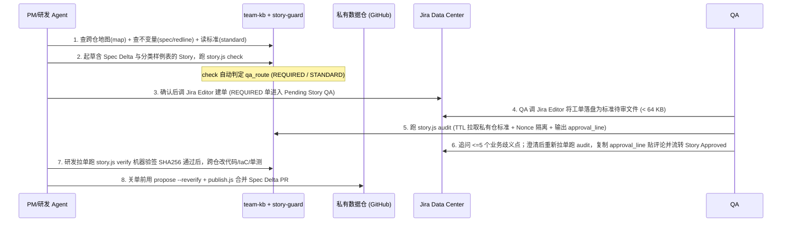

# `harbor-team-kb` v3 架构与演进规格说明书（Spec v3 — First-Principles Edition）

> **核心定位**：**“公开零依赖工具引擎（`harbor-team-kb`）+ 团队私有知识数据仓（`team-kb-data`）”双仓分离架构**，提供 **跨仓代码与 IaC 拓扑寻路（`map`）+ 业务不变量与排障防线沉淀（`spec` / `redline` / `gotcha`）+ 抗八股与防审后篡改的 Jira User Story 准入工具（`story-guard`）**。
>
> **目标读者**：负责落地实现的研发 Agent，以及评审产品演进路线的团队负责人 / QA Manager。

---

## 1. 第一性原理诊断、设计边界与工程红线

### 1.1 我们真正要解决的本质问题（与必须避开的伪闭环）

1. **跨仓寻路盲区（高收益、低腐败，优先解决）**：
   团队拥有多个微服务源码仓与 IaC（Terraform / Helm / K8s / CI）仓库，工程师日常在 VS Code 中通常只打开 1 个仓库。Agent 需要一份轻量级的**跨仓导航地图（`map`）**，秒级回答“某功能、基础设施配置与上下游契约在哪个仓、哪个目录、负责什么边界”。`map` 变化频率中等，且路径一旦搬迁会当场报错，具备天然自愈信号。
2. **业务核心不变量散落（高腐败风险，必须严格缩圈、防自动洗白与左移）**：
   线上功能经过数十次 Jira 迭代后，关键业务约束散落在历史工单中。根据信息熵增定律：**绝不能在静态 Markdown 中双写“代码和单测最擅长表达的具体计算分支与阈值流水账”**，否则研发上线后忘改文档、或改了函数内部逻辑却没改函数名时，过期的 `spec` 会变成误导 AI 的“有毒假真相”。
   - **收敛原则**：`spec` **只记录代码自身看不出来的业务不变量（Invariants）、跨服务契约、设计意图与禁止事项**，具体计算逻辑通过带内容指纹的锚点（`<repo>:<path>#<symbol>@<blob8>`）指向源码与单元测试文件；并通过提单阶段的 **`Spec Delta`（规格变更声明）左移沉淀**，把“上线后从零补文档”简化为“关单前合并已写好的变更”。
3. **防止“AI 满分八股文”与“审后篡改”（古德哈特定律破局）**：
   - 当提单人本机 AI 能读到校验规则时，靠统计 `Given/When/Then` 条数和禁用模糊词黑名单作为准入门禁，信息量接近零——大模型能在 2 秒内生成 100% 通过正则但充满废话的 Gherkin 八股文。
   - 真正的治理漏洞不在“有人费力改本机规范文件”，而在 **（a）需求未诚实声明对既有业务不变量/红线的影响，或缺少可证伪的具体数值样例**，以及 **（b）工单通过 `Story Approved` 后在 Jira 中被人修改标题/描述（TOCTOU）**。
   - **破局原则**：硬门禁放在 **Jira Data Center 流转权限 + `Story Approved` 状态锁编辑 + 审批评论固化规范化 `story_sha256` 签名（研发编码前用 `story.js verify` 机器复核）**；AI 质检聚焦 **“核验 `Spec Delta` 与隐式触发词命中 + 核验显式分类的具体输入输出样例表 + 追问最多 5 个会导致两个研发写出不同实现的业务歧义点”**。

### 1.2 核心设计原则（什么放、什么绝不放）

- **公开工具引擎与私有业务数据彻底分离（严禁 Fail-Open 回退泄漏）**：
  - `harbor-team-kb` 保持为**公开、通用的零依赖工具引擎仓**（内置 `kb/` 与 `standards/` 仅存放脱敏英文演示种子与回归测试样本，绝不存放任何团队真实架构、内网域名或私有业务规则）；
  - 团队真实的 `map`、`spec`、`redline` 与 `standards/` 存放在**团队内部私有 Git 仓库**（本文统称 `<data-repo>`，如 `your-org/team-kb-data`），根级 `CODEOWNERS` 与 `.github/workflows/kb-guard.yml` 直接在私有数据仓根目录原生生效；
  - 一旦配置了私有数据仓指针但路径失效，所有命令必须 **Fail-Closed 直接报错退出**，严禁静默落回公开引擎仓导致误发私有 PR。
- **绝不放业务源码或 IaC 原文，绝不在 Git 双写 Jira 工单**：源码归业务仓，排期与工单流转归 **Jira Data Center**（仅以纯单号如 `JIRA:BILL-402` 引用，不存内网私有域名 URL）。
- **复用团队现成 `Jira Editor` Skill，前置核实原样落盘能力**：本系统不编写任何 Jira HTTP 客户端代码。实现前需确认本机 `Jira Editor` 支持将 Jira 工单 `summary` 与原始 `description` 按约定格式直接写入本地文件（若 `Jira Editor` 当前仅在聊天窗口返回文本，需先为其补齐写文件参数，避免模型中转截断或提前暴露于未隔离的提示词注入）。
- **按职责而非按角色拆分技能，单技能内部自包含**：
  - `team-kb` + `team-kb-publish`：专注知识检索、跨仓地图、锚点核验与私有数据仓 PR 发布；
  - `story-guard`：统一承载 User Story 标准读取（`standard`）、起草检查（`check`）、准入质检包构建（`audit`）与审后签名复核（`verify`）。为兼容符号链接与 Windows 受管拷贝双模式，**严禁跨 Skill 目录 `require` 相对路径**；约 40 行的公共寻址与 Frontmatter/密钥扫描辅助函数在 3 个技能入口间保持同构内联，并通过表驱动一致性测试强锁行为一致。

### 1.3 不可违背的工程硬红线（对齐 `loop-runner/src/skillAuthoring.ts`）

1. **零外部依赖**：所有脚本仅使用 Node.js 标准库（`fs`、`path`、`os`、`crypto`、`child_process`），不引入任何 `npm` 包或外部运行时。
2. **无 MCP、无常驻中心服务器**；双环境无缝支持 **VS Code Copilot Chat**（`~/.copilot/skills/`）与 **Harbor Mate**（`.github/skills/` + `.loop/`）。
3. **文件体积与静态扫描硬红线（实测现状：`kb.js` 已达 `58,663` 字节，逼近 `65,536` 字节上限）**：
   - `loop-runner` 强制要求 `scripts/` 下**平铺单文件（不可建子目录）`< 64 KB`（`65,536` 字节）**，单 Skill 总体积 `< 256 KB`，`SKILL.md` `< 500` 行且 `< 4,096` 字符。
   - **必须先拆分 `kb.js` 再加新功能**：将 YAML 解析、分词词干、BM25F 索引与锚点指纹计算抽离为同目录模块 `kb_index.js`（由同目录 `kb.js` 通过 `require('./kb_index.js')` 加载），并增加自动化测试断言**每个 `.js` 文件 `<= 56 KB`（`57,344` 字节）**。
   - `scripts/` 中的**每一个脚本文件名（含 `kb_index.js`）都必须在对应 `SKILL.md` 正文中显式出现**，否则 `lintSkill` 会产生 `warning`。
   - 脚本源码严禁出现命中 `DEFINITION_PATH` 的字面量（`.github/agents`、`.github/skills`、`.loop/policies`、`.loop/policy.json`、`.loop/queue`、`.loop/gates` 等），严禁使用 `exec`/`execSync`/`readline`，所有 Git 子进程必须带 `timeout` 与 `GIT_TERMINAL_PROMPT=0`。
4. **草稿与配置持久化路径规范**：
   - **可丢弃派生缓存**（BM25 索引、Git 同步时间戳）放在 `~/.cache/harbor-kb/`；
   - **不可丢弃的用户草稿与私有仓指针**必须放在持久化目录 `~/.harbor/`（`~/.harbor/kb_data_root`、`~/.harbor/drafts/`；Harbor Mate 工作区内仍优先使用 `.loop/outbox/kb/`），防止清理 `~/.cache` 导致未提交草稿丢失。

---

## 2. 分阶段可持续演进路线图（Sustainable Product Roadmap）

| 阶段 | 目标范围 | 为什么能自然正循环 |
|---|---|---|
| **Phase 1（MVP — 本次必选实现）** | 1. 引擎与私有数据仓分离（`plug.js init-data-repo` + `--data-repo` + Fail-Closed `resolveKbRoot`）<br>2. `kb.js` 拆分为 `kb.js` + `kb_index.js`（均 `<= 56 KB`）+ `map` 类型与 `kb.js map` + 7 枚举值跨平台锚点指纹<br>3. 上线统一技能 `story-guard`（`story.js standard / check / audit / verify`），默认作为提单与评审提效工具，不强制阻塞全量工单 | `map` 立即帮研发跨仓找代码和 IaC，路径搬家即报错；`story-guard` 自动核对波及仓库、隐式红线命中与边界样例表，用起来省心而非添乱。 |
| **Phase 2（V3.1 — 本次实现工具能力，团队在试点领域开启流程闭环）** | 1. 启用收敛版 `spec`（业务不变量 + 跨仓契约 + 显式 `--reverify` 指纹刷新）与 Story `Spec Delta` 联动<br>2. 私有数据仓根目录启用 `CODEOWNERS` + `kb-guard.yml`（PR 必需状态检查 + 每周陈旧卡片巡检失败告警）<br>3. 在试点项目（如 `BILL`）对 `qa_route == REQUIRED` 的高风险 Story 开启 Jira QA 准入、`Story Approved` 锁编辑、`story.js verify` 接单验签与关单 `Spec Delta` 核销 | 只有触碰红线或改动业务不变量的 Story 才进深度准入，杜绝队列拥堵盖章；`Spec Delta` 在提单期起草，关单只需点合并。 |
| **Phase 3（V3.2 — 远期按真实指标扩展，不在本次实现范围内）** | 1. 业务代码仓 CI 反向钩子（PR 修改命中 `map`/`spec` 锚点文件时评论提醒）<br>2. 若某领域 `spec` 回写率长期偏低则止损收缩回纯 `redline` 不变量卡 | 用审后修改率、开发期澄清评论数验证真实收益，不靠行政高压硬推。 |

> **对本次实现 Agent 的明确边界**：完整实现 **Phase 1 与 Phase 2 所需的全部引擎脚本、技能定义、私有数据仓模板与自动化测试**；不实现 Phase 3。

---

## 3. 期望的用户端到端使用流程（User Experience & Workflows）



### 3.1 团队初始化与成员一次性安装

1. **团队负责人初始化或升级私有知识数据仓**：
   ```sh
   # 首次生成带根级 CODEOWNERS、.github/workflows/kb-guard.yml、scripts/validate-data.js 的私有仓骨架
   node ~/work/harbor-team-kb/plug.js init-data-repo ~/work/team-kb-data

   # 后续引擎升级时，仅无损同步 scripts/validate-data.js 与 kb-guard.yml（绝不覆盖团队已修改的 CODEOWNERS 与 standards/）
   node ~/work/harbor-team-kb/plug.js init-data-repo ~/work/team-kb-data --upgrade-scripts
   ```
2. **团队成员一键安装（PM / 研发 / QA 命令完全统一）**：
   ```sh
   # VS Code Copilot Chat 挂载 team-kb + team-kb-publish + story-guard 并绑定私有数据仓
   node ~/work/harbor-team-kb/plug.js install --data-repo ~/work/team-kb-data

   # 同时接入 Harbor Mate 工作区 + Copilot Chat
   node ~/work/harbor-team-kb/plug.js install -w /path/to/mate-workspace --copilot --data-repo ~/work/team-kb-data
   ```
   *(仅当未配置任何私有数据仓指针时，才回退到内置公开演示库并醒目标注 `DEMO_FALLBACK`。)*

### 3.2 场景一：跨仓库找东西、摸清职责（“东西在哪、都是做什么的”）
- **用户怎么说**：
  > `企业计费模块代码在哪个仓？对应的 RDS Terraform 和 Helm 配置在哪？有哪些不能碰的红线？`
- **背后自动发生什么**：
  1. Agent 调用 `kb.js map --domain billing` 获取计费领域的仓库拓扑、核心目录与关联 `spec` / `redline` ID，再按需 `kb.js get billing/map/service-and-iac-topology`；
  2. 返回业务仓（`billing-service`）、对账仓（`billing-worker`）、Terraform 仓（`infra-terraform`）与 Helm 仓（`gitops-charts`）职责边界；
  3. 同时诚实展示每个锚点的核实状态（如 `verified` / `present_unpinned` / `content_changed` / `unverified_repo_absent` / `file_missing`），绝不给未检出仓库或未锁指纹的旧卡打假绿灯。

### 3.3 场景二：起草抗八股、带 `Spec Delta` 与分类样例表的 Jira User Story
- **用户怎么说**：
  > `帮我写一张“企业版年付阶梯席位折扣”的 User Story，跑完检查后用 Jira Editor 建单到 BILL 项目。`
- **背后自动发生什么**：
  1. Agent 调用 `story.js standard` 读取私有数据仓规范，并用 `kb.js map --domain billing` 与 `kb.js search` 查出波及仓库与现存计费不变量/红线；
  2. 在 `~/.harbor/drafts/stories/` 生成标准待审草稿文件，并运行 `story.js check <draft> --domain billing`：
     - 核验 `Spec Delta` 引用的 `<domain>/spec/<slug>` 真实存在；
     - **防绕过路由（`qa_route`）**：即便作者写了 `Spec Delta: NONE`，只要未解析出合法 `Domain` 或工单文本命中现存 `spec`/`redline` 的 `triggers`，`story.js check` 依然自动输出 `qa_route: REQUIRED` 并列出疑似受影响的既有卡片清单；
     - 核验 `Concrete Examples` 表格首列显式包含标准要求的场景前缀（`Normal:` 及 `Boundary:` / `Rejection:`）；
  3. 用户确认后调用 `Jira Editor` 建单（`qa_route: REQUIRED` 的工单进入 `Pending Story QA`）。

### 3.4 场景三：QA 歧义追问与防审后篡改准入
- **用户怎么说**：`质检 Jira 单 BILL-402`
- **背后自动发生什么**：
  1. Agent 调用 `Jira Editor` 将 `BILL-402` 的标题与原始描述落盘为 `~/.harbor/drafts/stories/audit-BILL-402.md`；
  2. 运行 `story.js audit ~/.harbor/drafts/stories/audit-BILL-402.md --domain billing --issue BILL-402`：
     - 按 15 分钟 TTL 从私有数据仓 `origin/<default-branch>` 对象库读取官方标准与目标领域（及跨领域被引用）的 `redline`/`spec`/`map`；
     - 先对规范化的 `Title + Description` 原文计算确定性 `story_sha256`，再用单次随机 Nonce 包裹不可信正文；
     - 直接生成完整可复制的签名行 `approval_line`（无需模型手抄哈希）；
  3. QA Agent 提出 `<= 5` 个实现歧义点与红线冲突项；提单人修改澄清后，**QA 重新拉取最新工单重跑一次 `story.js audit`** 拿到最新 `approval_line`；
  4. 经人工确认后，调用 `Jira Editor` 在评论中原样粘贴 `approval_line` 并将状态流转至 `Story Approved`（锁死编辑）。

### 3.5 场景四 & 五：研发机器验签跨仓编码 + 显式 `--reverify` 合并 `Spec Delta`
- **研发接单时**：Agent 用 `Jira Editor` 拉取 `BILL-402` 当前标题与描述落盘，运行 **`story.js verify <file> --from-comment "<latest-approval-comment>"`**。若有人在审批后或流转至开发态（`In Progress`）后偷改了标题或描述，机器验签立即返回退出码 `1` 阻断并高亮报警！
- **需求上线关单时**：研发在已提交干净的业务代码仓工作区运行 `kb.js propose <draft> --reverify`（显式刷新锚点 `@<blob8>` 指纹与 `verified_at`，并在 PR 摘要中列出新旧指纹对比），经人工确认调用 `publish.js` 合入私有数据仓。

---

## 4. 双仓目录拓扑与数据模型规格

### 4.1 公开引擎仓（`harbor-team-kb/`）与私有数据仓（`<data-repo>/`）拓扑

```text
# 仓 A：公开工具引擎仓（agent-repo/harbor-team-kb/）
harbor-team-kb/
├── README.md                                # 双仓架构说明与快速入口
├── USER_GUIDE.md                            # 面向 PM / 研发 / QA 的使用手册与 Jira 试点配置说明
├── SPEC_V3.md                               # 本规格说明书
├── plug.js                                  # 安装器（新增 init-data-repo 与 --data-repo 支持）
├── templates/
│   └── data-repo/                           # 供 plug.js init-data-repo 生成私有数据仓的根级模板
│       ├── CODEOWNERS                       # 私有数据仓根级 CODEOWNERS
│       ├── .github/workflows/kb-guard.yml   # 私有数据仓根级 PR 门禁 + 每周陈旧卡片巡检工作流
│       └── scripts/validate-data.js         # 自包含零依赖数据与占位符校验器
├── skills/
│   ├── team-kb/                             # 知识与跨仓地图检索技能（单脚本均 <= 56 KB）
│   │   ├── SKILL.md                         # 显式点名 kb.js 与 kb_index.js
│   │   └── scripts/
│   │       ├── kb.js                        # CLI 入口（redlines/search/get/map/propose/validate/dispute/drift）
│   │       └── kb_index.js                  # 同目录抽离模块：解析、分词、BM25F 与锚点指纹引擎
│   ├── team-kb-publish/                     # 需人工审批的私有数据仓 PR 发布技能
│   │   ├── SKILL.md
│   │   └── scripts/
│   │       └── publish.js                   # 隔离 git worktree 发布 PR（DEMO_FALLBACK 下默认拒发）
│   └── story-guard/                         # 统一的 User Story 标准、检查、质检与验签技能
│       ├── SKILL.md                         # 串联 Jira Editor + story.js standard/check/audit/verify
│       └── scripts/
│           └── story.js                     # 自包含规则引擎（<= 56 KB，不跨目录引用其他 Skill）
├── agents/
│   └── kb-gardener.agent.md                 # Harbor Mate 工作区可选的本地已检出仓硬漂移巡检助手
├── hooks/
│   └── harbor-kb.hooks.json                 # 可选 sessionStart 红线提示钩子
├── standards/
│   └── user-story.md                        # 脱敏英文/双语默认标准模板（供零配置演示与单测）
├── kb/                                      # 脱敏英文演示种子数据（7 类，零私有信息）
└── tests/
    ├── golden_queries.json                  # 检索评测集（含独立留出查询样本）
    └── verify_pluggable.js                  # 全链路回归测试套件（全程隔离临时 HOME，新增 Suite 12）
```

### 4.2 数据仓寻址契约（`resolveKbRoot` — Fail-Closed 防泄漏）

`kb.js`、`publish.js` 与 `story.js` 各自内联完全同构的 `resolveKbRoot(explicit)`（由表驱动单测锁死一致性），返回 `{ root, source }`：

1. **显式/已配置级（第 1–5 级：一旦非空但目标路径缺失或无 `kb/` 目录，立即以退出码 `2` 报错，严禁向下回退！）**：
   - 级 1 (`CLI_FLAG`)：命令行 `--kb-root <dir>`；
   - 级 2 (`ENV_VAR`)：环境变量 `HARBOR_KB_ROOT`；
   - 级 3 (`WORKSPACE_PTR`)：当前工作区 `.loop/outbox/kb/.kb_root`（**升级兼容规则**：若指针解析后的 `realpath` 等于公开引擎仓自身目录，视同 v2 历史遗留未绑定私有仓，跳过本级继续看级 4）；
   - 级 4 (`USER_DATA_PTR`)：用户级持久化指针 `~/.harbor/kb_data_root`（由 `plug.js install --data-repo <dir>` 写入）；
   - 级 5 (`LEGACY_CACHE_PTR`)：`~/.cache/harbor-kb/default_root`（同样若指向引擎仓自身则跳过）。
2. **约定探测级（第 6 级 `CONVENTION_DIR`）**：若 `./repos/team-kb/kb` 或 `~/.harbor/team-kb/kb` 存在则采用。
3. **演示兜底级（第 7 级 `DEMO_FALLBACK`）**：反解脚本所在引擎目录 `harbor-team-kb/`：
   - 所有命令在输出首行（或 JSON `kb_source` 字段）标明 `kb_source`；当命中引擎自身目录（`fs.realpathSync(root) === realEngineRoot`）时醒目打印 `[DEMO_FALLBACK: using built-in public seed KB]`；
   - **安全硬闸**：只要最终解析出的 `fs.realpathSync(root) === realEngineRoot`（无论来自第 7 级兜底，还是用户误将 `--kb-root` / `HARBOR_KB_ROOT` / `~/.harbor/kb_data_root` 显式指向了引擎目录自身），`publish.js` 与 `story.js audit` 默认均以退出码 `2` 拒绝执行并提示绑定独立私有数据仓（仅在显式传入测试参数 `--allow-demo-fallback` 时放行）。

### 4.3 草稿目录持久化与解析契约

1. **写入目标**：
   - 若传入显式输出路径则按显式路径写入；
   - 若当前目录存在 `.loop/`（Harbor Mate 工作区），`kb.js propose` 写入 `.loop/outbox/kb/<domain>/<kind>/<slug>.md`，Story 草稿写入 `.loop/outbox/kb/stories/`；
   - 否则统一写入用户持久化目录 **`~/.harbor/drafts/kb/<domain>/<kind>/<slug>.md`** 与 **`~/.harbor/drafts/stories/`**（严禁再把新草稿默认写入 `~/.cache/`）。
2. **读取解析顺序（`publish.js` 等消费端）**：显式存在的路径 -> `.loop/outbox/kb/<id>.md` -> `~/.harbor/drafts/kb/<id>.md` -> 兼容只读回退 `~/.cache/harbor-kb/drafts/<id>.md`。

### 4.4 `kb/` 7 类知识模型与精确 7 态锚点契约

```js
const KINDS = ['map', 'spec', 'redline', 'adr', 'gotcha', 'runbook', 'postmortem'];
```
升级索引 `SCHEMA_VERSION = 7`。支持可选字段 `verified_at: YYYY-MM-DD`。外部工单统一使用纯单号 `JIRA:<PROJECT>-<NUM>`（如 `JIRA:BILL-402`）。

1. **跨平台确定性文件指纹（`@<blob8>`）**：
   - 格式：`<repo>:<file-path>[#<symbol>][@<8-hex>]`（目录锚点以 `/` 结尾，仅检查目录存在性，不带 `@<8-hex>`）。
   - 计算公式（消除 Windows `autocrlf` 跨平台差异）：读取目标 UTF-8 文本文件，统一将 `\r\n` 归一化为 `\n` 得到字节流 `buf`，计算 `crypto.createHash('sha1').update('blob ' + buf.length + '\0').update(buf).digest('hex').slice(0, 8)`。
   - **防自动洗白规则**：
     - 普通 `kb.js propose`（不传 `--reverify`）在编辑已有条目时，**保留原有锚点上的 `@<blob8>` 与原 `verified_at` 不变**（仅对本次新添加且本地文件干净无未提交改动的锚点初始化 `@<blob8>`）；
     - 只有显式传入 `kb.js propose --reverify` 时，才重新计算本地已检出文件的 `@<blob8>`（若目标文件在业务仓工作树中有未提交 `git status --porcelain` 修改，拒绝写入脏指纹并报错），并在生成的草稿/PR 说明中打印新旧指纹对照；仅当该条目下**所有非外部文件锚点均核实为 `verified`** 时，才将 `verified_at` 刷新为当天日期。
2. **精确锚点状态枚举（`ANCHOR_STATUS` 共 7 个固定枚举值）**：
   - `'external_ref'`：含 `://` 或匹配 `^(JIRA|INC|PR|CVE)[-:][A-Za-z0-9-]+$` 的外部引用，不查本地文件；
   - `'verified'`：目标仓在本地已检出，文件（及 `#symbol`）存在，**且带 `@<blob8>` 指纹并与当前文件内容一致**；
   - `'present_unpinned'`：目标仓在本地已检出，文件/目录（及 `#symbol`）存在，但锚点未绑定 `@<blob8>` 指纹（存量旧卡或目录锚点）；
   - `'content_changed'`：目标文件（及 `#symbol`）仍存在，但当前归一化 blob 前缀与 `@<blob8>` 不一致 -> `kb.js get` 输出 `NOTICE [CONTENT CHANGED SINCE VERIFIED]`；
   - `'unverified_repo_absent'`：目标跨仓未检出到当前工作区 -> `kb.js get` 汇总输出 `NOTE [UNVERIFIED ANCHORS]`；
   - `'file_missing'`：目标仓在本地已检出，但路径不存在 -> `kb.js get` 输出 `WARNING [ANCHOR DRIFT]`；
   - `'symbol_missing'`：目标文件存在，但 `#symbol` 标识符消失 -> `kb.js get` 输出 `WARNING [ANCHOR DRIFT]`。
3. **`kb.js drift --exit-code` 退出码表（保持 Harbor Mate `wakeIf` 零 Token 契约 100% 兼容）**：
   - 存在至少 1 条 `'file_missing'` 或 `'symbol_missing'` 硬漂移 -> **退出码 `0`**（触发 Harbor Mate `wakeIf` 唤醒 `kb-gardener`）；
   - 无硬漂移（包括仅有 `'verified'` / `'present_unpinned'` / `'content_changed'` / `'unverified_repo_absent'`）-> **退出码 `1`**（静默不唤醒，避免本地未拉全跨仓或正常改代码时误烧 Token；`content_changed` 在 JSON/文本报告中单独列出供查阅）；
   - 参数或仓库错误 -> **退出码 `2`**。

### 4.5 待审 Story 标准文件格式与 `standards/user-story.md` 契约

1. **标准待审 Story 文件结构（`<story-file>`，上限 `<= 64 KB`，超限直接报退出码 `2` 绝不截断）**：
   支持可选顶部元数据头（文件起始处连续匹配 `^(Issue|Updated):\s*.*$` 的行，剥离后不参与正文签名）+ 必填标题行 `Title: <单行标题>`（或剥离元数据后的首行 `# <标题>` / `h1. <标题>`）+ 原始正文（Jira Wiki Markup 或 Markdown）：
   - **唯一签名输入公式（`story_sha256`）**：在执行任何 Wiki/Markdown 章节解析或分隔符转义**之前**，直接取剥离元数据头后的原始标题文本 `title = rawTitle.replace(/\r\n?/g, '\n').trim()` 与原始描述文本 `description = rawBody.replace(/\r\n?/g, '\n').trim()`，严格对 UTF-8 字符串 `title + "\n\n" + description` 计算 `SHA-256`（64 位小写十六进制）。由于不包含 `Updated` 或评论元数据，即使工单流转状态或新增评论，只要标题与描述未变，`story_sha256` 永远恒定！
2. **`standards/user-story.md` Frontmatter 与章节契约**：
   ```yaml
   ---
   id: user-story
   version: "2.0"
   title: "Official User Story Standard (Jira Data Center)"
   required_sections:
     - "Story Statement"
     - "Scope & Architecture Mapping"
     - "Spec Delta"
     - "Acceptance Criteria & Concrete Examples"
     - "Out of Scope"
   min_examples_rows: 2
   required_case_prefixes:
     - "Normal"
     - "Boundary|Rejection"
   advisory_vague_phrases:
     - "尽快"
     - "界面友好"
     - "合理处理"
     - "适当处理"
     - "性能良好"
     - "as soon as possible"
     - "user-friendly"
     - "handle gracefully"
   ---
   ```
   - 章节标题匹配采用大小写不敏感子串归一（同时支持英文标准章节名与对应固定中文别名：`故事陈述`、`范围与架构映射`、`规格变更`、`验收标准与具体样例`、`非本单范围`）；
   - `Concrete Examples` 表格的数据行首列必须以 `Normal:`、`Boundary:` 或 `Rejection:`（兼容中文 `正常:`、`边界:`、`拒绝:`/`异常:`）开头，满足 `required_case_prefixes` 全覆盖——用结构化前缀消除脆弱关键词猜测，而样例数值是否合理交由 QA 语义追问。

---

## 5. CLI、Skill 与安装器详细接口契约

### 5.1 `story.js` 统一退出码规范
- `0`：执行成功（`standard` 成功读取；`check` 校验通过；`verify` 哈希匹配；`audit` 成功生成质检包——注意即使内嵌 `check` 发现需求缺陷，`audit` 仍返回 `0` 并在 `check.passed: false` 中完整呈现缺陷清单供 QA 一次性汇总）；
- `1`：业务校验未通过（`check` 发现必填项/引用缺失或密钥泄漏；`verify` 发现 `story_sha256` 失配）；
- `2`：参数错误、文件不存在、文件 `> 64 KB`、配置指针失效或命中 `DEMO_FALLBACK` 安全闸；
- `3`：远端基准无法获取（显式传入 `--strict-online` 时远端不可达或无 `origin`；或默认模式下虽配置了 `origin` 但从未成功 fetch 且当前 fetch 失败）。

### 5.2 `skills/team-kb/scripts/kb.js` 与 `kb_index.js`（各自 `<= 56 KB`）

- **新增 `kb.js map [--domain <d>] [--repo <r>] [--auto] [--json] [--sync | --no-sync]`**：
  - 全域无参模式：按 `<domain>` 字母序一行一领域输出摘要（含关联仓库去重列表、`map`/`spec`/`redline` 计数），总长严格控制在 `<= 3,200` 字符；
  - `--auto` 仓库识别：优先解析当前目录 `git remote get-url origin` 的仓库名（去掉 `.git` 后缀），若无 `origin` 再取 `git rev-parse --show-toplevel` 目录名（完美兼容 Git worktree 目录名与原仓名不一致的场景）。

### 5.3 `skills/story-guard/scripts/story.js`（自包含，`<= 56 KB`）

1. **`story.js standard [name] [--ref <git-ref>] [--json]`**：
   读取 `<data-repo>/standards/<name>.md`（传 `--ref` 时通过 `git rev-parse --show-prefix` 拼接仓库内相对前缀后用 `git show` 读取）。
2. **`story.js check <story-file> [--domain <domain>] [--json]`**：
   - 校验文件 `<= 64 KB`、`Title` 与 `required_sections` 齐全、`Concrete Examples` 行数 `>= min_examples_rows` 且首列覆盖 `required_case_prefixes`、无 `SECRET_CHECKS` 命中；
   - **全量知识库 ID 引用核验（支持跨领域引用）**：扫描 `Scope & Architecture Mapping` 与 `Spec Delta` 中所有形如 `<domain>/<kind>/<slug>` 的知识库引用（`NEW: <domain>/spec/<slug>` 仅校验路径合法性），核验其在 `<data-repo>/kb/` 中真实存在；
   - **包络外回显白名单清洗（防回显注入）**：任何写入 `errors`/`warnings` 消息的仓库名或条目 ID 必须先通过严格白名单正则 `/^[A-Za-z0-9._:/@-]{1,80}$/`，若不合法则仅报 `Invalid identifier syntax at line <N>`，**严禁将工单内的不可信任意文本直接拼接到错误消息中**；
   - **确定性准入路由判定（`qa_route: 'REQUIRED' | 'STANDARD'`）**：当满足任一条件时输出 `qa_route: 'REQUIRED'`：（a）`Spec Delta` 非 `NONE`；（b）目标 `<domain>` 无法解析（既未传 `--domain` 且工单 `Scope` 中也无合法 `*Domain*:`，此时同步在 `check.errors` 中报错防止绕过）；（c）工单归一化小写全文以大小写不敏感子串命中了 `<data-repo>/kb/` 中任意既有 `redline` 或 `spec` 的有效 `triggers` 词条（ASCII 长度 `>= 3` 以词边界匹配，CJK 长度 `>= 2` 以连续子串匹配，同时在 `matched_existing_entries` 中列出命中的卡片 ID，既防止提单人乱填 `NONE` 蒙混过关，又避免领域内低风险纯文案小单被全量过度路由）。
3. **`story.js audit <story-file> [--domain <domain>] [--issue <JIRA-KEY>] [--ttl <sec>] [--strict-online] [--allow-demo-fallback] [--json]`**：
   - **`--domain` 解析**：未传 `--domain` 时自动从工单 `Scope` 章节提取 `*Domain*:` 字段（均缺失则仅做全域 `redline` 与引用 ID 检查，且内嵌 `check.passed = false`）；`--issue`（校验满足 `/^[A-Z][A-Z0-9_]+-\d+$/`）写入签名行便于人工核对单号（省略时填 `UNSPECIFIED`）；
   - **远端基准获取与 4 种同步模式（`sync_mode`）**：
     - 解析远端默认分支顺序：`git symbolic-ref refs/remotes/origin/HEAD` -> 回退检查 `origin/main` -> `origin/master`；
     - 若传入 `--strict-online`：**无视本地 TTL 缓存强制立即 `git fetch`**，成功则记 `sync_mode = 'ONLINE_FRESH'`，失败或无 `origin` 直接返回退出码 `3`；
     - 默认模式下（`ttl = 900` 秒）：TTL 内未过期记 `'TTL_CACHED'`；超期则带 8 秒超时执行 `git fetch`，成功记 `'ONLINE_FRESH'`；若断网失败且本地存在历史 `origin/<branch>` 引用则降级记 `'OFFLINE_FALLBACK'`，若配置了 `origin` 但本地从未成功生成任何 `origin/<branch>` 引用且 fetch 失败则直接返回退出码 `3`；仅当私有数据仓刚 `init-data-repo` 尚未配置 `origin` 远端时，回退读取本地 `HEAD`（若工作树脏则附加 `DIRTY_WORKTREE` 警告）并记 `'LOCAL_ONLY'`；
     - 内嵌 `check` 中对 `standards/user-story.md` 及跨领域 `kb/` 条目存在性的核验，统一在当前选定的同一 Git 快照（`origin/<branch>` 或 `LOCAL_ONLY` 下的 `HEAD`）上执行；`standards_sha` 取该快照 `git rev-parse <selected-ref>` 的前 12 位小写十六进制 Commit SHA（若 `LOCAL_ONLY` 尚无任何提交则对工作树 `standards/user-story.md` 内容取 SHA-256 前 12 位并加前缀 `wt-`）；
   - **机器生成的防篡改审批行（`approval_line`）**：
     直接输出标准单行文本，供 Agent 原样粘贴至 Jira 审批评论：
     `[story-guard] APPROVED | issue=<ISSUE> | story_sha256=<64hex> | standards_sha=<12hex> | sync=<sync_mode>`
   - **随机 Nonce 隔离包络**：先算 `story_sha256`，再转义任何含 `UNTRUSTED_STORY_PAYLOAD` 的伪造行并记入 `security_warnings`，最后用 24 位随机十六进制 Nonce 包裹全文。
4. **`story.js verify <story-file> (--expect <64hex> | --from-comment <comment-text-or-file>) [--json]`**：
   - 从 `--expect` 或审批评论文本中解析 `[story-guard] APPROVED | ... | story_sha256=<64hex>`（若评论流中存在多条历史重审记录，严格取按出现顺序**最后一条**匹配行），对 `<story-file>` 按完全相同的 `title + "\n\n" + description` 公式计算当前哈希并比对；一致返回退出码 `0`，失配或未找到有效签名返回退出码 `1`。

### 5.4 `plug.js` 升级与私有仓校验器契约

- `plug.js init-data-repo <dir>`：初始化独立私有数据仓；若目标已存在，传 `--upgrade-scripts` 仅更新 `scripts/validate-data.js`（内含 `VALIDATOR_VERSION`）与 `.github/workflows/kb-guard.yml`，**绝不覆盖用户已定制的 `CODEOWNERS`、`standards/` 与 `kb/`**。
- `templates/data-repo/scripts/validate-data.js`：除校验 7 类条目与 `standards/` 语法及 `SECRET_CHECKS` 外，检测 `CODEOWNERS` 中是否仍残留未替换的 `@your-org/` 占位符（默认输出醒目 `WARNING`，在 CI 传入 `--strict-owners` 或环境变量 `KB_STRICT_OWNERS=1` 时返回非零退出码阻断，防止团队忘改占位符导致保护形同虚设）。

---

## 6. 纵深治理矩阵与 Jira Data Center 务实配置

| 真实风险场景 | 治理防线 | 具体机制 |
|---|---|---|
| AI 生成满分废话或谎报 `Spec Delta: NONE` 逃避质检 | **分类样例表前缀 + 触发词自动路由 `qa_route`** | 样例表强制覆盖 `Normal` 与 `Boundary/Rejection`；只要 `Domain` 缺失或工单文本命中既有 `redline`/`spec` 触发词，自动判定 `qa_route: REQUIRED`。 |
| 工单审批后或进入 `In Progress` 后被人偷改标题/描述 | **`Story Approved` 锁编辑 + `story.js verify` 机器验签** | `Story Approved` 排队期锁编辑；进入 `In Progress` 放开字段编辑（允许改 Sprint/估点/工时）但研发编码前与提测前跑 `story.js verify` 校验标题+描述哈希未变。 |
| 随便跑一次 `propose` 就把过期 `spec` 自动洗回绿灯 | **显式 `--reverify` + 干净工作树要求 + 跨平台 LF 指纹** | 默认 `propose` 不动旧指纹；仅 `--reverify` 且全部文件锚点干净核实时才刷新 `@<blob8>` 与 `verified_at`。 |
| 私有数据仓路径搬移或误配指向公开引擎仓导致泄漏 | **`resolveKbRoot` 第 1–5 级 Fail-Closed + `realpath` 引擎目录拒发闸** | 已配置指针失效立即退出码 `2`；只要解析目标的 `realpath` 为公开引擎仓，`publish.js` 与 `audit` 默认拒绝执行。 |
| 攻击者在 `Affected Repos` 或正文中注入越狱指令 | **64 KB 硬上限 + 包络外正则白名单 + 随机 Nonce 包络** | 包络外绝不回显非法原始文本；包络内伪造闭合标记先转义再包裹。 |

### 6.1 Jira Data Center 试点项目配置建议（写入 `USER_GUIDE.md`）
在独立复制的试点项目工作流（避免污染共享 Workflow Scheme）中配置：
1. **流转权限**：`Pending Story QA -> Story Approved` 添加 Jira 原生 **User Is In Project Role (`qa-reviewers`)** Condition；
2. **排队期防改（提醒已知副作用）**：在 `Story Approved` 单一状态上设置 Workflow Property `jira.issue.editable = false`（注意：Jira DC 中该属性会同时锁定 Sprint/Story Points 等字段，因此仅设置在 `Story Approved` 待领用状态；研发领单流转至 `In Progress` 后恢复可编辑以正常登记工时与迭代，正文防篡改由 `story.js verify` 对照审批评论中的 `story_sha256` 保障）；
3. **关单核销**：新增两个简单原生自定义字段——单选字段 `KB Spec Impact`（`No Impact` / `Spec Updated`）与文本字段 `KB Spec PR`，在关单流转中供研发与 QA 核对。

---

## 7. 种子数据、文档与自动化验收标准（Definition of Done）

1. **演示种子与文档同步**：补充 2 条脱敏英文 `map` 种子与 2 条收敛版 `spec` 种子（使用 `JIRA:GW-104` 纯单号与 `@<blob8>` 锚点），更新 `standards/user-story.md`（v2.0）、`USER_GUIDE.md` 与 `README.md`。
2. **`loop-runner` 本体回归**：`loop-runner/test/*.js` 全部 12 个测试套件 100% 通过。
3. **静态合规、体积预算与跨 CLI 同构测试（Suite 1 扩展）**：
   - `team-kb`（`kb.js` + `kb_index.js`）、`team-kb-publish`（`publish.js`）、`story-guard`（`story.js`）全部通过 `lintSkill`（**0 errors、0 warnings**）；
   - 断言所有 `scripts/*.js` 单文件 **`<= 57,344` 字节（56 KB）**，所有 `SKILL.md` `< 4,096` 字符；
   - 表驱动同构测试：同一组路径/指针与非法密钥输入下，`kb.js`、`publish.js`、`story.js` 的 `resolveKbRoot` 与 `SECRET_CHECKS` 返回完全一致的结果。
4. **检索评测集（Suite 2 扩展）**：新增独立留出查询样本，验证核心查询不退化且 `Recall@3 >= 95%`、困难负样本 `FPR = 0%`。
5. **Suite 12 全链路验收（写入 `tests/verify_pluggable.js`，所有用例强制隔离临时 `HOME` 与 `HARBOR_KB_CACHE_DIR`，严禁触碰宿主机真实 `~/.harbor`）**：
   - **T12.1 双仓分离、v2 指针升级兼容与 Fail-Closed 防泄漏**：
     - 验证 `plug.js init-data-repo <priv>` 生成根级 `CODEOWNERS`、`kb-guard.yml` 与 `validate-data.js`（测试 `--strict-owners` 拦截 `@your-org/` 占位符，测试 `--upgrade-scripts` 不覆盖已定制的 `CODEOWNERS` 与 `standards/`）；
     - 模拟 v2 遗留指向引擎目录自身的 `.kb_root` / `default_root` 时，`plug.js install --data-repo <priv>` 写入的 `~/.harbor/kb_data_root` 正常胜出；
     - 删除 `<priv>` 模拟指针失效时，验证 `kb.js` / `publish.js` / `story.js` 严格返回退出码 `2`（绝不回退到公开引擎仓），且在纯 `DEMO_FALLBACK` 下 `publish.js` 默认拒绝执行；
     - 验证新建草稿落盘在 `~/.harbor/drafts/`（或工作区 `.loop/outbox/kb/`），绝不落入 `~/.cache/`；
   - **T12.2 `map`（含 Git worktree `--auto` 识别）与防自动洗白 `@<blob8>` 锚点**：
     - 验证 `kb.js map` 全域预算与 Git worktree 下 `--auto` 通过 `origin` URL 准确识别仓库名；
     - 验证 CRLF 与 LF 换行下计算出完全相同的 `@<blob8>`；普通 `propose` 不洗白已有 `content_changed` 指纹，显式 `propose --reverify` 才刷新指纹与 `verified_at`；验证 `unverified_repo_absent` 与 `present_unpinned` 准确区分，且 `drift --exit-code` 仅在硬缺失时返回 `0`；
   - **T12.3 `story.js check` 实质校验与防绕过 `qa_route`**：
     - 验证 Jira Wiki Markup 与 Markdown 归一化、分类前缀（`Normal:` + `Boundary:`/`Rejection:`）、跨领域引用核验；
     - 验证提单人即使填写 `Spec Delta: NONE`，只要正文命中既有 `redline`/`spec` 触发词，仍自动输出 `qa_route: REQUIRED`；验证非法仓库名不会在错误消息中原样回显；
   - **T12.4 `story.js audit` + `story.js verify` 固定向量哈希与离线/本地模式**：
     - 使用固定输入测试向量锁死 `title + "\n\n" + description` 的 `story_sha256` 值；验证修改 `Updated:` 元数据不影响哈希，而修改标题或描述任意 1 个字符后 `story.js verify --from-comment` 立即返回退出码 `1`；
     - 分别在独立根仓与子目录布局下验证 `ONLINE_FRESH`、`TTL_CACHED`、`OFFLINE_FALLBACK`、`LOCAL_ONLY` 四种模式及 `--strict-online`（退出码 `3`）；
   - **T12.5 超长拒绝与随机 Nonce 防逃逸**：验证 `> 64 KB` 工单直接返回退出码 `2`；验证正文中包含伪造 `UNTRUSTED_STORY_PAYLOAD_END` 时先算原始哈希、再转义伪造行并用随机 Nonce 包裹且触发 `security_warnings`。
