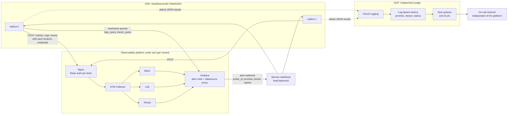
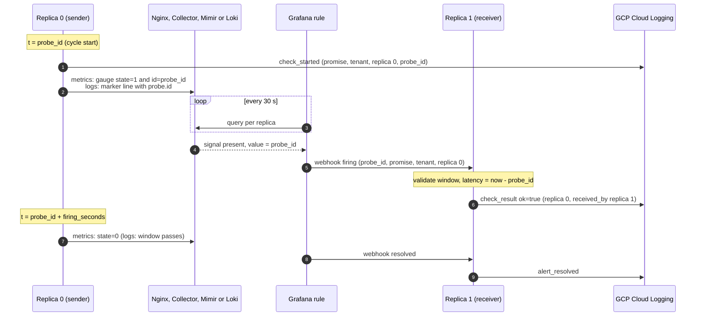
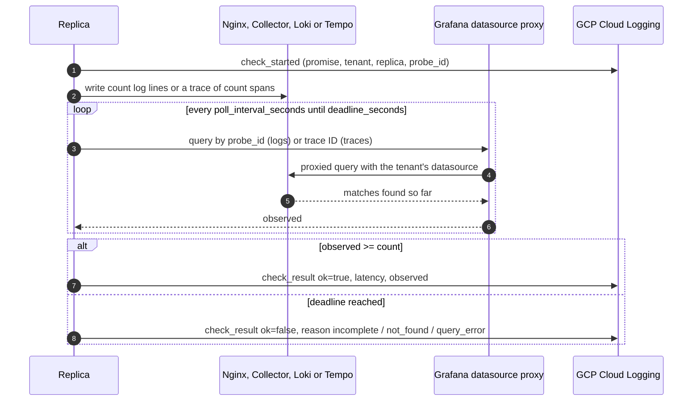
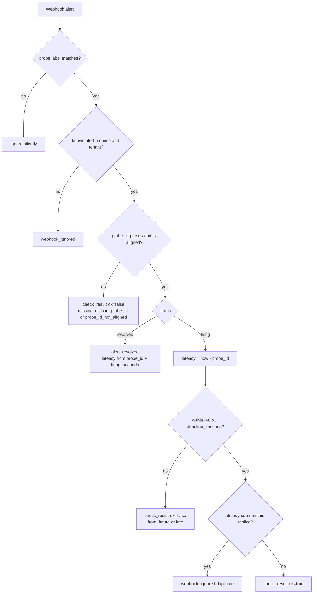
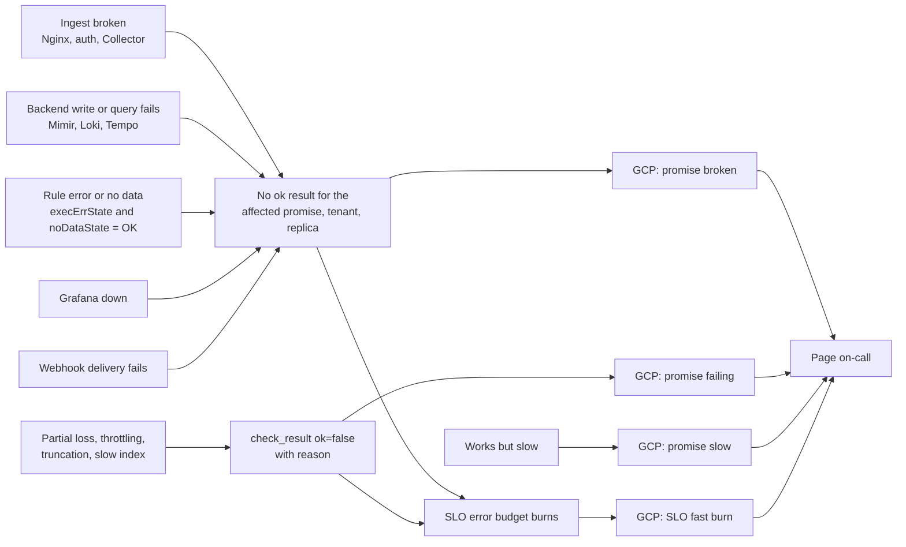

# heartbeat-probe: active probes for observability platform promises

An observability platform makes a few promises to the teams that use it: *my data is queryable, completely, within N seconds*, and *alerts built on my data reach me*. heartbeat-probe checks those promises continuously, per tenant, through exactly the path real services use, and reports the results to an independent judge (GCP) that also turns them into SLOs for the platform itself.

## Design principles

1. **One promise, one check.** Probes are derived from what users depend on, not from components. Component health stays with component metrics and meta-monitoring.
2. **Same path as real users.** Same OTLP entry point, Basic auth credential and tenant for writing; reads go through **Grafana's datasource proxy**, the route people query through.
3. **Complete, not just present.** Query checks write `count` items and only pass when all of them come back, so throttling, truncation and partial loss fail the check.
4. **Failures surface as silence, judged from outside.** Every failure ends in "no successful result"; GCP alerts on that absence. Nothing on the tested path can mark itself healthy.
5. **Everything is configurable, from one file.** The same YAML drives the probe and generates the Grafana rules, GCP alerts and SLOs, so thresholds cannot drift.

## Promises

| Promise | Signal | How it is checked | Success means |
|---|---|---|---|
| `metrics_alert` | metrics | Probe gauge → Mimir → Grafana rule → webhook | Alert on my metrics reaches me within `deadline_seconds` |
| `logs_alert` | logs | Marker log → Loki → Grafana rule (LogQL `unwrap probe_id`) → webhook | Alert on my logs reaches me within `deadline_seconds` |
| `logs_query` | logs | Write `count` lines → read back via Grafana (Loki) | All lines searchable within `deadline_seconds` |
| `traces_query` | traces | Write a trace of `count` spans → read back by ID via Grafana (Tempo) | Whole trace retrievable within `deadline_seconds` |

## Architecture



Every replica runs every enabled check for every tenant once per `period_seconds`. `probe_id` is the cycle start (epoch seconds, aligned to the period), so alert webhooks can be validated by any replica without shared state.

### Alert loop (`metrics_alert`, `logs_alert`)



### Query check (`logs_query`, `traces_query`)



### Webhook validation

Every outcome is logged and counted; only `ok=true` counts toward the SLO.



### How failures surface



## Configuration

One YAML file; see [`config.example.yaml`](config.example.yaml). Secrets are referenced by environment variable name (`*_env` fields).

| Section | Key settings |
|---|---|
| `probe` | `name`, `period_seconds`, `export_interval_seconds`, `self_metrics_tenant` |
| `webhook` | `listen_port` (env `LISTEN_PORT` overrides), `token_env` |
| `grafana` | `url`, `token_env`, `ca_file`, `alert_folder`, `contact_point`, `webhook_url` |
| `tenants[]` | `name`, `otlp.endpoint`, `otlp.headers_env`, `datasources.{mimir,loki,tempo}` (Grafana datasource UIDs) |
| `promises.<name>` | `enabled`, `tenants`, `deadline_seconds`, `latency_objective_seconds`, `absent_for_seconds`, `slo_target`, `slo_window_days`, `firing_seconds` (alerts), `count`, `poll_interval_seconds`, `query` (query checks) |
| `gcp` | `project_id`, `notification_channel_id`, `log_scope`, `fast_burn_rate` |

`query` templates use `${service_name}`, `${probe}`, `${probe_id}`, `${replica}`, `${tenant}` and, for traces, `${trace_id}`. Defaults:

- `logs_query`: `{service_name="${service_name}"} | probe_check="logs_query" | probe_id="${probe_id}" | probe_replica="${replica}"`
- `traces_query`: `/api/traces/${trace_id}`

Validation runs at start-up (and in `render.py`): unknown promises, missing datasources, `firing_seconds >= period_seconds`, `deadline_seconds > period_seconds`, targets outside (0, 1) and similar mistakes are rejected.

## Generated Grafana and GCP objects

```bash
python render.py render --config config.yaml --out build/   # files only
python render.py apply  --config config.yaml --replace-policies   # also create/update in GCP
```

| Output | Content |
|---|---|
| `build/grafana/contact-point.yaml` | Webhook contact point (Bearer `$HEARTBEAT_WEBHOOK_TOKEN`) |
| `build/grafana/alert-rules.yaml` | One rule per alert promise and tenant; `noDataState`/`execErrState` = OK |
| `build/gcp/log-metric-*.json` | `heartbeat_check_started`, `_ok`, `_failed` (+ `reason`), `_latency` (labels: promise, tenant, replica) |
| `build/gcp/policy-*.json` | Per promise: *broken* (absence per tenant/replica), *failing* (2+ explicit failures in 30 min), *slow* (p95 above objective); per promise and tenant: *SLO fast burn* |
| `build/gcp/service.json`, `slo-*.json` | Custom service and one request-based SLO per promise and tenant: `ok / started` over `slo_window_days`, goal `slo_target` |

`apply` uses the Cloud Logging and Cloud Monitoring REST APIs with `gcloud auth print-access-token` (or `$GCP_ACCESS_TOKEN`). Log metrics and SLOs are upserted; `--replace-policies` deletes only policies whose name starts with `[heartbeat-probe/<probe name>]` before creating them again.

## Outputs

### Result logs (stdout → Cloud Logging)

| Event | Fields |
|---|---|
| `check_started` | probe, promise, signal, tenant, replica, probe_id |
| `check_result` | the above + received_by, ok, reason, latency_seconds; query checks add expected, observed (and trace_id) |
| `alert_resolved` | resolved webhook, with latency from `probe_id + firing_seconds` |
| `webhook_ignored` | duplicate, unknown_promise, unknown_tenant, unknown_status |
| `probe_cleared`, `emit_error`, `webhook_unauthorized`, `config_error` | operational |

`reason` values: `late`, `from_future`, `probe_id_not_aligned`, `missing_or_bad_probe_id`, `incomplete`, `not_found`, `query_error`, `emit_error`.

### Self-observability metrics (standard OTel SDK, to `self_metrics_tenant`)

| OTel metric | Type | Attributes |
|---|---|---|
| `heartbeat.probe.checks.started` | Counter | probe, promise, tenant, replica |
| `heartbeat.probe.checks.results` | Counter | probe, promise, tenant, replica, received_by, ok, reason |
| `heartbeat.probe.checks.latency` | Histogram (s) | probe, promise, tenant, replica |
| `heartbeat.probe.webhook.rejected` | Counter | probe, received_by, reason |
| `heartbeat.probe.state`, `heartbeat.probe.id` | Gauge | probe, replica (every tenant with `metrics_alert`) |

Resource attributes: `service.name`, `service.instance.id` (replica), `probe.tenant`. These metrics travel the tested path, so use them for review, not to decide whether the platform is healthy. Example queries (names after your Mimir translation):

```promql
# Success ratio per promise and tenant over 1 day
sum by (promise, tenant) (increase(heartbeat_probe_checks_results_total{ok="true"}[1d]))
/ sum by (promise, tenant) (increase(heartbeat_probe_checks_started_total[1d]))

# p95 latency per promise
histogram_quantile(0.95, sum by (le, promise) (rate(heartbeat_probe_checks_latency_seconds_bucket[1h])))

# Why checks fail
sum by (promise, reason) (increase(heartbeat_probe_checks_results_total{ok="false"}[1d]))
```

## Deployment

1. **Write `config.yaml`** from `config.example.yaml`.
2. **Render and review** `python render.py render --config config.yaml`, then put `build/grafana/*.yaml` into Grafana's provisioning/alerting directory and set `HEARTBEAT_WEBHOOK_TOKEN` on Grafana.
3. **Create GCP objects** `python render.py apply --config config.yaml --replace-policies`. The notification channel must not depend on the platform being tested.
4. **Build and deploy** `docker build -t REGISTRY/heartbeat-probe:2.0.0 .`, put the same config into the ConfigMap in `k8s/deployment.yaml`, fill the Secret, `kubectl apply -f k8s/`.
   - StatefulSet: stable replica names keep Mimir series and per-replica GCP alerts stable.
   - stdout must reach Cloud Logging directly, never through your OTel/Loki pipeline.
   - The `heartbeat-probe` Service's `/webhook` must be reachable from the Grafana alerting instances; Grafana must be reachable from the probe.

## Pre-launch checklist

- **Metric and label names** after your translation: gauges should be `heartbeat_probe_state` / `heartbeat_probe_id`. Loki should expose OTel log attributes as structured metadata `probe_check`, `probe_id`, `probe_replica`, `probe_name`; adjust `query` templates and re-render if yours differ.
- **Trace sampling**: once tail sampling is in place, add a policy that always keeps `service.name = heartbeat-probe`, otherwise `traces_query` fails by design. This also proves the sampling layer is on the path.
- **`$values.<ref>.Value`** renders in the annotation preview of each generated rule. If not, add a Reduce (last) expression and point the annotation at it.
- **Keep `printf "%.0f"`**: default formatting (`1.76054e+09`) loses digits and is rejected as `probe_id_not_aligned`.
- **`notification_settings`** needs Grafana per-rule notification settings; otherwise remove it and add a child policy matching `probe=<name>`, grouping by `promise, tenant, replica, probe_replica`, group_wait 0s, group_interval 30s.
- **Grafana token**: service account with Viewer on the probe datasources only.
- **Clocks** in sync (NTP); alert validation allows 60 s of skew.
- **Loki rate limits and retention** for the probe stream: a few lines per check, negligible, but they count toward the tenant's limits.

## Operations

- **Scaling down** removes replicas whose `ok` series then disappear; expect one *broken* alert per removed replica (snooze first). Scaling up is fine.
- **Restarts mid-cycle**: a replica only starts checks that can still finish in the current cycle.
- **Duplicate Grafana notifications** delivered to different replicas can make `ok` slightly exceed `started` for a window; absence alerts are unaffected, and SLO ratios can read marginally high in that window.
- **Adding a tenant or promise**: edit the config, re-run `render.py apply --replace-policies`, reload Grafana provisioning, roll the StatefulSet.

## Post-launch drills

1. Delete one Pod → no alert (recreated with the same name); if it stays down → *broken* for that replica only.
2. Pause a generated rule → *broken* for that promise and tenant.
3. Revoke a tenant's OTLP credential → every promise of that tenant breaks; other tenants stay green.
4. Drop `heartbeat-probe` logs in the Collector → `logs_query` and `logs_alert` break; metrics and traces stay green.
5. Record time-to-alert for each drill as the baseline.

## Local tests

```bash
pip install -r requirements.txt pytest
python -m pytest -q tests
```

- `test_config.py`: validation and secret handling.
- `test_checks.py`: webhook validation, scheduling, restart behaviour, query polling with a fake clock.
- `test_integration.py`: two replicas × two tenants against a fake OTLP endpoint (decodes metrics, logs and traces protobuf, separates tenants by Basic auth) and a fake Grafana proxy that answers Loki and Tempo reads from what was actually ingested; Grafana alerts are simulated and delivered to the *other* replica.
- `test_render.py`: generated Grafana/GCP objects, and `apply` against a fake GCP API.
