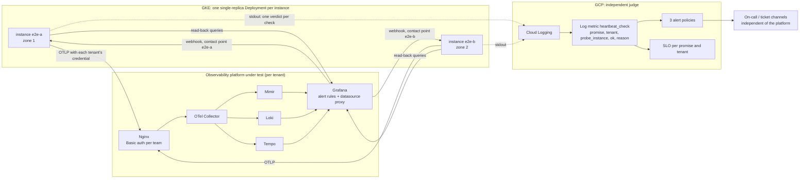
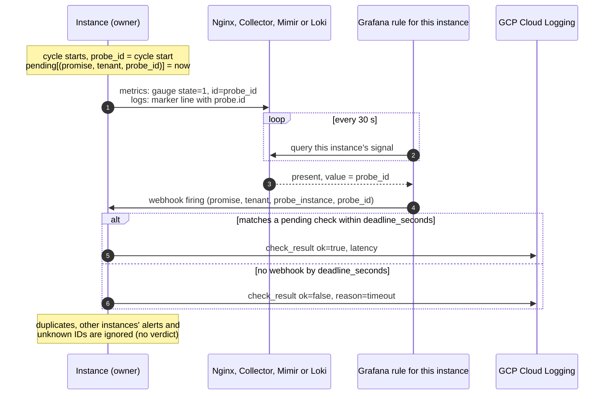
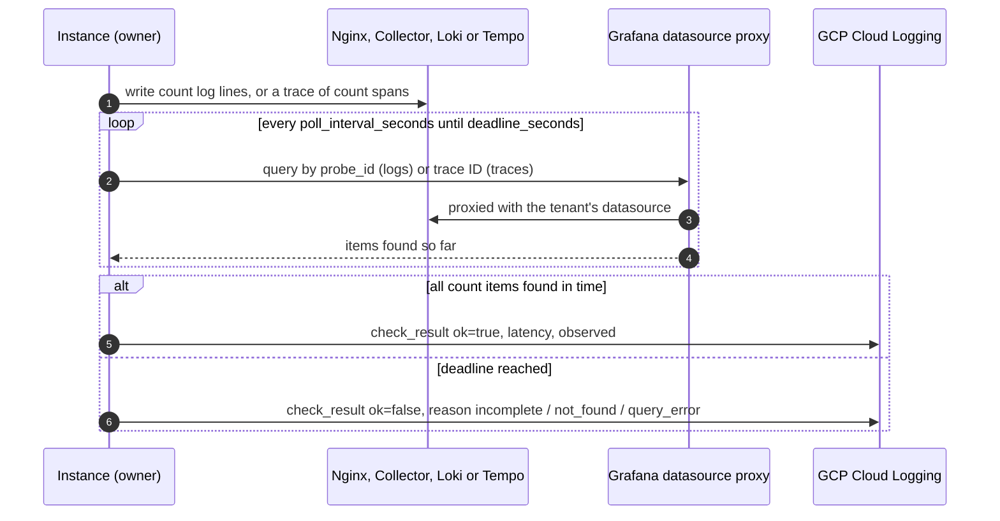
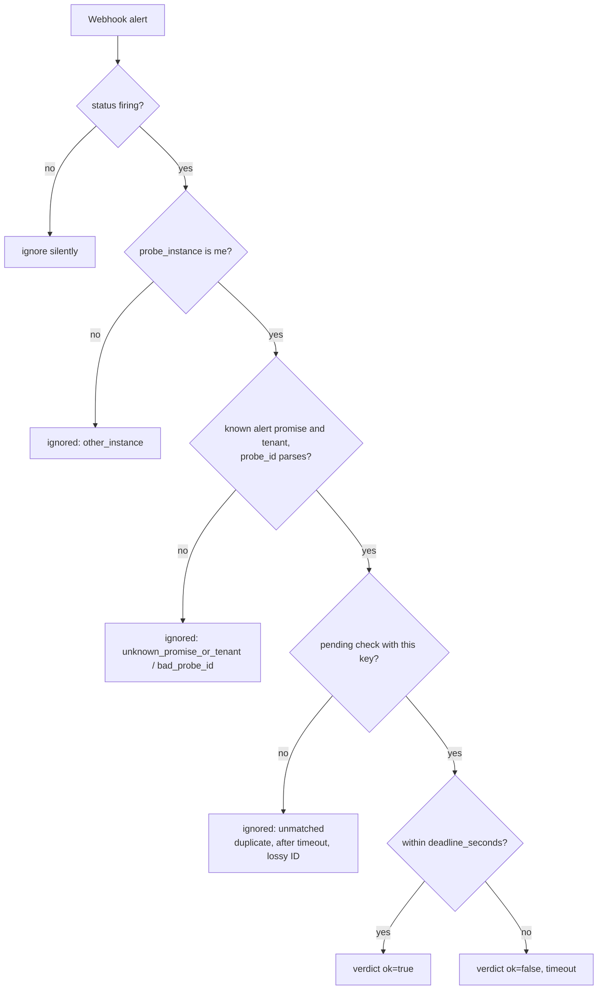
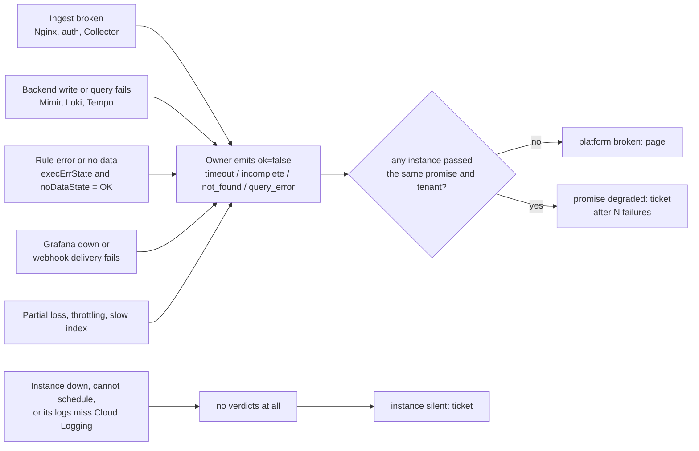
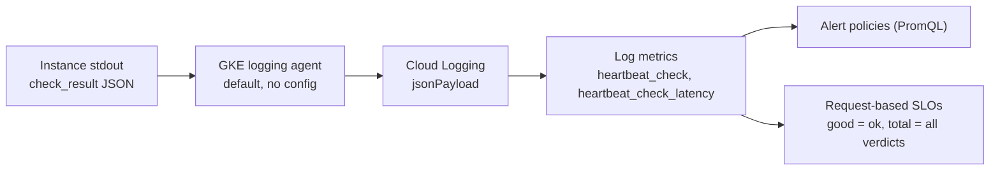

# heartbeat-probe: active probes for observability platform promises

An observability platform makes a few promises to the teams that use it: *my data is queryable, completely, within N seconds*, and *alerts built on my data reach me within N seconds*. heartbeat-probe checks those promises continuously, per tenant, through exactly the path real services use, and reports one verdict per check to an independent judge (GCP), which alerts on broken promises and keeps an SLO for each.

## Design principles

1. **One promise, one check.** Probes follow what users depend on, not components. `deadline_seconds` *is* the promise: a check passes only within it.
2. **Same path as real users.** Writes use each tenant's OTLP entry point and Basic auth credential; reads go through **Grafana's datasource proxy**.
3. **Complete, not just present.** Query checks write `count` items and pass only when all of them come back.
4. **The owner decides, once.** The instance that starts a check is the only one that can judge it, and it emits exactly one verdict. Duplicates, misrouted webhooks and restarts cannot change a count.
5. **Measurer faults are not platform faults.** A check interrupted by a restart or shutdown has no verdict (void). An instance with no verdicts at all is reported as *silent*, separately from *platform broken*.
6. **Judged from outside, configured once.** Verdicts go to GCP over a path that does not touch the platform. One YAML file drives the probes and generates the Grafana rules and every GCP object.

## Promises

| Promise | Signal | How it is checked |
|---|---|---|
| `metrics_alert` | metrics | Probe gauge → Mimir → Grafana rule → webhook to the owning instance |
| `logs_alert` | logs | Marker log → Loki → Grafana rule (LogQL `unwrap probe_id`) → webhook to the owning instance |
| `logs_query` | logs | Write `count` lines → read back via Grafana (Loki) until all are visible |
| `traces_query` | traces | Write a trace of `count` spans → read back by ID via Grafana (Tempo) |

## Architecture

Two or more **independent instances**, one Pod each, in different zones. They share nothing; each owns its checks and has its own webhook.



Every instance runs every enabled check for every tenant once per `period_seconds`. `probe_id` is the cycle start (epoch seconds). A process that starts mid-cycle waits for the next boundary.

### Alert check (`metrics_alert`, `logs_alert`)



### Query check (`logs_query`, `traces_query`)



### Webhook handling

The webhook is unauthenticated (cluster-internal). A notification can only *complete* a check this instance is waiting for; it can never create a verdict on its own.



### How failures surface



## Where verdicts are made

| Question | Who answers | How |
|---|---|---|
| Did this check pass? | The instance that started it | Webhook matched within the deadline, or all items read back within the deadline. Otherwise an explicit failure with a reason. Exactly one verdict per check. |
| Is the platform keeping the promise? | GCP Cloud Monitoring | Alert policies and SLOs over the `heartbeat_check` log metric. |

The self-observability metrics in Mimir travel the tested path and vanish when it breaks: use them for review, never for the verdict.

### How verdicts reach GCP

The probe has no GCP client. It prints one JSON line per verdict to stdout:



Because each check yields exactly one verdict, plain counting is exact: `passed / all verdicts` is the share of checks in which the platform kept the promise.

Consequences of this path:

- **Runs on GKE** (or anywhere whose stdout reaches Cloud Logging). On-premises would need another route, such as the Ops Agent.
- **Create the log metrics before deploying**: they only count entries ingested after they exist.
- **Expect a few minutes of delay** (ingestion plus metric extraction); alert windows default to 15 minutes.
- **Log exclusions or sinks that drop the container's logs** make instances look silent. That fails safe, but check exclusion filters before go-live.

### GCP alerts

| Policy | Severity / channel | Fires when |
|---|---|---|
| platform broken | CRITICAL / page | For a promise and tenant, at least one instance failed and **no instance passed** within `broken_window_seconds` |
| promise degraded | WARNING / ticket | At least `degraded_failures` failed checks for a promise and tenant within `degraded_window_seconds` |
| probe instance silent | WARNING / ticket | An instance produced no verdict within `silent_window_seconds` |

"No instance passed" keeps a single instance's own trouble (its node or zone) from paging, and still pages while one instance is down, since a missing instance cannot pass.

### Where to look

| What | Where |
|---|---|
| Promise attainment and error budget | Cloud Monitoring → Services → `heartbeat-probe` → one SLO per promise and tenant |
| Incidents | Cloud Monitoring → Alerting, policies prefixed `[heartbeat-probe]` |
| Why a check failed | Logs Explorer: `jsonPayload.event="check_result" AND jsonPayload.ok=false` |
| Ignored webhooks (routing, ID format) | Logs Explorer: `jsonPayload.event="webhook_ignored"` |
| Trends for review | Grafana, from the self-observability metrics |

## What this covers and what it does not

**Covers**

- Quantified platform reliability: an exact SLO per promise and tenant, usable for reporting, capacity requests and change freezes.
- Silent failures of the alerting path itself (Grafana down, rule errors, webhook delivery, expired credentials), detected from outside the platform.
- Blast radius: which tenants and promises an incident affected, from when and for how long.
- Before/after comparison for platform changes (sampling layer, scaling, upgrades).
- Freshness and completeness numbers: time to queryable logs, complete traces.

**Does not cover**

- **Prevention.** It detects impact, not causes; overload still needs quotas, isolation, sampling and per-service footprint visibility.
- **Root cause.** It names the broken promise and tenant, not the failing component.
- **Problems outside the probe's own data.** Probe traffic is tiny and well-formed: high-cardinality rejections, a single throttled stream, real traces dropped by sampling and low-rate partial loss can go unnoticed. Each instance usually reuses one connection, so it exercises few Collector replicas.
- **Teams' own alert rules and contact points.** It proves the platform can deliver an alert, not that each team's rule is correct.
- **Query performance under load.** Probe queries are small.
- **Derived metrics.** Recording rules are not yet a promise (a natural next one: "a written metric shows up in the recording-rule output within N minutes").

## Configuration

One YAML file; see [`config.example.yaml`](config.example.yaml). Secrets are referenced by environment variable name (`*_env` fields).

| Section | Key settings |
|---|---|
| `probe` | `service_name`, `period_seconds`, `export_interval_seconds`, `self_metrics_tenant` |
| `instances[]` | `name` (the identity a process takes from `$PROBE_INSTANCE`), `webhook_url` (that instance's Service) |
| `webhook` | `listen_port` (`$LISTEN_PORT` overrides); no authentication |
| `grafana` | `url`, `token_env`, `ca_file`, `alert_folder` |
| `tenants[]` | `name`, `otlp.endpoint`, `otlp.headers_env`, `datasources.{mimir,loki,tempo}` (Grafana datasource UIDs) |
| `promises.<name>` | `enabled`, `tenants`, `deadline_seconds`, `slo_target`, `slo_window_days`; alert: `firing_seconds`; query: `count`, `poll_interval_seconds`, `query` |
| `gcp` | `project_id`, `page_channel_id`, `ticket_channel_id`, `log_scope`, `alerting.{broken_window_seconds, degraded_failures, degraded_window_seconds, silent_window_seconds}` |

`query` templates use `${service_name}`, `${probe_id}`, `${instance}`, `${tenant}` and, for traces, `${trace_id}`. Defaults:

- `logs_query`: `{service_name="${service_name}"} | probe_check="logs_query" | probe_id="${probe_id}" | probe_instance="${instance}"`
- `traces_query`: `/api/traces/${trace_id}`

Start-up and `render.py` reject unknown promises or settings, an unlisted `$PROBE_INSTANCE`, missing datasources, `deadline_seconds > period_seconds`, `firing_seconds >= period_seconds`, targets outside (0, 1) and similar mistakes.

## Generated Grafana and GCP objects

```bash
python render.py render --config config.yaml --out build/                  # files only
python render.py apply  --config config.yaml --replace-policies --prune    # also create/update in GCP
```

| Output | Content |
|---|---|
| `build/grafana/contact-points.yaml` | One webhook contact point per instance (resolve messages off) |
| `build/grafana/alert-rules.yaml` | One rule per alert promise × tenant × instance, routed to that instance's contact point; `noDataState`/`execErrState` = OK |
| `build/gcp/log-metric-*.json` | `heartbeat_check` (labels promise, tenant, probe_instance, ok, reason) and `heartbeat_check_latency` |
| `build/gcp/policy-*.json` | The three PromQL policies above |
| `build/gcp/service.json`, `slo-*.json` | Custom service `heartbeat-probe` and one request-based SLO per promise × tenant |

`apply` uses the Cloud Logging and Cloud Monitoring REST APIs with `gcloud auth print-access-token` (or `$GCP_ACCESS_TOKEN`). Log metrics and SLOs are upserted. `--replace-policies` deletes policies whose name starts with `[heartbeat-probe` first; `--prune` deletes `heartbeat_*` log metrics and SLOs the config no longer produces.

## Outputs

### Verdict logs (stdout → Cloud Logging)

| Event | Fields |
|---|---|
| `check_result` | promise, signal, tenant, instance, probe_id, ok, reason, latency_seconds; query checks add expected, observed (and trace_id); timeouts add waited_seconds |
| `webhook_ignored` | reason (`other_instance`, `unknown_promise_or_tenant`, `bad_probe_id`, `unmatched`), label values |
| `cycle_started`, `waiting_for_next_cycle`, `started`, `stopped`, `config_error` | operational |

Failure `reason` values: `timeout`, `incomplete`, `not_found`, `query_error`, `emit_error`.

### Self-observability metrics (standard OTel SDK, to `self_metrics_tenant`)

| OTel metric | Type | Attributes |
|---|---|---|
| `heartbeat.probe.checks` | Counter | probe_instance, promise, tenant, ok, reason |
| `heartbeat.probe.checks.latency` | Histogram (s) | probe_instance, promise, tenant |
| `heartbeat.probe.webhook.ignored` | Counter | probe_instance, reason |
| `heartbeat.probe.webhook.rejected` | Counter | probe_instance, reason (malformed requests) |
| `heartbeat.probe.state`, `heartbeat.probe.id` | Gauge | probe_instance (every tenant with `metrics_alert`) |

Resource attributes: `service.name`, `service.instance.id` (instance), `probe.tenant`. The attribute is named `probe_instance` so it never collides with Prometheus' `instance` label.

```promql
# Pass ratio per promise and tenant over 1 day
sum by (promise, tenant) (increase(heartbeat_probe_checks_total{ok="true"}[1d]))
/ sum by (promise, tenant) (increase(heartbeat_probe_checks_total[1d]))

# Why checks fail
sum by (promise, reason, probe_instance) (increase(heartbeat_probe_checks_total{ok="false"}[1d]))
```

## Deployment

1. **Write `config.yaml`** from `config.example.yaml`, listing every instance and its Service URL.
2. **Render and review** `python render.py render --config config.yaml`, then put `build/grafana/*.yaml` into Grafana's provisioning/alerting directory.
3. **Create GCP objects** `python render.py apply --config config.yaml --replace-policies --prune`, **before** step 4: log metrics do not count entries from before they existed. Channels must not depend on the platform being tested.
4. **Build and deploy** `docker build -t REGISTRY/heartbeat-probe:3.0.0 .`, put the same config into the ConfigMap in `k8s/deployment.yaml`, fill the Secret, `kubectl apply -f k8s/`.
   - One single-replica Deployment per instance, `strategy: Recreate`, so two processes never own the same identity.
   - Required pod anti-affinity on `topology.kubernetes.io/zone`. With three zones, an instance in a failed zone reschedules into the free one (after the usual ~5 minute eviction delay).
   - One Service per instance; Grafana must reach them, and the probes must reach Grafana.
   - stdout must reach Cloud Logging directly, never through your OTel/Loki pipeline.
   - Optional: the webhook has no authentication. If other workloads share the cluster, enable the NetworkPolicy at the end of the manifest so only Grafana can reach it.

### Migrating from 2.x

Identity moved from replica (`REPLICA_ID`) to instance (`PROBE_INSTANCE`); the StatefulSet becomes one Deployment per instance; the webhook token is gone; the log metrics, policies and SLOs are replaced. Run `apply --replace-policies --prune` to remove the 2.x GCP objects, re-provision Grafana (delete the old `heartbeat-e2e` rule group and contact point), then deploy.

## Pre-launch checklist

- **GCP objects in a test project first.** In particular, confirm that Cloud Monitoring PromQL accepts the log metric as `logging_googleapis_com:user_heartbeat_check` with `increase()` and `absent_over_time()`. If not, the three conditions can be rewritten as filter-based conditions with the same logic.
- **Log exclusions**: no exclusion filter or sink drops the `heartbeat-probe` container logs.
- **Names after translation**: gauges should be `heartbeat_probe_state` / `heartbeat_probe_id` with label `probe_instance`. Loki should expose OTel log attributes as structured metadata `probe_check`, `probe_id`, `probe_instance`; adjust `query` templates and re-render if yours differ.
- **Trace sampling**: once tail sampling is in place, always keep `service.name = heartbeat-probe`, otherwise `traces_query` fails by design.
- **`$values.<ref>.Value`** renders in the annotation preview of each generated rule. Keep `printf "%.0f"`: default formatting (`1.76054e+09`) loses digits, and the check then times out with `webhook_ignored reason=unmatched`.
- **Per-rule `notification_settings`** must be supported by your Grafana version. Otherwise route by `probe_instance` in the notification policy tree to the instance's contact point.
- **`deadline_seconds` ≥ rule interval (30 s) + Grafana delivery + export interval** for alert promises.
- **Grafana token**: service account with Viewer on the probe datasources only.
- **At least two zones with schedulable nodes**, otherwise the second instance stays Pending.

## Operations

- **Restarts and deploys** never count against the platform: the interrupted cycle is void, measuring resumes at the next boundary.
- **Adding an instance**: add it to `instances`, add its Deployment and Service, re-render Grafana, re-run `apply`. Removing one: the reverse, plus `--prune`; expect one *silent* ticket for it until the policy is replaced.
- **Adding a tenant or promise**: edit the config, re-render Grafana, `apply --replace-policies --prune`, roll the instances.

## Post-launch drills

1. Delete one instance's Pod → no alert (it resumes at the next cycle). Keep it unschedulable for 15 min → *probe instance silent* only.
2. Pause one instance's generated rule → that instance times out → *promise degraded* after N failures, no page (the other instance still passes).
3. Revoke a tenant's OTLP credential → every promise of that tenant fails on both instances → *platform broken* pages; other tenants stay green.
4. Drop `heartbeat-probe` logs in the Collector → `logs_query` and `logs_alert` break; metrics and traces stay green.
5. Record time-to-alert for each drill as the baseline.

## Local tests

```bash
pip install -r requirements.txt pytest
python -m pytest -q tests
```

- `test_checks.py`: owner verdicts, including the four accuracy scenarios (normal, duplicate webhook, duplicate hiding a failure, restart mid-cycle), webhook filtering, timeouts, query polling with a fake clock, shutdown voiding.
- `test_config.py`: validation, identity and secret handling.
- `test_integration.py`: two instances × two tenants against a fake OTLP endpoint (decodes metrics, logs and traces protobuf, separates tenants by Basic auth) and a fake Grafana proxy answering Loki and Tempo reads from what was ingested. The test plays Grafana alerting, sends each notification to its owner plus a duplicate and a misrouted copy, and asserts exactly one verdict per check.
- `test_render.py`: generated Grafana and GCP objects, and `apply` (upsert, prune, replace) against a fake GCP API.
