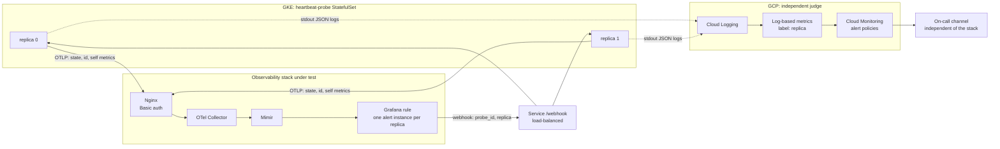
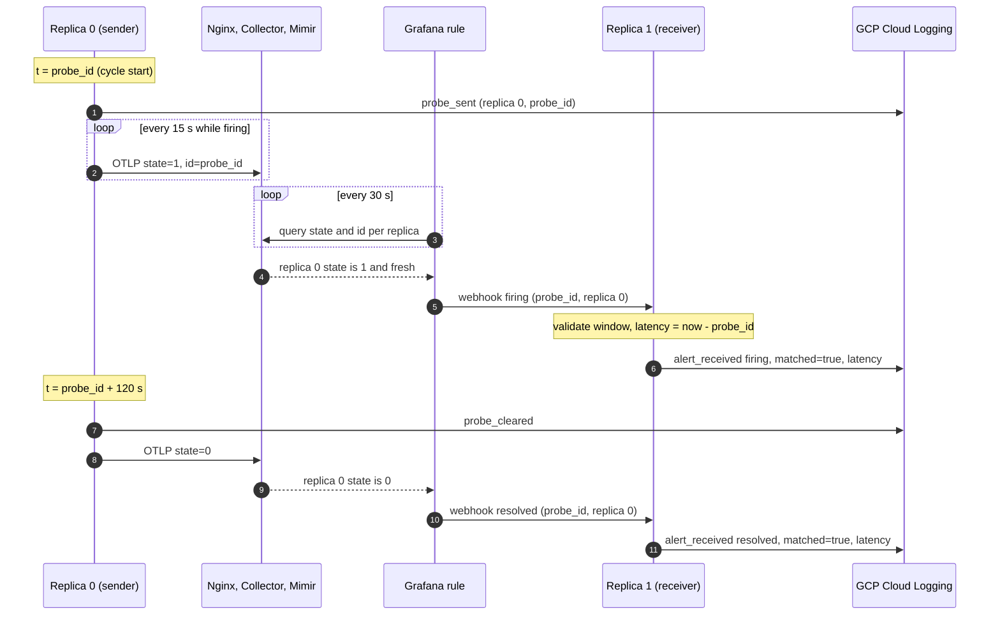
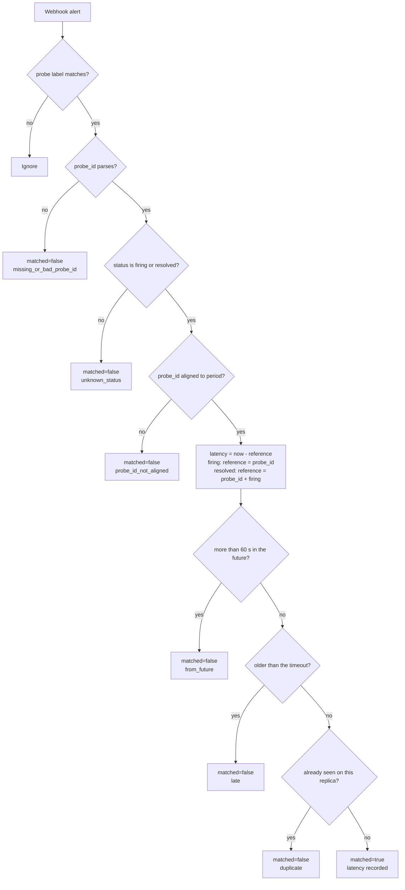
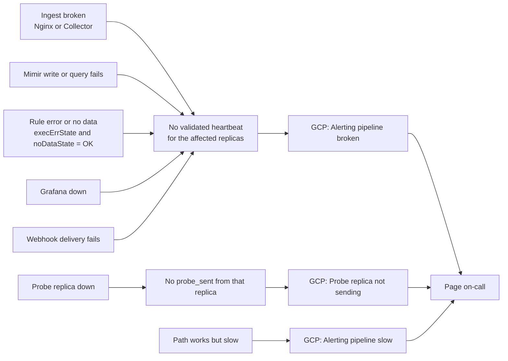

# heartbeat-probe: end-to-end alerting pipeline probe

Continuously verifies that the whole path "metric ingest → Nginx → OTel Collector → Mimir → Grafana rule evaluation → webhook notification" works, and raises alerts on GCP when the path breaks, when the probe itself stops, or when it gets slow. Runs with multiple replicas.



## How it works

| Time (defaults) | What happens |
|---|---|
| Every 300 s | Each replica starts a new probe; `probe_id` = cycle start (epoch seconds, aligned to the period) |
| First 120 s | `heartbeat_probe_state{replica}=1`; Grafana fires for that replica and the webhook echoes `probe_id` |
| Remaining 180 s | `heartbeat_probe_state{replica}=0`; the alert resolves and the webhook sends `resolved` |

One probe cycle, with the notification landing on a different replica than the sender:



### Multiple replicas: stateless pairing

The webhook goes through a Service and can land on any replica, so pairing does not rely on in-process memory:

- `probe_id` *is* the probe start time, so the receiver computes end-to-end latency as `now − probe_id`.
- Validation: `probe_id` must be aligned to the period and inside the timeout window (not too old, not from the future). Anything else is logged as `matched=false` with a reason.
- `replica` in the log is the replica that **sent** the probe (taken from the alert labels); `received_by` is the replica that actually received the webhook.
- Timeouts are not detected by the service itself. GCP detects them per replica as "no validated heartbeat for a while".

How a received notification is validated (every outcome is logged and counted in `heartbeat.probe.notifications`):



### Log events (`jsonPayload.event`)

| Event | Meaning |
|---|---|
| `probe_sent` | Replica entered the firing phase (`replica` = itself) |
| `probe_cleared` | Replica entered the resolve phase |
| `alert_received` | Webhook received; fields `status`, `matched`, `latency_seconds`, `reason`, `replica`, `received_by` |
| `webhook_unauthorized` | Webhook authentication failed |

`reason` values: `late` (arrived after the timeout), `from_future`, `probe_id_not_aligned` (ID lost precision in formatting), `missing_or_bad_probe_id`, `unknown_status`, `duplicate` (the same replica received a repeat notification; best effort only).

### Self-observability metrics (standard OTel SDK)

The probe exports its own operational metrics over the same OTLP endpoint so you can review how it is doing in Grafana. Resource attributes include `service.name=heartbeat-probe` and `service.instance.id=<replica name>`.

| OTel metric | Type | Attributes | Name in Mimir (default translation) |
|---|---|---|---|
| `heartbeat.probe.sent` | Counter | probe, replica | `heartbeat_probe_sent_total` |
| `heartbeat.probe.notifications` | Counter | probe, replica (sender), received_by, status, matched, reason | `heartbeat_probe_notifications_total` |
| `heartbeat.probe.latency` | Histogram (seconds) | probe, replica, status | `heartbeat_probe_latency_seconds_bucket`, etc. |
| `heartbeat.probe.webhook.rejected` | Counter | probe, received_by, reason | `heartbeat_probe_webhook_rejected_total` |

Example queries (adjust names to what your Mimir translation actually produces):

```promql
# Validated heartbeats per replica per hour (expect about 3600/300 = 12)
sum by (replica) (increase(heartbeat_probe_notifications_total{matched="true", status="firing"}[1h]))

# End-to-end latency p95
histogram_quantile(0.95, sum by (le, replica) (rate(heartbeat_probe_latency_seconds_bucket{status="firing"}[1h])))

# Why pairing failed
sum by (reason) (increase(heartbeat_probe_notifications_total{matched="false"}[1d]))
```

These metrics travel through the very path being tested. **Use them for review and analysis only, not to decide whether the path is broken**: when the path breaks they disappear too. That decision is made on GCP.

### GCP alerts (created by `gcp/setup.sh`, each fires per replica)

| Alert | Condition | What it catches |
|---|---|---|
| Alerting pipeline broken | No validated heartbeat for a replica within 15 min | That replica's path is broken; all replicas at once = the whole path is broken (including Grafana being down) |
| Probe replica not sending | No `probe_sent` from a replica within 15 min | The probe replica itself is down |
| Alerting pipeline slow | End-to-end latency p95 > 180 s | The path works but is badly degraded |

How failures surface. The design rule is that every failure turns into *silence*, and GCP alerts on silence:



## Deployment

1. **Build the image**: `docker build -t REGISTRY/heartbeat-probe:1.1.0 .`
2. **Deploy to GKE**: set the OTLP endpoint, team credential and webhook token in `k8s/deployment.yaml`, then `kubectl apply -f k8s/`.
   - Uses a **StatefulSet**: replica names are stable (`heartbeat-probe-0`, `-1`), so Mimir series and the per-replica GCP alerts survive restarts.
   - Logs go to stdout and GKE ships them to Cloud Logging. **They must not go through your own OTel/Loki pipeline.**
   - Make the `heartbeat-probe` Service's `/webhook` reachable from the Grafana alerting instances (internal load balancer or Ingress).
3. **Grafana**: put `grafana/*.yaml` into the provisioning/alerting directory.
   - Replace `MIMIR_DATASOURCE_UID` with the datasource for the probe's tenant.
   - Set the `HEARTBEAT_WEBHOOK_TOKEN` environment variable on Grafana.
4. **GCP**: `PROJECT_ID=... CHANNEL_ID=... ./gcp/setup.sh`. The notification channel must be independent of the system being monitored.

## Pre-launch checklist

- **Metric names in Mimir**: OTel `heartbeat.probe.state` / `heartbeat.probe.id` translate to `heartbeat_probe_state` / `heartbeat_probe_id` by default. If your translation adds suffixes, update the queries in `alert-rule.yaml`.
- **`$values.B.Value` resolves**: preview the annotation in the Grafana rule editor and confirm each replica's alert instance gets its own ID. If it does not, add a Reduce expression D (last of B) and use `$values.D.Value`.
- **Keep `printf "%.0f"`**: default formatting renders `1.76054e+09`, which loses precision and is rejected as `probe_id_not_aligned` (never counted as success).
- **`notification_settings`** requires a Grafana version with per-rule notification settings. Otherwise remove that block and add a child policy in the UI: match `probe=e2e`, send to `heartbeat-probe-webhook`, group_by including `replica`, group_wait 0s, group_interval 30s.
- **`noDataState` / `execErrState` must be OK**: any failure must show up as *no notification*, so GCP detects the gap, rather than as a fake notification.
- **Replica clocks must be in sync** (NTP): pairing uses a time window with 60 s tolerance.

## Operations

- **Scaling down raises an alert**: the removed replica's heartbeat disappears and GCP fires one "broken" alert for it. This is expected; snooze it before scaling down. Scaling up is fine.
- **Duplicate notifications**: if Grafana's cross-instance de-duplication fails, several replicas may each receive the same notification. Counts on GCP will be higher, but they are only used to check presence, so alerting is unaffected.

## Post-launch drills

1. Delete one replica's Pod → expect no alert (the StatefulSet recreates it with the same name); if it does not come back, expect *Probe replica not sending*.
2. Pause the rule in Grafana → expect *Alerting pipeline broken* for every replica.
3. Temporarily drop `heartbeat_probe_*` in the Collector → same as above.
4. Record the time from each failure to the GCP alert as the baseline for the alerting path.

## Local tests

```bash
pip install -r requirements.txt pytest
python -m pytest -q tests
```

The integration test starts two replicas and a fake OTLP receiver (decoding protobuf), delivers replica 0's notification to replica 1, and checks cross-replica pairing, the `replica` attribute, self-observability metrics, the credential header and authentication.
