# Grafana dashboards

Panel-by-panel reference for the two dashboards in [`../grafana/`](../grafana/). Queries are copied from the JSON; if you change a panel, change it here too.

| Dashboard | File | uid | Data source | Tag |
|---|---|---|---|---|
| Red Hat host · Metrics | [`redhat-host-metrics.json`](../grafana/redhat-host-metrics.json) | `redhat-host` | Mimir (Prometheus type) | `redhat-host` |
| Red Hat host · Logs | [`redhat-host-logs.json`](../grafana/redhat-host-logs.json) | `redhat-host-logs` | Mimir (host info table) + Loki (log panels) | `redhat-host` |

> **Screenshots**: captured 2026-11-02 from the lab Grafana (`http://localhost:3000`) against Mimir and Loki with `X-Scope-OrgID: redhat`, host `lima-otel-cs9` (the `otel-cs9` lab VM). The full-page metrics shot is a populated dashboard over roughly the last 3 hours; the single-panel shots are `viewPanel` captures over the last 6 hours. They show lab data (including a synthetic `payments-api` workload and its JSON logs), not production; values and series differ per host.

Both dashboards refresh every 30 s and default to the last hour.

## How to read this page

- Metric names are shown as Mimir stores them with its default OTLP translation (no unit/type suffixes): `system.cpu.time` → `system_cpu_time`. If your backend adds suffixes (`_seconds_total`), the queries need them too (see the README, "Grafana dashboards").
- Every host agent puts the host attributes on every data point as labels (`instance`, `deployment_environment_name`, `team`, `business_line`, `role`, `region`), so no `target_info` join and no Mimir attribute promotion is needed.
- `$job`, `$host` etc. are template variables, explained next.

## Filters and variables

Both dashboards share the same seven host variables; the logs dashboard adds three log filters. Both carry a dashboard link on the tag `redhat-host` (with `includeVars` and `keepTime`), shown as the "Red Hat host" link at the top: switching between the metrics and the logs dashboard keeps the time range and every filter whose name exists on both.

| Variable | Label | Type | Selection | Query | Narrowed by |
|---|---|---|---|---|---|
| `job` | Job | query | single | `label_values(system_cpu_time, job)` | nothing |
| `env` | Environment | query | multi, All | `label_values(system_cpu_logical_count{job="$job"}, deployment_environment_name)` | `job` |
| `team` | Team | query | multi, All | `label_values(system_cpu_logical_count{job="$job",deployment_environment_name=~"$env"}, team)` | `job`, `env` |
| `business_line` | Business line | query | multi, All | `label_values(system_cpu_logical_count{job="$job",deployment_environment_name=~"$env",team=~"$team"}, business_line)` | `job`, `env`, `team` |
| `role` | Role | query | multi, All | `label_values(system_cpu_logical_count{job="$job",deployment_environment_name=~"$env",team=~"$team",business_line=~"$business_line"}, role)` | up to `business_line` |
| `region` | Region | query | multi, All | `label_values(system_cpu_logical_count{job="$job",deployment_environment_name=~"$env",team=~"$team",business_line=~"$business_line",role=~"$role"}, region)` | up to `role` |
| `host` | Host | query | **single** | `label_values(system_cpu_logical_count{job="$job",deployment_environment_name=~"$env",team=~"$team",business_line=~"$business_line",role=~"$role",region=~"$region"}, instance)` | all of the above |

How they work:

- **Cascading**: each variable's query is restricted by the variables above it, so the Host list only contains hosts that match the chosen environment / team / business line / role / region. Variables refresh when the time range changes, so a host that stopped reporting drops out of the list after the range moves past it.
- **Why `system_cpu_logical_count`**: it is one series per host and carries all host labels, so it is a cheap "inventory" series. Every host that reports host metrics appears there.
- **`job`** is the agent's `service.name` (`SERVICE_NAME`, default `redhat-host`). It keeps the dashboards from mixing in other sources of the same metric names. It is a single-select, so one job at a time.
- **`host`** is the `instance` label (= `service.instance.id` = host name). It is single-select and has no "All": every panel shows exactly one host. Multi-select filters above it only narrow the list.
- **Multi-select = regex match**: `=~"$env"` with several selected values becomes an alternation. "All" has a custom value of `.*` (the variables' `allValue`), which also matches series that lack that label, so hosts installed without e.g. `team` still show up under All.

Logs dashboard only:

| Variable | Label | Type | Default | Meaning |
|---|---|---|---|---|
| `level` | Level | custom | `.*` | Dropdown: `.*` (all), `fatal\|error`, `warn`, `info`, `unknown`. The value is used as a regex on `detected_level` (`fatal\|error` is an alternation, shows both). |
| `unit` | systemd unit (regex) | textbox | `.*` | Regex on the structured metadata `systemd_unit` (e.g. `sshd\.service` or `(sshd\|chronyd)\.service`). |
| `search` | Search (regex) | textbox | empty | Regex line filter on the log body (`\|~ "$search"`); empty matches every line. |

The three log filters are LogQL regexes (Go RE2, unanchored). They only apply to the two log panels, not to Host info.

## Metrics dashboard (`redhat-host`)

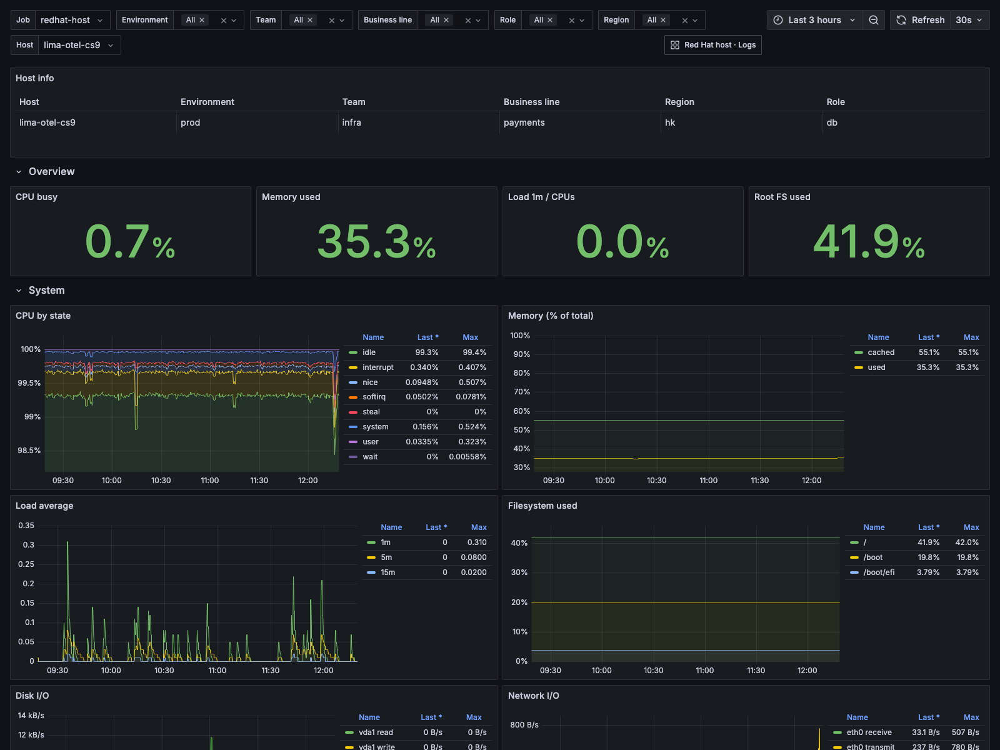

*Whole dashboard, lab Grafana, host `lima-otel-cs9`, last ~3 h, captured 2026-11-02. The capture ends at the Disk I/O / Network I/O row; the Processes row is shown in its two panel screenshots below.*

Layout: Host info table, an **Overview** row of four stat panels, a **System** row of six time series, and a **Processes** row of two time series. The time series show a legend table (last value and max) on the right and a shared tooltip across series.

### Host info (panel 100, table)

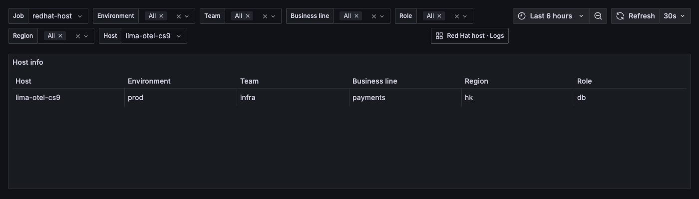

- **Meaning**: which host you are looking at: host name and its labels Environment, Team, Business line, Role, Region (columns renamed from the label names; `Time` and `Value` hidden).
- **Watch for**: an empty table means no host matches the filters or the host stopped reporting more than two minutes ago. Check that the labels are what you expect: a wrong `role` or `region` means the profile used at install time is wrong.
- **Query** (instant):

  ```promql
  max by (instance, deployment_environment_name, team, business_line, role, region) (last_over_time(system_cpu_logical_count{job="$job",instance="$host"}[2m]))
  ```

- **Intent**: take the latest `system_cpu_logical_count` of the selected host within 2 minutes (the value itself is the CPU count and is hidden) and keep only its label set, to render the labels as a table row.
- **Note**: the column order in the panel's `organize` transformation gives both `role` and `region` index 5; Grafana then orders those two columns by itself.

### Overview row

The four stats show the **last non-null value** in the selected range, colour the value (not the background), and use the same thresholds: green below 70 %, orange from 70 %, red from 90 %. All four are instant queries.

#### CPU busy (panel 2, stat)

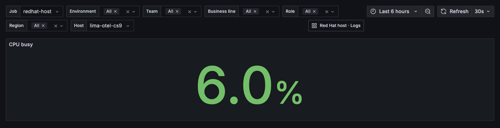

- **Meaning**: share of all CPU time that was not idle over the last 2 minutes, across all cores.
- **Watch for**: sustained values above 70 % (orange) or 90 % (red). Short peaks are normal; compare with Load 1m / CPUs and the "CPU by state" panel to see whether it is user, system or iowait.
- **Query**:

  ```promql
  1 - sum(rate(system_cpu_time{job="$job",instance="$host",state="idle"}[2m])) / sum(rate(system_cpu_time{job="$job",instance="$host"}[2m]))
  ```

- **Intent**: `system_cpu_time` is a counter of CPU seconds per core and state. The rate of the `idle` state divided by the rate of all states is the idle fraction; one minus that is the busy fraction. Summing removes the per-core label. Unit: percent (0-1).

#### Memory used (panel 3, stat)

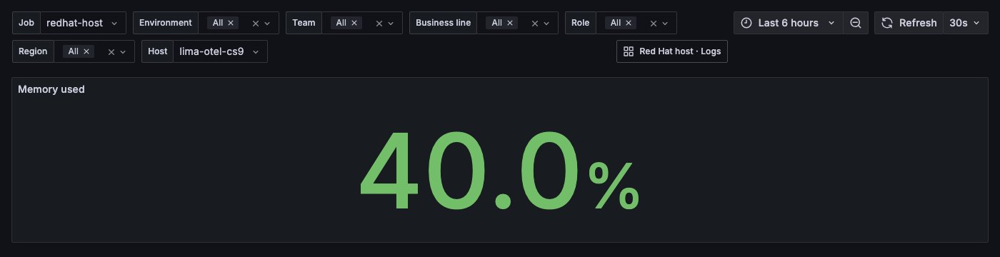

- **Meaning**: fraction of memory in the `used` state.
- **Watch for**: above 90 %, or a steady climb (leak). On Linux `used` excludes page cache and buffers, so a high `cached` share is not a problem.
- **Query**:

  ```promql
  sum(system_memory_utilization{job="$job",instance="$host",state="used"})
  ```

- **Intent**: the agent enables `system.memory.utilization`, a gauge per state that is already a 0-1 fraction of total memory, so no division is needed. `sum` drops the other labels. Unit: percent (0-1).

#### Load 1m / CPUs (panel 4, stat)

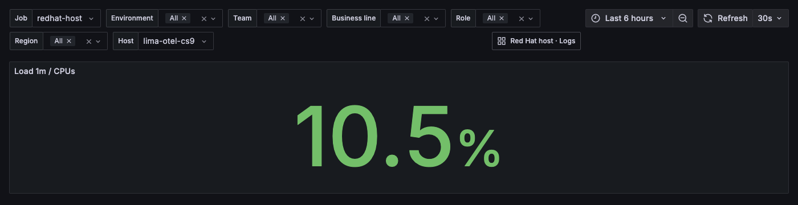

- **Meaning**: 1-minute load average per logical CPU. 100 % means as many runnable tasks as CPUs.
- **Watch for**: above 100 % means tasks are queueing for CPU (or blocked on I/O, since Linux load includes uninterruptible sleep). Orange from 70 %, red from 90 %.
- **Query**:

  ```promql
  sum(system_cpu_load_average_1m{job="$job",instance="$host"}) / sum(system_cpu_logical_count{job="$job",instance="$host"})
  ```

- **Intent**: normalise the load by CPU count so one threshold works for hosts of different sizes. Unit: percent (0-1), so a load of 2 on 4 CPUs shows as 50 %.

#### Root FS used (panel 5, stat)

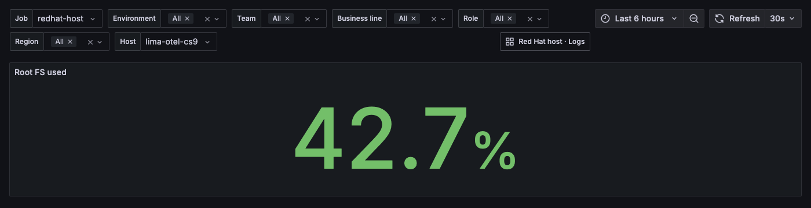

- **Meaning**: used fraction of the filesystem mounted on `/`.
- **Watch for**: above 90 %. A full root filesystem breaks logging, package installs and often the applications.
- **Query**:

  ```promql
  sum(system_filesystem_usage{job="$job",instance="$host",mountpoint="/",state="used"}) / sum(system_filesystem_usage{job="$job",instance="$host",mountpoint="/"})
  ```

- **Intent**: `system_filesystem_usage` is bytes per state (`used`, `free`, `reserved`). Used divided by the sum of all states gives the share of the total, including blocks reserved for root. It can therefore differ slightly from `df`'s Use%. Only `mountpoint="/"` is selected; other mounts are in "Filesystem used".

### System row

All six panels are time series with a legend table (last, max) on the right.

#### CPU by state (panel 7)

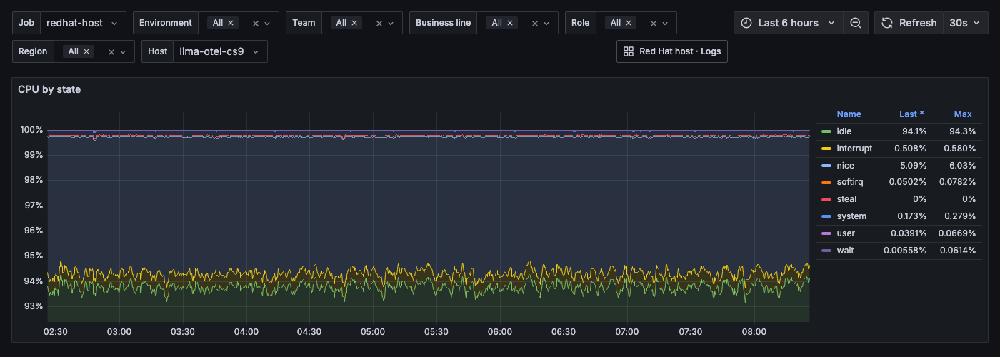

- **Meaning**: how the CPU time is split between states (`user`, `system`, `idle`, `iowait`, `nice`, `steal`, `softirq`, `interrupt`), as shares of total. **Stacked** (mode `normal`), so the stack always adds up to 100 %.
- **Watch for**: high `iowait` (storage bottleneck), high `system` (kernel, network or syscalls), any `steal` (noisy neighbour on a VM), `user` dominated (application work).
- **Query** (legend `{{state}}`):

  ```promql
  sum by (state) (rate(system_cpu_time{job="$job",instance="$host"}[2m])) / scalar(sum(rate(system_cpu_time{job="$job",instance="$host"}[2m])))
  ```

- **Intent**: per-state CPU-seconds per second, summed over cores, divided by the total over all states (`scalar(...)` turns the total into a single number so it can divide every series). Unit: percent (0-1).

#### Memory (% of total) (panel 8)

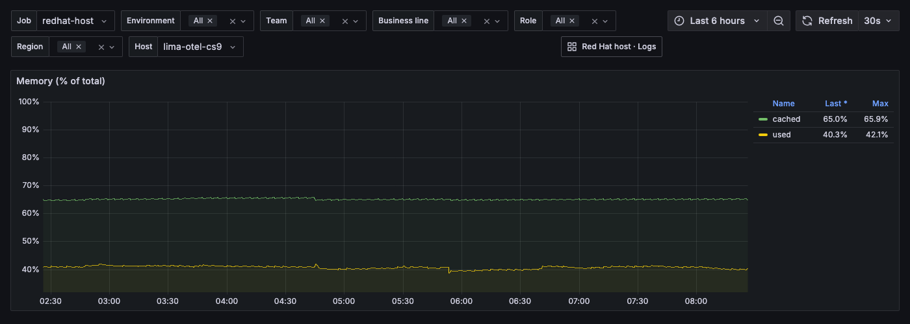

- **Meaning**: the `used` and `cached` states as a fraction of total memory, not stacked, axis capped at 100 %.
- **Watch for**: `used` rising towards 100 % with `cached` shrinking (the kernel is dropping cache under pressure). Other states (`free`, `buffered`, `slab_*`) are not drawn.
- **Query** (legend `{{state}}`):

  ```promql
  sum by (state) (system_memory_utilization{job="$job",instance="$host",state=~"used|cached"})
  ```

- **Intent**: the gauge is already a fraction; select the two states that matter and sum away other labels.

#### Load average (panel 9)

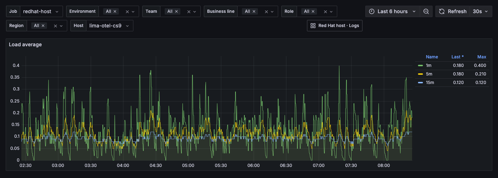

- **Meaning**: the raw 1, 5 and 15 minute load averages (three series, legends `1m`, `5m`, `15m`), not divided by CPU count.
- **Watch for**: compare with the CPU count in Host info or "Load 1m / CPUs". 1m above 5m above 15m means load is rising; the reverse means it is recovering.
- **Queries**:

  ```promql
  sum(system_cpu_load_average_1m{job="$job",instance="$host"})
  sum(system_cpu_load_average_5m{job="$job",instance="$host"})
  sum(system_cpu_load_average_15m{job="$job",instance="$host"})
  ```

- **Intent**: plot the three gauges as they are; `sum` only drops labels. Unit: plain number.

#### Filesystem used (panel 10)

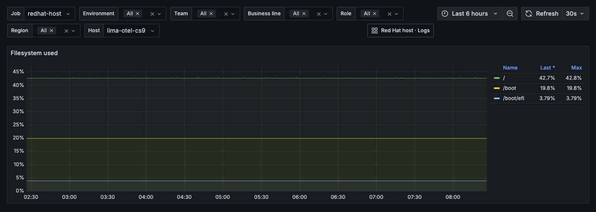

- **Meaning**: used fraction of every mounted real filesystem, one series per mount point.
- **Watch for**: any mount approaching 100 %, or a fast rise (runaway log or data growth). A mount that disappears from the legend was unmounted or excluded.
- **Query** (legend `{{mountpoint}}`):

  ```promql
  sum by (mountpoint) (system_filesystem_usage{job="$job",instance="$host",state="used"}) / sum by (mountpoint) (system_filesystem_usage{job="$job",instance="$host"})
  ```

- **Intent**: the same used-over-total as "Root FS used", for all mount points. The agent already excludes pseudo filesystems (`tmpfs`, `overlay`, `proc`, ...) and mounts under `/dev`, `/proc`, `/sys`, `/run` and container storage, so only real filesystems appear (README, "Cardinality guards"). Unit: percent (0-1).

#### Disk I/O (panel 11)

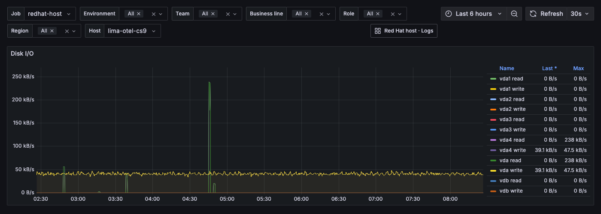

- **Meaning**: bytes per second read from and written to each block device, one series per device and direction (`read`, `write`).
- **Watch for**: sustained writes or reads that match a performance complaint; combine with `iowait` in "CPU by state". Loop, RAM, zram, sr and fd devices are excluded by the agent.
- **Query** (legend `{{device}} {{direction}}`):

  ```promql
  sum by (device, direction) (rate(system_disk_io{job="$job",instance="$host"}[2m]))
  ```

- **Intent**: `system_disk_io` is a byte counter; its 2-minute rate is throughput. Unit: bytes/s.

#### Network I/O (panel 12)

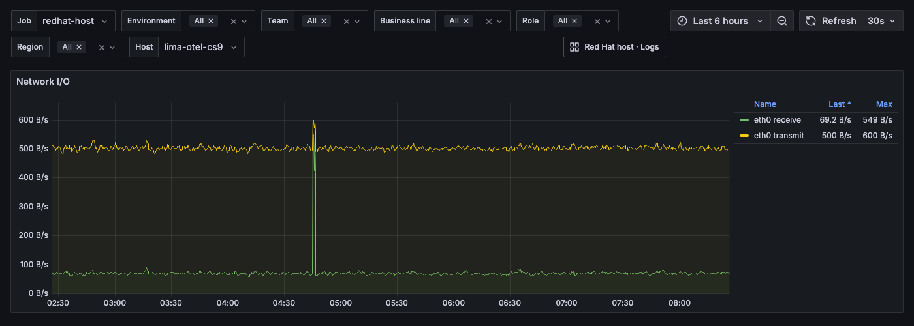

- **Meaning**: bytes per second received and transmitted per network interface (`receive`, `transmit`).
- **Watch for**: saturation of the link, an interface that suddenly goes to zero, or asymmetric traffic that is unexpected for the role. Loopback and container/VM interfaces (`veth*`, `docker*`, `br-*`, `cni*`, ...) are excluded by the agent.
- **Query** (legend `{{device}} {{direction}}`):

  ```promql
  sum by (device, direction) (rate(system_network_io{job="$job",instance="$host"}[2m]))
  ```

- **Intent**: `system_network_io` is a byte counter; its 2-minute rate is throughput. Unit: bytes/s.

### Processes row (`PROCESS_ALLOW_REGEX`)

The row title in the JSON now reads **Processes (PROCESS_ALLOW_REGEX)**. These two panels show per-process data, but only for processes that pass the agent's export-time filter:

- The agent scrapes all non-kernel processes and `filter/process_allow` keeps only those whose executable name matches `PROCESS_ALLOW_REGEX` (for example `^(sshd|chronyd|mysqld)$`); the optional `PROCESS_EXCLUDE_REGEX` then drops names from that set. `.*` shows every non-kernel process. Kernel threads are always excluded at scrape time. See the README, "Per-process metrics".
- **Both panels are empty** when the host has per-process metrics off (neither `PROCESS_ALLOW_REGEX` nor the legacy `PROCESS_NAMES` set), or when nothing running matches the regex.
- The legend is the executable name (label `process_executable_name`). Same-name processes of one owner are **summed** by the agent (one series per name and owner), and `process.pid` is not exported unless `KEEP_PROCESS_PIDS=true`. The panels sum over `process_owner` too, so one line per name.
- With a broad regex the legend grows quickly; narrow the regex in the profile (re-run the installer) rather than filtering in Grafana.

#### Process CPU (cores) (panel 14)

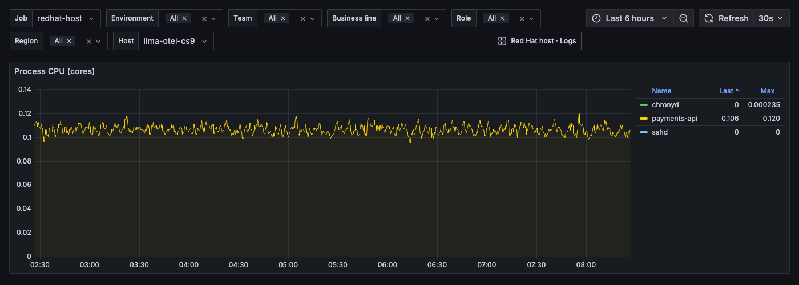

- **Meaning**: CPU used by each allowed process name, in cores (1 = one core fully busy).
- **Watch for**: one name dominating the host CPU, or a process that should be busy and sits at 0. Because the per-name value is a sum of counters, it **drops when one of several same-name processes exits**, and `rate()` treats a drop as a counter reset, which can show a short spike or gap.
- **Query** (legend `{{process_executable_name}}`):

  ```promql
  sum by (process_executable_name) (rate(process_cpu_time{job="$job",instance="$host"}[2m]))
  ```

- **Intent**: `process_cpu_time` counts CPU seconds (all states summed); its rate is seconds per second, i.e. cores. Summing by executable name collapses owners. Unit: plain number (cores).

#### Process memory (RSS) (panel 15)

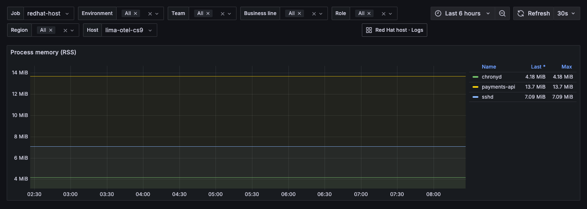

- **Meaning**: resident memory (RSS) of each allowed process name, summed over its processes.
- **Watch for**: a steady climb of one name (leak), a sudden drop (restart or OOM kill), or a name that vanishes.
- **Query** (legend `{{process_executable_name}}`):

  ```promql
  sum by (process_executable_name) (process_memory_usage{job="$job",instance="$host"})
  ```

- **Intent**: `process_memory_usage` is a gauge in bytes of resident memory; sum by name matches the agent's one-series-per-name model. Unit: bytes. Shared pages are counted once per process, so the sum for a multi-process service over-counts shared memory. `process.memory.virtual` is exported but not drawn here.

## Logs dashboard (`redhat-host-logs`)

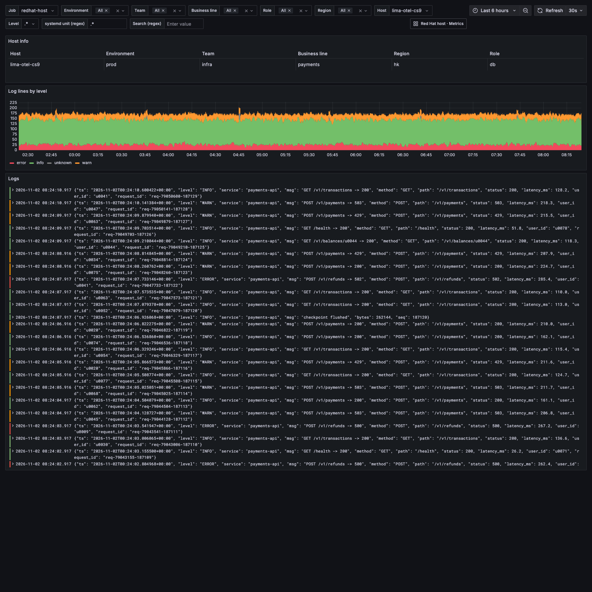

*Whole dashboard, lab Grafana, host `lima-otel-cs9`, last 6 h, captured 2026-11-02.*

Layout: Host info, a volume-by-level time series, and the log stream. The host variables work as described above; Level, systemd unit and Search narrow both log panels.

### How logs are selected (LogQL)

Both panels use the same selector and pipeline:

```logql
{service_name=~".+"} | service_instance_id="$host" | detected_level=~"$level" | systemd_unit=~"$unit" |~ "$search"
```

- `{service_name=~".+"}` is the only **index label** used: any stream with a service name. It is deliberately broad because the host is not an index label in Loki.
- `service_instance_id`, `detected_level` and `systemd_unit` are **structured metadata** (not index labels), so they are filtered in the pipeline after the selector. `service_instance_id="$host"` picks the host chosen in the Host variable.
- `|~ "$search"` is a regex line filter on the log body; with the default empty value it matches every line.
- Because only `service_name` is indexed, queries scan all streams in the range for the tenant before filtering. Keep the time range narrow on busy tenants.

### Host info (panel 100, table)

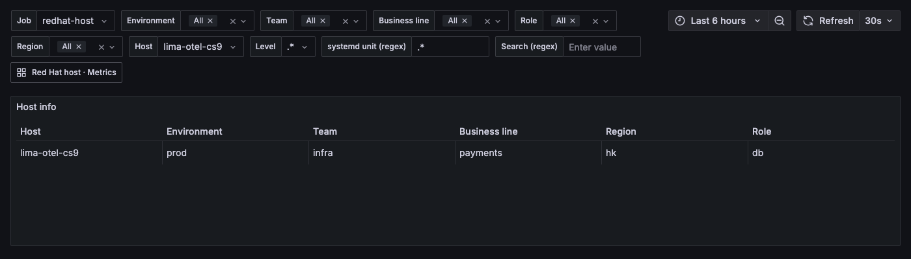

Identical to the metrics dashboard's Host info (Mimir query, not Loki): host name and Environment / Team / Business line / Role / Region, with the same query, meaning and caveats; see [Host info](#host-info-panel-100-table). It confirms which host the log panels refer to.

### Log lines by level (panel 17, time series)

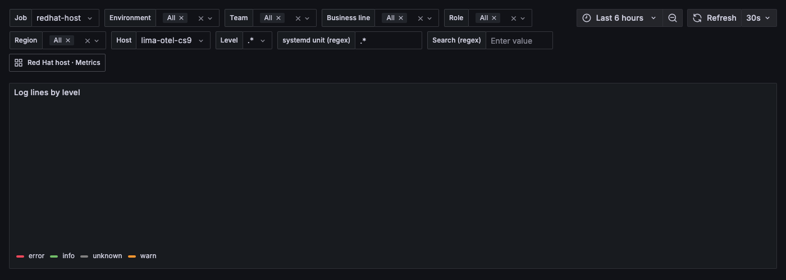

- **Meaning**: number of log lines per minute, split by severity (`fatal`, `error`, `warn`, `info`, `unknown`), for the selected host and filters. Fixed colours: `fatal` dark red, `error` red, `warn` orange, `info` green, `unknown` gray.
- **Watch for**: a burst of `error`/`fatal`, a sudden jump in total volume (a service in a crash loop or debug logging left on), or silence (agent or collector stopped; the log receivers retry and replay after an outage, so a gap followed by a burst is a catch-up). Read the lines in the Logs panel below, which uses the same filters.
- **Query** (legend `{{detected_level}}`):

  ```logql
  sum by (detected_level) (count_over_time({service_name=~".+"} | service_instance_id="$host" | detected_level=~"$level" | systemd_unit=~"$unit" |~ "$search" [1m]))
  ```

- **Intent**: select the host's lines with the common pipeline, count lines per series in 1-minute windows (`count_over_time ... [1m]`, a fixed window, not the dashboard interval), and sum by severity. Severity comes from journald `PRIORITY`, mapped by the agent to `fatal`, `error`, `warn`, `info`; lines without a priority are `unknown`. Unit: lines per minute.

### Logs (panel 18, logs)

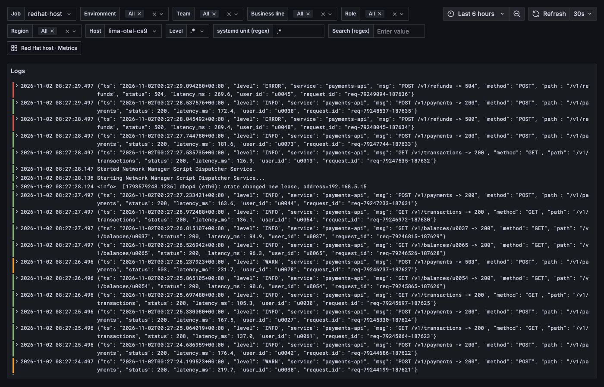

- **Meaning**: the log lines themselves, newest first, with line wrapping; click a line for details (structured metadata such as `systemd_unit` and `syslog_identifier`).
- **Watch for**: use it after the volume panel shows something odd: set Level to `fatal|error`, narrow the unit, and use Search for a pattern (for example `Failed|denied`).
- **Query**:

  ```logql
  {service_name=~".+"} | service_instance_id="$host" | detected_level=~"$level" | systemd_unit=~"$unit" |~ "$search"
  ```

- **Intent**: the same selection as the volume panel without aggregation, so the two always agree for the same filters. Journald lines carry the message as the body and priority as `detected_level`; application log files (`LOG_PATHS`) appear in the same stream but have no `systemd_unit`, so a `unit` filter other than `.*` hides them.

## Provenance and maintenance

- Screenshots in [`images/`](images/) come from the lab Grafana (`localhost:3000`, Mimir org `redhat`, host `lima-otel-cs9`), captured 2026-11-02. Re-take them when panels change.
- The dashboards are provisioned from the JSON files in `../grafana/`; edit the JSON (or export it from Grafana) and update this page in the same change.
