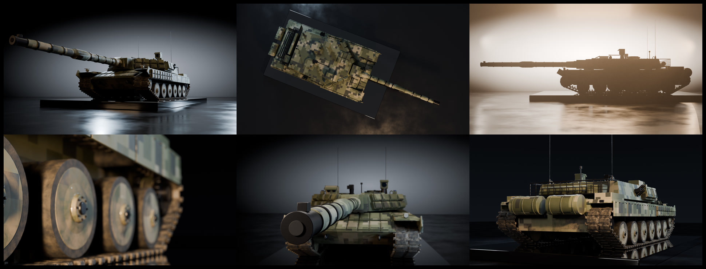

# ZTZ-99A 风格主战坦克比例模型展示

这是一套用 Blender 4.2 Python 程序化建模的现代主战坦克比例模型展示，外形参考 ZTZ-99A。场景、材质、灯光和机位都由脚本生成，成片与静帧使用 Cycles，并在 CPU 上渲染。

## 目录

- `code/`：建模与渲染脚本，以及已保存的场景 `tank_scene.blend`
  - `build_and_render.py`：搭建整车场景，渲染约 30 秒、24fps 的动画帧
  - `render_stills.py`：打开场景文件，按镜头渲染静帧
  - `encode.sh`：把帧序列和音频编码成 mp4
- `storyboard/`：分镜脚本 `分镜脚本.md`，以及关键帧参考图
- `renders/tank_showcase.mp4`：已编码的展示成片
- `renders/stills/`：静帧 PNG 和联系表（含 `contact_sheet_v2.jpg`）

## 运行

在 `tank-showcase/` 目录下执行。

渲染视频帧，并保存场景：

```bash
blender -b -P code/build_and_render.py -- --save code/tank_scene.blend
```

渲染静帧。`--suffix` 可选，例如 `_v2`：

```bash
blender -b code/tank_scene.blend -P code/render_stills.py -- --shots 1,2,3 [--suffix _v2]
```

把帧编码成 mp4：

```bash
code/encode.sh
```

## 硬编码路径

脚本仍使用绝对路径 `/workspace/tank_video`，本次没有改写：

- `code/build_and_render.py` 未传 `--out` 时，帧写到 `/workspace/tank_video/frames`
- `code/render_stills.py` 未传 `--out` 时，静帧写到 `/workspace/tank_video/stills`
- `code/encode.sh` 会先 `cd /workspace/tank_video`，读取该目录下的 `frames/f_%04d.png` 和 `audio.wav`，再写出 `tank_showcase.mp4`

仓库里的成片和静帧是已经渲染好的文件。`audio.wav` 不在本目录中，编码脚本会到上面的绝对路径去找它。

## 静帧


